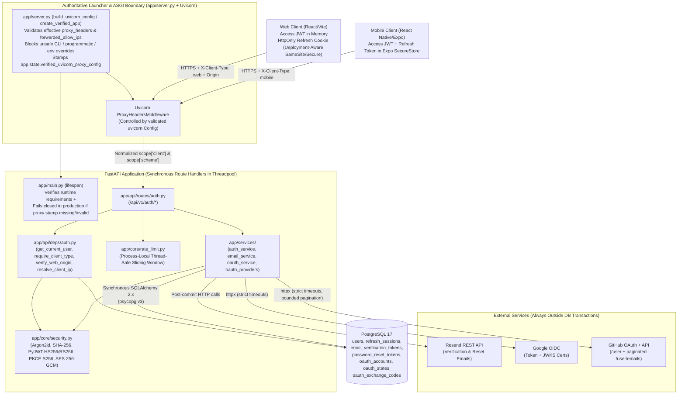
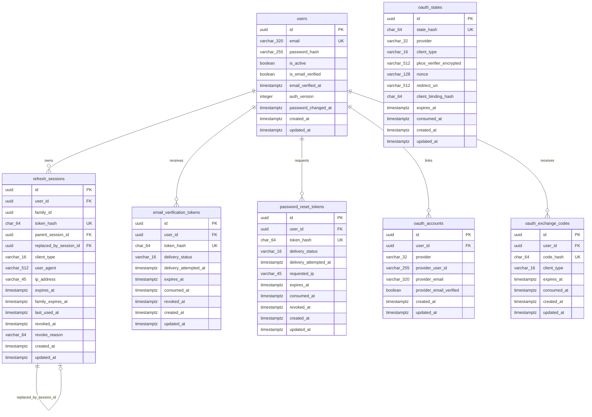
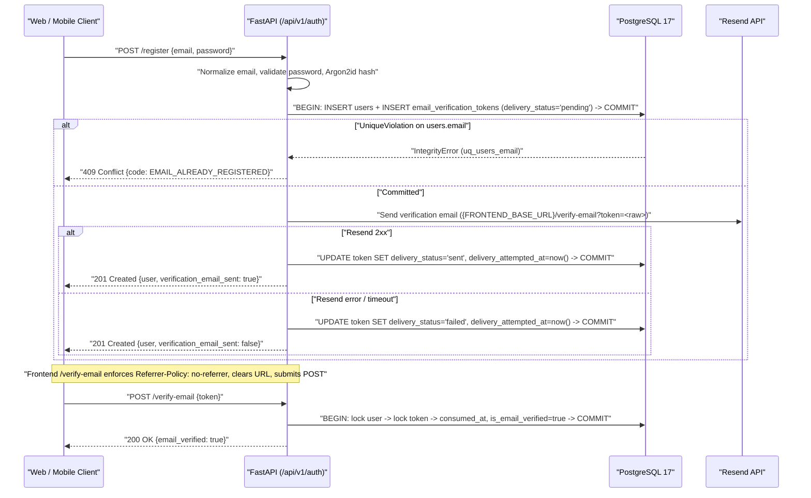

# Folio360 — Product Phase 0: Authentication Architecture Specification (`F360-P0-AUTH-SPEC-REV4`)

---

## 1. Document Status, Scope, Baseline, and Revision History

- **Document ID:** `F360-P0-AUTH-SPEC-REV4` (Final Targeted Corrections Revision)
- **Project:** Folio360 (Student360) Backend — Modular Monolith
- **Repository:** `C:\Users\vasista0305\OneDrive\Desktop\folio360_backend` (`https://github.com/prajwalvasista2005/Folio360_backend.git`)
- **Approved Git Baseline:**
  - **Branch:** `main`
  - **Commit:** `206970f5923bd19d445cce905e6bbaf0b5c697ff`
  - **Commit Message:** `feat(stage2): add database foundation`
  - **Completed Prerequisite Stages:** Stage 0 (Environment & Repository), Stage 1 (FastAPI Application Foundation — 43 tests), Stage 2 (PostgreSQL 17 + Synchronous SQLAlchemy 2.x + Alembic Foundation — 38 tests; 81 total tests passing).
- **Status:** Complete, implementation-ready Phase 0 authentication specification awaiting independent review and explicit approval from the project owner before any Stage 3 implementation begins.
- **Scope:** End-to-end backend authentication for **web** (React/Vite) and **mobile** (React Native / Expo) clients covering email/password registration, email verification via Resend, login, JWT access tokens, rotating opaque refresh sessions, logout / logout-all, password recovery and authenticated password change, and Google OIDC + GitHub OAuth 2.0 login.
- **Out of Scope:** Frontend UI implementation, user profiles/portfolios, RBAC/roles, MFA/2FA, explicit cross-provider account linking (schema-prepared, endpoints deferred), session listing/individual revocation UI (`GET /sessions`, `DELETE /sessions/{id}` deferred), and Redis/message-broker/KMS infrastructure.

### Revision History
- **Rev 0:** Initial architecture review, existing repository audit, and 11 architectural decision proposals (Q1–Q11).
- **Rev 1 (`F360-P0-AUTH-SPEC-REV1`):** Locked approved Q1–Q11 decisions; separated Alembic migrations by stage (`0002`, `0003`, `0004`); formalized Resend delivery-failure/recovery contract; replaced timestamp JWT invalidation with integer `users.auth_version`; hardened 422 validation stripping, logging redaction, PostgreSQL `DETAIL:` mapping, and OAuth concurrency handling.
- **Rev 2 (`F360-P0-AUTH-SPEC-REV2`):** Added deployment-aware refresh-cookie policy (Development, Mode 1 Same-Site Production, Mode 2 Cross-Site Production); defined deadlock-free `users`-first row locking for `change-password` and `reset-password`; standardized `folio360_oauth_binding` cookie naming; refined GitHub email suitability terminology; added official OAuth/OIDC references; added AES-256-GCM PKCE verifier encryption at rest; added token-bearing frontend page referrer controls, safe `urllib.parse` OAuth redirect query building, and separate Git authorization governance.
- **Rev 3 (`F360-P0-AUTH-SPEC-REV3`):** Adopted single Uvicorn `ProxyHeadersMiddleware` trust boundary; added Google OIDC `aud`/`azp` validation; classified Google confidential web-server PKCE evidence with pre-release live verification gate; specified bounded GitHub `/user/emails` pagination; clarified Resend immediate first-retry vs. 10-second subsequent-failure backoff.
- **Rev 4 (`F360-P0-AUTH-SPEC-REV4` — This Document):** Narrowly scoped correction of two material defects identified in Rev3 review:
  1. **Correction A — Effective Uvicorn Proxy Configuration Enforcement (Modified Sections: §2, §5, §6, §16.3, §19.1, §20, §21, §22):** Replaced Rev3's environment-only `os.environ.get("FORWARDED_ALLOW_IPS")` check with an authoritative Uvicorn configuration builder and launcher (`app/server.py` -> `build_uvicorn_config`, `create_verified_app`, `run_server`) coupled with a fail-closed production `lifespan` verification stamp (`app.state.verified_uvicorn_proxy_config`). Blocks unsafe CLI overrides (`--forwarded-allow-ips="*"`), programmatic overrides (`uvicorn.Config(..., forwarded_allow_ips="*")`), and ambient environment overrides (`FORWARDED_ALLOW_IPS`, `UVICORN_FORWARDED_ALLOW_IPS`, `UVICORN_PROXY_HEADERS`) while explicitly distinguishing pre-ASGI launcher checks from FastAPI `lifespan` checks.
  2. **Correction B — Google OIDC Additional-Audience Trust Policy (Modified Sections: §14, §16.3, §20, §21):** Closed the OIDC Core §3.1.3.7 multi-audience gap by adopting **Option B — Explicit Trusted-Audience Allowlist (`GOOGLE_TRUSTED_ADDITIONAL_AUDIENCES: list[str] = []`, empty by default)** so untrusted additional audiences in `aud` are unconditionally rejected even when `azp == GOOGLE_CLIENT_ID`, duplicate audience entries (`len(aud) != len(set(aud))`) are rejected, and all 10 deterministic audience/`azp` test cases are enforced.

### Rev3 -> Rev4 Correction Matrix

| Defect ID | Rev3 Gap | Rev4 Resolution | Affected Sections |
| :--- | :--- | :--- | :--- |
| **Correction A** | Checking only `os.environ.get("FORWARDED_ALLOW_IPS")` in `lifespan` can be bypassed by Uvicorn CLI flags (`--forwarded-allow-ips="*"`), Click `UVICORN_*` env vars, or programmatic `uvicorn.run()` / `uvicorn.Config()` arguments because Uvicorn does not expose `Config` in the ASGI `lifespan` scope. | Added authoritative `app/server.py` (`build_uvicorn_config`, `create_verified_app`, `run_server`) that validates effective `proxy_headers` and `forwarded_allow_ips` against `Settings` (`PROXY_HEADERS_ENABLED`, `TRUSTED_PROXY_IPS`) + CLI + programmatic args + `FORWARDED_ALLOW_IPS`/`UVICORN_*` env vars **before** starting Uvicorn and stamps `app.state.verified_uvicorn_proxy_config`; production `lifespan` fails closed if the stamp is missing or invalid. Added 10 mandatory tests. | §2, §5, §6, §16.3, §19.1, §20, §21, §22 |
| **Correction B** | Rev3 accepted any multi-element `aud` array containing `GOOGLE_CLIENT_ID` whenever `azp == GOOGLE_CLIENT_ID`, failing OIDC Core 1.0 §3.1.3.7's requirement to reject untrusted additional audiences. | Adopted **Option B (Explicit Trusted-Audience Allowlist)** via `GOOGLE_TRUSTED_ADDITIONAL_AUDIENCES: list[str] = []` (default empty = strict single-client policy out of the box). Every element of `aud` must be unique (`len(aud) == len(set(aud))`), `GOOGLE_CLIENT_ID` must be present, and every additional element must belong to `GOOGLE_TRUSTED_ADDITIONAL_AUDIENCES`; `azp` is validated independently. Added 10 mandatory tests. | §14, §16.3, §20, §21 |

---

## 2. Existing Backend Inspection Findings

Direct read-only inspection of the repository at commit `206970f5923bd19d445cce905e6bbaf0b5c697ff` (and installed packages in `venv`) confirms the following baseline contracts:

| Component | Inspected File | Key Findings & Stage 3 Impact |
| :--- | :--- | :--- |
| Application factory, CORS & lifespan | [app/main.py](file:///c:/Users/vasista0305/OneDrive/Desktop/folio360_backend/app/main.py) | `create_app(settings=None)` is import-safe; module-level `app = create_app()` requires no DB or auth secrets at import time. Lifespan runs `settings.validate_runtime_requirements()`, initializes synchronous engine, `NullPool` readiness engine, `sessionmaker`, and readiness `BoundedSemaphore`. `CORSMiddleware` already configures `allow_origins=settings.CORS_ORIGINS` and `allow_credentials=True` (lines 111–118). Mount `auth.router` under `api_v1_router`, attach the rate limiter to `app.state`, and verify `app.state.verified_uvicorn_proxy_config` in production `lifespan`. |
| Configuration | [app/core/config.py](file:///c:/Users/vasista0305/OneDrive/Desktop/folio360_backend/app/core/config.py) | `Settings(BaseSettings)` uses `UPPER_SNAKE_CASE`, `SecretStr`, `hide_input_in_errors=True`, and `ENVIRONMENT: Literal["development", "testing", "production"]`. `Settings()` stays constructible with zero auth env vars in dev/test; production checks run in `validate_runtime_requirements()`. |
| Exception handling | [app/core/exceptions.py](file:///c:/Users/vasista0305/OneDrive/Desktop/folio360_backend/app/core/exceptions.py) | Defines `AppException`, `ResourceNotFoundError`, `ValidationAppError`, and `{"error": {"message", "status_code", "details"}}`. Stage 3A adds: (1) custom `RequestValidationError` handler stripping Pydantic v2's `input` key; (2) optional `headers: Optional[dict[str, str]] = None` on `AppException` (`WWW-Authenticate: Bearer`, `Retry-After`); (3) error codes placed strictly under `details["code"]` so `SENSITIVE_KEY_SUBSTRINGS` (`"auth"`, `"token"`, etc.) never redact them. |
| Security logging | [app/core/logging.py](file:///c:/Users/vasista0305/OneDrive/Desktop/folio360_backend/app/core/logging.py) | `SecurityFilter`, `SecurityFormatter`, and `sanitize_log_text()` redact credentials, DB URIs, and heuristic SQL. Extend for `api_key`, `code_verifier`, `pkce_verifier`, `pkce_verifier_encrypted`, `oauth_pkce_encryption_key`, `id_token`, `cookie`, `set-cookie`, `exchange_code`, `oauth_code`, `new_password`, `current_password`, and Resend keys `\bre_[A-Za-z0-9_]{16,}\b`. |
| Database base & session | [app/db/base.py](file:///c:/Users/vasista0305/OneDrive/Desktop/folio360_backend/app/db/base.py), [app/db/session.py](file:///c:/Users/vasista0305/OneDrive/Desktop/folio360_backend/app/db/session.py) | Synchronous SQLAlchemy 2.x with `psycopg` v3, deterministic naming conventions (`pk_`, `uq_`, `ck_`, `ix_`, `fk_`), `TimestampMixin`, and synchronous `get_db()`. |
| Existing `users` table | [app/models/user.py](file:///c:/Users/vasista0305/OneDrive/Desktop/folio360_backend/app/models/user.py), [alembic/versions/0001_create_users.py](file:///c:/Users/vasista0305/OneDrive/Desktop/folio360_backend/alembic/versions/0001_create_users.py) | `0001_create_users` creates `users` (`id`, `email`, `is_active`, `created_at`, `updated_at` + 3 email `CHECK` constraints). |
| Installed Uvicorn CLI, Config, Lifespan & Proxy Middleware | [uvicorn/main.py](file:///c:/Users/vasista0305/OneDrive/Desktop/folio360_backend/venv/Lib/site-packages/uvicorn/main.py), [uvicorn/config.py](file:///c:/Users/vasista0305/OneDrive/Desktop/folio360_backend/venv/Lib/site-packages/uvicorn/config.py), [uvicorn/lifespan/on.py](file:///c:/Users/vasista0305/OneDrive/Desktop/folio360_backend/venv/Lib/site-packages/uvicorn/lifespan/on.py), [uvicorn/server.py](file:///c:/Users/vasista0305/OneDrive/Desktop/folio360_backend/venv/Lib/site-packages/uvicorn/server.py), [uvicorn/middleware/proxy_headers.py](file:///c:/Users/vasista0305/OneDrive/Desktop/folio360_backend/venv/Lib/site-packages/uvicorn/middleware/proxy_headers.py) | Direct source inspection confirms: (1) `uvicorn.main` uses Click `auto_envvar_prefix="UVICORN"` (line 61), accepting CLI `--proxy-headers`/`--forwarded-allow-ips` and `UVICORN_PROXY_HEADERS`/`UVICORN_FORWARDED_ALLOW_IPS`; (2) `Config.__init__` defaults `proxy_headers=True` (line 225) and `forwarded_allow_ips = os.environ.get("FORWARDED_ALLOW_IPS", "127.0.0.1,::1")` (line 363); (3) `Config.load()` wraps `self.loaded_app = ProxyHeadersMiddleware(self.loaded_app, trusted_hosts=self.forwarded_allow_ips)` **outside** `FastAPI` (lines 543–544); (4) `LifespanOn.main()` passes only `scope = {"type": "lifespan", "asgi": ..., "state": self.state}` to `loaded_app` (lines 80–86) without exposing `Config`; and (5) if `lifespan` startup fails, `Server.startup()` calls `sys.exit(STARTUP_FAILURE)` (lines 116–118). Directly motivates Rev4 Correction A (§19.1). |
| Pinned dependencies | [requirements.in](file:///c:/Users/vasista0305/OneDrive/Desktop/folio360_backend/requirements.in), [requirements.txt](file:///c:/Users/vasista0305/OneDrive/Desktop/folio360_backend/requirements.txt) | **Zero new Python dependencies required:** `argon2-cffi==25.1.0`, `PyJWT==2.15.1`, `cryptography==50.0.2` (`AESGCM`), `httpx==0.28.1`, `resend==2.53.2`, `email-validator==2.4.0`, `fastapi==0.163.1`, `pydantic==2.14.3`, `SQLAlchemy==2.0.38`, `psycopg==3.3.9`, `alembic==1.20.1`, `uvicorn`, `pytest==9.2.0`, `pytest-mock==3.17.0`. |

---

## 3. Mandatory Product Requirements

1. **Dual-Client Support:** First-class support for web (React/Vite) and native mobile (React Native / Expo) clients without introducing Redis or separate auth microservices.
2. **Synchronous Architecture Preservation:** Synchronous SQLAlchemy 2.x (`psycopg` v3) and synchronous FastAPI route functions (`def`) executed in Starlette's worker threadpool. No async SQLAlchemy.
3. **Email/Password Registration & Mandatory Verification:** Registration with email + password, Resend verification email, and mandatory email verification before password login succeeds.
4. **Short-Lived Access JWTs + Rotating Opaque Refresh Sessions:** 15-minute access JWTs paired with PostgreSQL-backed single-use rotating refresh tokens (14-day rolling TTL, 30-day absolute family cap) with family-wide replay revocation.
5. **Immediate Global Access-Token Invalidation:** Integer `users.auth_version` matched against JWT `"ver"` claim in `get_current_user` (zero timestamp-precision race window).
6. **Password Recovery & Atomic Password Change:** Forgot-password / reset-password via Resend + deadlock-free atomic authenticated password change.
7. **Social Login (Google OIDC & GitHub OAuth 2.0):** Server-driven Authorization Code + PKCE (`S256`) using pinned `httpx`, `PyJWT[crypto]`, and `cryptography` (`AESGCM` for PKCE verifier encryption at rest), returning a 60-second single-use `oauth_exchange_code` (never tokens in redirect URLs).
8. **Deployment-Aware Web Cookie Policy:** Explicitly supports development, same-site production, and cross-site production without assuming a hosting provider, leaving Expo mobile JSON transport unchanged.
9. **Backward Compatibility:** Preserves all Stage 1 and Stage 2 routes, lifespan/readiness contracts, and all 81 existing tests with zero regressions.

---

## 4. Approved Q1–Q11 Decisions (Binding)

| ID | Topic | Binding Decision |
| :--- | :--- | :--- |
| **Q1** | GitHub email policy | **Option A:** Require a **verified, syntactically valid, non-noreply email suitable for registration** (retrieved across all paginated `/user/emails` pages) for **new** GitHub OAuth accounts. Reject `@users.noreply.github.com` (and subdomains) with `verified_email_required`. Existing linked GitHub users authenticate by `(github, provider_user_id)` even if their GitHub email changes or disappears. |
| **Q2** | Account linking & auto-merge | **Option A:** Never auto-merge OAuth sign-ins into an existing `users` row solely by email equality; reject with `email_already_registered`. Explicit authenticated account-linking endpoints are deferred; `oauth_accounts` supports future multi-provider links. |
| **Q3** | Email verification HTTP method | **Option A:** `POST /api/v1/auth/verify-email` with JSON `{"token": "..."}`. Emails link to `{FRONTEND_BASE_URL}/verify-email?token=...`; frontend captures, scrubs URL, and submits `POST`. |
| **Q4** | Token storage & hashing | **Option A:** Random opaque tokens (`secrets.token_urlsafe(32)`) stored exclusively as lowercase hex SHA-256 (`CHAR(64)`) in PostgreSQL for email verification (24h), password reset (30m), refresh sessions, and OAuth exchange codes (60s). Single-use + explicit revocation. Argon2id exclusively for passwords. |
| **Q5** | Refresh token rotation & replay | **Option A:** Single-use rotation grouped by `family_id`, serialized via `SELECT ... FOR UPDATE`. Replay of a rotated token revokes the affected `family_id` (unrelated families untouched). 14-day rolling TTL, 30-day absolute `family_expires_at` cap. Clients implement single-flight refresh deduplication. |
| **Q6** | Web vs. mobile token transport | **Option A:** `X-Client-Type: web \| mobile`. **Web:** HttpOnly refresh cookie (deployment-aware `SameSite`/`Secure` per §12.3) + in-memory access JWT (never `localStorage`) + CSRF `X-Client-Type: web` and strict `Origin` allowlist checks. **Mobile:** access + refresh tokens in JSON stored in Expo `SecureStore`, zero cookies. |
| **Q7** | OAuth token handoff to client | **Option A:** Backend callback redirects to allowlisted client URI with safely appended 60-second single-use `code=<oauth_exchange_code>` (never auth tokens in redirect URLs), exchanged via `POST /api/v1/auth/oauth/exchange`. |
| **Q8** | OAuth & JWT library choice | **Option A:** Direct implementation with pinned `httpx`, `PyJWT[crypto]`, and `cryptography`. No `Authlib` or `itsdangerous`. |
| **Q9** | Rate limiting & email cooldown | **Option A:** Process-local thread-safe sliding-window IP rate limiter (consuming Uvicorn-normalized ASGI client IP verified via §19.1) + PostgreSQL-backed per-account email cooldowns (`>= 60s` between `'sent'`, `<= 3/hr`). No Redis. |
| **Q10** | Password reset & change sessions | **Option A:** Password reset atomically revokes **all** refresh sessions and increments `users.auth_version`. Password change atomically verifies `current_password` on the locked `users` row, rejects OAuth-only accounts (`400 PASSWORD_NOT_SET`), revokes old sessions, increments `users.auth_version`, and issues one fresh session + access JWT for the current client. |
| **Q11** | Enumeration policy & session UI | Duplicate `POST /register` returns `409 EMAIL_ALREADY_REGISTERED`. `POST /forgot-password` and `POST /resend-verification` always return generic `202 Accepted`. Defer `GET /sessions` and `DELETE /sessions/{session_id}`; retain `POST /logout-all`. |

---

## 5. Final Authentication Architecture



### Core Architectural Invariants
1. **Verified Uvicorn Proxy Trust Boundary:** Uvicorn's `ProxyHeadersMiddleware` exclusively owns `X-Forwarded-For` and `X-Forwarded-Proto` rewriting, configured strictly through `app/server.py` (`build_uvicorn_config` / `create_verified_app`) and verified by a fail-closed production `lifespan` stamp (§19.1). Application code never parses `X-Forwarded-For`.
2. **Strict DB-Transaction / External-Network Separation:** Resend, Google, and GitHub HTTP calls **never** execute inside an open PostgreSQL transaction or while holding `SELECT ... FOR UPDATE` locks.
3. **Threadpool Execution:** All routes in `app/api/routes/auth.py` are synchronous `def` handlers so synchronous SQLAlchemy, Argon2id, and `httpx`/Resend I/O run in Starlette's worker threadpool without blocking the asyncio event loop.
4. **PostgreSQL as Single Source of Security Truth:** Refresh rotation, replay detection, token single-use, email cooldowns, OAuth state/exchange-code consumption, and `auth_version` invalidation are all enforced atomically in PostgreSQL.

---

## 6. Module Responsibilities and Proposed Folder Structure

```text
app/
├── main.py                          # [Modified 3A] Mount auth.router, attach rate_limiter, verify proxy stamp in production lifespan
├── server.py                        # [3A] Authoritative Uvicorn config builder, CLI wrapper, & verified app factory
├── api/
│   ├── deps/
│   │   ├── __init__.py
│   │   └── auth.py                  # [3A] get_current_user, require_client_type, verify_web_origin, resolve_client_ip, rate-limit deps
│   └── routes/
│       ├── health.py                # [Existing Stage 1/2 — unchanged]
│       └── auth.py                  # [3A, extended in 3B & 3C] /api/v1/auth/* synchronous endpoints
├── core/
│   ├── config.py                    # [Modified 3A, 3B, 3C] Auth, JWT, proxy, deployment-aware cookies, Resend, OAuth settings
│   ├── exceptions.py                # [Modified 3A] RequestValidationError input stripper, headers support, auth error classes
│   ├── logging.py                   # [Modified 3A, 3C] Extended secret/token/cookie/Resend/PKCE redaction patterns
│   ├── rate_limit.py                # [3A] Thread-safe in-memory sliding-window IP limiter
│   └── security.py                  # [3A, extended in 3C] Argon2id + dummy hash, SHA-256 tokens, PyJWT HS256, PKCE S256, AES-256-GCM
├── models/
│   ├── __init__.py                  # [Modified 3A, 3B, 3C] Export all ORM models for Alembic metadata
│   ├── user.py                      # [Modified 3A] Additive auth columns + constraints
│   ├── refresh_session.py           # [3A] RefreshSession ORM model
│   ├── email_verification_token.py  # [3A] EmailVerificationToken ORM model
│   ├── password_reset_token.py      # [3B] PasswordResetToken ORM model
│   └── oauth.py                     # [3C] OAuthAccount, OAuthState, OAuthExchangeCode ORM models
├── schemas/
│   ├── __init__.py
│   ├── auth.py                      # [3A, extended in 3B] Pydantic v2 request/response schemas
│   └── oauth.py                     # [3C] OAuth exchange schemas & provider identity DTOs
└── services/
    ├── __init__.py
    ├── auth_service.py              # [3A, extended in 3B] Core auth, sessions, atomic password reset & change, resend cooldown logic
    ├── email_service.py             # [3A, extended in 3B] Resend wrapper + templates + sanitized result
    ├── oauth_providers.py           # [3C] Google OIDC (JWKS + trusted-audience/azp validation) & GitHub OAuth (/user + paginated /user/emails)
    └── oauth_service.py             # [3C] Encrypted PKCE state, binding cookie, safe redirect builder, atomic provisioning, exchange code
```

---

## 7. Database Schema and Relationships



### Detailed Table & Constraint Specifications

All tables inherit `TimestampMixin` (`created_at`, `updated_at`) and use `Base`'s deterministic naming conventions (`pk_`, `uq_`, `ck_`, `ix_`, `fk_`).

#### 7.1 `users` (Extended in Stage 3A)
- **Existing (`0001_create_users`):** `id` (`UUID`, PK), `email` (`VARCHAR(320)`, `NOT NULL`, `UNIQUE`), `is_active` (`BOOLEAN`, `NOT NULL`, `server_default=true`), `created_at`, `updated_at`, plus `ck_users_email_lowercase_trimmed`, `ck_users_email_not_empty`, `ck_users_email_no_whitespace`.
- **Added (`0002_add_core_auth_tables`):**
  - `password_hash`: `VARCHAR(255)`, `NULL` (Argon2id hash; `NULL` for OAuth-only users).
  - `is_email_verified`: `BOOLEAN`, `NOT NULL`, `server_default=false`.
  - `email_verified_at`: `TIMESTAMPTZ`, `NULL`.
  - `auth_version`: `INTEGER`, `NOT NULL`, `server_default=0` (matched against JWT `"ver"` claim).
  - `password_changed_at`: `TIMESTAMPTZ`, `NULL` (audit timestamp only).
- **New Constraints:**
  - `ck_users_email_verified_at_consistency`: `(is_email_verified = false AND email_verified_at IS NULL) OR (is_email_verified = true AND email_verified_at IS NOT NULL)`
  - `ck_users_auth_version_non_negative`: `auth_version >= 0`

#### 7.2 `email_verification_tokens` (Stage 3A)
- Columns: `id` (`UUID`, PK), `user_id` (`UUID`, `NOT NULL`, `FK -> users.id ON DELETE CASCADE`), `token_hash` (`CHAR(64)`, `NOT NULL`, `UNIQUE`), `delivery_status` (`VARCHAR(16)`, `NOT NULL`, `server_default='pending'`), `delivery_attempted_at` (`TIMESTAMPTZ`, `NULL`), `expires_at` (`TIMESTAMPTZ`, `NOT NULL`), `consumed_at` (`TIMESTAMPTZ`, `NULL`), `revoked_at` (`TIMESTAMPTZ`, `NULL`), `created_at`, `updated_at`.
- Constraints: `ck_email_verification_tokens_delivery_status` (`delivery_status IN ('pending', 'sent', 'failed')`), `ck_email_verification_tokens_hash_hex` (`token_hash ~ '^[0-9a-f]{64}$'`), `ck_email_verification_tokens_not_both_consumed_revoked` (`NOT (consumed_at IS NOT NULL AND revoked_at IS NOT NULL)`).
- Indexes: `ix_email_verification_tokens_user_created` on `(user_id, created_at DESC)`; `ix_email_verification_tokens_expires_at` on `(expires_at)`.

#### 7.3 `refresh_sessions` (Stage 3A)
- Columns: `id` (`UUID`, PK), `user_id` (`UUID`, `NOT NULL`, `FK -> users.id ON DELETE CASCADE`), `family_id` (`UUID`, `NOT NULL`), `token_hash` (`CHAR(64)`, `NOT NULL`, `UNIQUE`), `parent_session_id` (`UUID`, `NULL`, `FK -> refresh_sessions.id ON DELETE SET NULL`), `replaced_by_session_id` (`UUID`, `NULL`, `FK -> refresh_sessions.id ON DELETE SET NULL`), `client_type` (`VARCHAR(16)`, `NOT NULL`), `user_agent` (`VARCHAR(512)`, `NULL`), `ip_address` (`VARCHAR(45)`, `NULL`), `expires_at` (`TIMESTAMPTZ`, `NOT NULL`), `family_expires_at` (`TIMESTAMPTZ`, `NOT NULL`), `last_used_at` (`TIMESTAMPTZ`, `NULL`), `revoked_at` (`TIMESTAMPTZ`, `NULL`), `revoke_reason` (`VARCHAR(64)`, `NULL`), `created_at`, `updated_at`.
- Constraints: `ck_refresh_sessions_client_type` (`client_type IN ('web', 'mobile')`), `ck_refresh_sessions_hash_hex` (`token_hash ~ '^[0-9a-f]{64}$'`), `ck_refresh_sessions_expiry_bounds` (`expires_at <= family_expires_at`), `ck_refresh_sessions_revoke_reason_consistency` (`(revoked_at IS NULL AND revoke_reason IS NULL) OR (revoked_at IS NOT NULL AND revoke_reason IS NOT NULL)`).
- Indexes: `ix_refresh_sessions_user_active` on `(user_id, revoked_at)`; `ix_refresh_sessions_family_id` on `(family_id)`; `ix_refresh_sessions_expires_at` on `(expires_at)`.

#### 7.4 `password_reset_tokens` (Stage 3B)
- Columns: `id` (`UUID`, PK), `user_id` (`UUID`, `NOT NULL`, `FK -> users.id ON DELETE CASCADE`), `token_hash` (`CHAR(64)`, `NOT NULL`, `UNIQUE`), `delivery_status` (`VARCHAR(16)`, `NOT NULL`, `server_default='pending'`), `delivery_attempted_at` (`TIMESTAMPTZ`, `NULL`), `requested_ip` (`VARCHAR(45)`, `NULL`), `expires_at` (`TIMESTAMPTZ`, `NOT NULL`), `consumed_at` (`TIMESTAMPTZ`, `NULL`), `revoked_at` (`TIMESTAMPTZ`, `NULL`), `created_at`, `updated_at`.
- Constraints: `ck_password_reset_tokens_delivery_status` (`delivery_status IN ('pending', 'sent', 'failed')`), `ck_password_reset_tokens_hash_hex` (`token_hash ~ '^[0-9a-f]{64}$'`), `ck_password_reset_tokens_not_both_consumed_revoked` (`NOT (consumed_at IS NOT NULL AND revoked_at IS NOT NULL)`).
- Indexes: `ix_password_reset_tokens_user_created` on `(user_id, created_at DESC)`; `ix_password_reset_tokens_expires_at` on `(expires_at)`.

#### 7.5 `oauth_accounts` (Stage 3C)
- Columns: `id` (`UUID`, PK), `user_id` (`UUID`, `NOT NULL`, `FK -> users.id ON DELETE CASCADE`), `provider` (`VARCHAR(32)`, `NOT NULL`), `provider_user_id` (`VARCHAR(255)`, `NOT NULL`), `provider_email` (`VARCHAR(320)`, `NULL`), `provider_email_verified` (`BOOLEAN`, `NOT NULL`, `server_default=false`), `created_at`, `updated_at`.
- Constraints: `uq_oauth_accounts_provider_subject` (`UNIQUE (provider, provider_user_id)`), `uq_oauth_accounts_user_provider` (`UNIQUE (user_id, provider)`), `ck_oauth_accounts_provider` (`provider IN ('google', 'github')`), `ck_oauth_accounts_provider_user_id_not_empty`.
- Index: `ix_oauth_accounts_user_id` on `(user_id)`.

#### 7.6 `oauth_states` (Stage 3C)
- Columns: `id` (`UUID`, PK), `state_hash` (`CHAR(64)`, `NOT NULL`, `UNIQUE`), `provider` (`VARCHAR(32)`, `NOT NULL`), `client_type` (`VARCHAR(16)`, `NOT NULL`), `pkce_verifier_encrypted` (`VARCHAR(512)`, `NOT NULL` — AES-256-GCM ciphertext per §17.1; scrubbed to `'[CONSUMED]'` on use), `nonce` (`VARCHAR(128)`, `NULL`), `redirect_uri` (`VARCHAR(512)`, `NOT NULL`), `client_binding_hash` (`CHAR(64)`, `NULL` — SHA-256 hex of **`folio360_oauth_binding`** cookie value; raw value never stored), `expires_at` (`TIMESTAMPTZ`, `NOT NULL` — 10 minutes), `consumed_at` (`TIMESTAMPTZ`, `NULL`), `created_at`, `updated_at`.
- Constraints: `ck_oauth_states_provider`, `ck_oauth_states_client_type`, `ck_oauth_states_state_hash_hex`, `ck_oauth_states_client_binding_hash_hex`, `ck_oauth_states_google_nonce`, `ck_oauth_states_pkce_not_empty`.
- Index: `ix_oauth_states_expires_at` on `(expires_at)`.

#### 7.7 `oauth_exchange_codes` (Stage 3C)
- Columns: `id` (`UUID`, PK), `user_id` (`UUID`, `NOT NULL`, `FK -> users.id ON DELETE CASCADE`), `code_hash` (`CHAR(64)`, `NOT NULL`, `UNIQUE`), `client_type` (`VARCHAR(16)`, `NOT NULL`), `expires_at` (`TIMESTAMPTZ`, `NOT NULL` — 60 seconds), `consumed_at` (`TIMESTAMPTZ`, `NULL`), `created_at`, `updated_at`.
- Constraints: `ck_oauth_exchange_codes_client_type`, `ck_oauth_exchange_codes_hash_hex`.
- Indexes: `ix_oauth_exchange_codes_user_id`, `ix_oauth_exchange_codes_expires_at`.

---

## 8. Migration Plan (Separated by Stage: 3A, 3B, 3C)

```text
0001_create_users (Stage 2 baseline — immutable)
  └── 0002_add_core_auth_tables (Stage 3A)
        └── 0003_add_password_reset_tokens (Stage 3B)
              └── 0004_add_oauth_tables (Stage 3C)
```

| Stage | Revision ID & Filename | Down Revision | Upgrade Scope | Downgrade Scope |
| :--- | :--- | :--- | :--- | :--- |
| **3A** | `0002_add_core_auth_tables` (`alembic/versions/0002_add_core_auth_tables.py`) | `0001_create_users` | `ALTER TABLE users` (5 columns + 2 CHECK constraints); `CREATE TABLE email_verification_tokens`; `CREATE TABLE refresh_sessions` | `DROP TABLE refresh_sessions`, `email_verification_tokens`; drop 2 constraints & 5 columns on `users` |
| **3B** | `0003_add_password_reset_tokens` (`alembic/versions/0003_add_password_reset_tokens.py`) | `0002_add_core_auth_tables` | `CREATE TABLE password_reset_tokens` | `DROP TABLE password_reset_tokens` |
| **3C** | `0004_add_oauth_tables` (`alembic/versions/0004_add_oauth_tables.py`) | `0003_add_password_reset_tokens` | `CREATE TABLE oauth_accounts`, `oauth_states` (`pkce_verifier_encrypted`), `oauth_exchange_codes` | `DROP TABLE oauth_exchange_codes`, `oauth_states`, `oauth_accounts` |

### Mandatory Migration Verification Rules (Every Stage)
1. Clean DB `alembic upgrade head` from empty `base`.
2. Upgrade from populated Stage 2 `0001_create_users` baseline (`is_email_verified=False`, `email_verified_at=None`, `auth_version=0`, `password_hash=None` via `server_default`).
3. Round-trip reversibility: `upgrade head -> downgrade <parent_rev> -> upgrade head`.
4. `alembic check` returns exit code `0`.
5. Least-privilege `folio360_app` DML permissions verified on all new tables created by `folio360_migrator`.

---

## 9. Complete API Contract

All endpoints live under `API_V1_PREFIX` (`/api/v1`) and preserve the Stage 1 error envelope:

```json
{
  "error": {
    "message": "Human-readable safe public message",
    "status_code": 401,
    "details": {
      "code": "INVALID_CREDENTIALS"
    }
  }
}
```

### 9.1 Endpoint Matrix

| Stage | Method & Path | Auth | Required Headers / Params | Success Status |
| :--- | :--- | :--- | :--- | :--- |
| 3A | `POST /api/v1/auth/register` | Public | — | `201 Created` |
| 3A | `POST /api/v1/auth/verify-email` | Public | — | `200 OK` |
| 3A | `POST /api/v1/auth/resend-verification` | Public | — | `202 Accepted` |
| 3A | `POST /api/v1/auth/login` | Public | `X-Client-Type: web \| mobile` | `200 OK` |
| 3A | `POST /api/v1/auth/refresh` | Refresh token (cookie/body) | `X-Client-Type` (+ `Origin` on web) | `200 OK` |
| 3A | `POST /api/v1/auth/logout` | Refresh token (cookie/body) | `X-Client-Type` (+ `Origin` on web) | `200 OK` |
| 3A | `POST /api/v1/auth/logout-all` | Bearer Access JWT | `Authorization: Bearer <jwt>` (+ `Origin` if `X-Client-Type: web`) | `200 OK` |
| 3A | `GET /api/v1/auth/me` | Bearer Access JWT | `Authorization: Bearer <jwt>` | `200 OK` |
| 3B | `POST /api/v1/auth/forgot-password` | Public | — | `202 Accepted` |
| 3B | `POST /api/v1/auth/reset-password` | Public | — | `200 OK` |
| 3B | `POST /api/v1/auth/change-password` | Bearer Access JWT | `Authorization`, `X-Client-Type` (+ `Origin` on web) | `200 OK` |
| 3C | `GET /api/v1/auth/oauth/{provider}/start` | Public | Query: `client_type`, `redirect_uri` | `302 Found` |
| 3C | `GET /api/v1/auth/oauth/{provider}/callback` | Provider redirect | Query: `code`, `state` (or `error`) | `302 Found` |
| 3C | `POST /api/v1/auth/oauth/exchange` | Public (exchange code) | `X-Client-Type` (+ `Origin` on web) | `200 OK` |

### 9.2 Stable Machine-Readable Error Code Catalog (`error.details.code`)

| HTTP Status | `error.details.code` | Meaning / Trigger |
| :--- | :--- | :--- |
| `400` | `INVALID_CLIENT_TYPE` | Missing or invalid `X-Client-Type` header (`web` or `mobile`). |
| `400` | `INVALID_VERIFICATION_TOKEN` | Verification token invalid, expired, revoked, or already consumed. |
| `400` | `INVALID_RESET_TOKEN` | Password reset token invalid, expired, revoked, or already consumed. |
| `400` | `PASSWORD_NOT_SET` | `change-password` attempted on an OAuth-only account (`password_hash IS NULL`). |
| `400` | `SAME_PASSWORD_NOT_ALLOWED` | New password matches current password in `change-password`. |
| `400` | `INVALID_OAUTH_PROVIDER` | Provider path param is not `google` or `github`. |
| `400` | `INVALID_REDIRECT_URI` | `redirect_uri` not an exact match in configured allowlist for `client_type`. |
| `400` | `INVALID_OAUTH_EXCHANGE_CODE` | Exchange code unknown, expired, consumed, or `client_type` mismatch. |
| `401` | `INVALID_CREDENTIALS` | Wrong email/password on login, or wrong `current_password` on `change-password`. |
| `401` | `INVALID_ACCESS_TOKEN` | Missing/malformed/expired JWT, signature/iss/aud failure, `auth_version` mismatch, or unknown user (`WWW-Authenticate: Bearer`). |
| `401` | `INVALID_REFRESH_TOKEN` | Missing/unknown/expired/revoked refresh token, or `client_type` mismatch. |
| `401` | `REFRESH_TOKEN_REUSE_DETECTED` | Previously rotated refresh token replayed; entire session family revoked. |
| `403` | `EMAIL_NOT_VERIFIED` | Password login before email verification (checked only after valid password verification). |
| `403` | `ACCOUNT_INACTIVE` | User has `is_active = false`. |
| `403` | `CSRF_ORIGIN_MISMATCH` | Web cookie-bearing request failed strict `Origin` allowlist check. |
| `409` | `EMAIL_ALREADY_REGISTERED` | `POST /register` email already exists. |
| `422` | `VALIDATION_ERROR` | Pydantic validation failure (`input` stripped). |
| `429` | `RATE_LIMIT_EXCEEDED` | IP rate limit triggered (`Retry-After` header included). |
| `503` | `SERVICE_UNAVAILABLE` | Downstream dependency unavailable. |

> **OAuth Callback Error Redirect Query Codes** (appended safely via §17.2 as `error=<code>` on `redirect_uri`): `oauth_cancelled`, `invalid_oauth_state`, `oauth_provider_error`, `verified_email_required`, `email_already_registered`, `account_inactive`.

### 9.3 Detailed Endpoint Contracts

1. **`POST /api/v1/auth/register` (3A):** Request `{"email", "password"}` (email trimmed/lowercased, valid `EmailStr`, `<= 320` chars; password 12–128 chars, UTF-8 bytes `<= 128`, non-whitespace, `!= email`). Returns `201 Created` with `{"message", "user": {id, email, is_active, is_email_verified, has_password, created_at}, "verification_email_sent": true | false}`. Errors: `409 EMAIL_ALREADY_REGISTERED`, `422`, `429`.
2. **`POST /api/v1/auth/verify-email` (3A):** Request `{"token"}`. Locks `users` row then token row (`FOR UPDATE`), verifies active/unexpired and `user.is_active`, consumes token, sets `is_email_verified=True` and `email_verified_at=now()`, revokes other active verification tokens, commits. Returns `200 OK` `{"message": "Email verified successfully.", "email_verified": true}`. Does not auto-login.
3. **`POST /api/v1/auth/resend-verification` (3A):** Request `{"email"}`. Always returns `202 Accepted` `{"message": "If an unverified account exists for this email, a verification link has been sent."}` following the exact retry/cooldown rules in §11.
4. **`POST /api/v1/auth/login` (3A):** Header `X-Client-Type: web | mobile`; body `{"email", "password"}`. Always runs Argon2id verification (against dummy hash if missing / OAuth-only) before checking `is_email_verified` or `is_active`. Web sets `folio360_refresh_token` cookie (§12.3) and returns `{"access_token", "token_type": "bearer", "expires_in": 900, "user": {...}}`; mobile sets zero cookies and adds `"refresh_token"` and `"refresh_expires_in": 1209600`.
5. **`POST /api/v1/auth/refresh` (3A):** Header `X-Client-Type` (+ `Origin` on web). Web reads `folio360_refresh_token` cookie; mobile reads `{"refresh_token"}`. Serializes via `FOR UPDATE`, rotates session, revokes family on replay (`401 REFRESH_TOKEN_REUSE_DETECTED`, clears web cookie), returns same shape as `/login`.
6. **`POST /api/v1/auth/logout` (3A):** Header `X-Client-Type` (+ `Origin` on web). Idempotently revokes active session (`logout`), clears web cookie with matching attributes, returns `200 OK`.
7. **`POST /api/v1/auth/logout-all` (3A):** Bearer Access JWT (+ `Origin` if `X-Client-Type: web`). Locks `users` (`FOR UPDATE`), increments `auth_version += 1`, revokes all active refresh sessions (`logout_all`), commits, clears web cookie if web. Returns `200 OK`.
8. **`GET /api/v1/auth/me` (3A):** Bearer Access JWT. Returns `id`, `email`, `is_active`, `is_email_verified`, `has_password`, `created_at`, `updated_at` (plus `oauth_providers: list[str]` in 3C).
9. **`POST /api/v1/auth/forgot-password` (3B):** Body `{"email"}`. Always returns `202 Accepted`. Eligible only when `is_active=True`, `is_email_verified=True`, `password_hash IS NOT NULL`. Uses identical §11 delivery/retry state machine.
10. **`POST /api/v1/auth/reset-password` (3B):** Body `{"token", "new_password"}`. Atomic `users`-first locked transaction (§13.1). Returns `200 OK`.
11. **`POST /api/v1/auth/change-password` (3B):** Bearer Access JWT + `X-Client-Type` (+ `Origin` on web); body `{"current_password", "new_password"}`. Atomic `users`-first locked transaction (§13.2). Returns `200 OK` with `"message"` + fresh client-specific access JWT and refresh session.
12. **`GET /api/v1/auth/oauth/{provider}/start` (3C):** Query `client_type`, `redirect_uri`. `302 Found` to provider; sets **`folio360_oauth_binding`** cookie on `web`.
13. **`GET /api/v1/auth/oauth/{provider}/callback` (3C):** Validates state + **`folio360_oauth_binding`** (web), clears **`folio360_oauth_binding`**, exchanges code, provisions/resolves user, redirects `302 Found` with safely appended `code=...` or `error=...` (§17.2).
14. **`POST /api/v1/auth/oauth/exchange` (3C):** Header `X-Client-Type` (+ `Origin` on web); body `{"code"}`. Consumes 60s code atomically (`FOR UPDATE`), creates fresh `refresh_session`, returns same shape as `/login`.

---

## 10. Email Registration, Verification Flow, and Frontend Token Hygiene



### Mandatory Frontend Rules for Token-Bearing Pages (`/verify-email`, `/reset-password`, `/auth/oauth/callback`)
1. Serve with HTTP header `Referrer-Policy: no-referrer` (plus `<meta name="referrer" content="no-referrer">`).
2. Load **zero** third-party analytics, telemetry, session-replay, or advertising scripts on token-bearing pages.
3. Avoid unnecessary external subresources that could receive the URL through referrer leakage.
4. Never log token-bearing URLs in client telemetry or server/proxy access logs.
5. Capture `token` (or `code`) into JS memory on mount and immediately strip it from browser URL/history via `window.history.replaceState({}, document.title, window.location.pathname)`.
6. Consume tokens exclusively via the approved `POST` APIs (`/verify-email`, `/reset-password`, `/oauth/exchange`).

---

## 11. Resend Delivery-Failure, First-Retry, and Recovery Contract

### 11.1 Four Explicit Delivery States
1. **Pending delivery (in-flight):** `delivery_status = 'pending'` AND `created_at >= now() - EMAIL_PENDING_STALE_SECONDS` (`30s`).
2. **Stale pending delivery (crashed process):** `delivery_status = 'pending'` AND `created_at < now() - EMAIL_PENDING_STALE_SECONDS` (`30s`).
3. **Failed delivery:** `delivery_status = 'failed'` with `delivery_attempted_at` set.
4. **Successful delivery:** `delivery_status = 'sent'` with `delivery_attempted_at` set.

```mermaid
stateDiagram-v2
    [*] --> pending : "Tx 1 COMMIT (token inserted under users FOR UPDATE)"
    pending --> sent : "Resend 2xx -> Tx 2 UPDATE ('sent')"
    pending --> failed : "Resend error/timeout -> Tx 2 UPDATE ('failed')"
    pending --> stale_pending : "Process crash before Tx 2 (>30s)"
    sent --> [*] : "Resets failure streak to 0; enforces 60s gap & 3/hr cap"
    failed --> [*] : "1st failure -> 0s immediate retry; 2nd+ consecutive failure -> 10s backoff"
    stale_pending --> [*] : "Revoked on retry (>30s); allows fresh send"
```

### 11.2 End-to-End Retry Sequence & Transaction Boundaries
1. **Initial Delivery (`POST /register` or first `POST /forgot-password`):**
   - **Tx 1:** Insert `User` (on `/register`) + token (`delivery_status='pending'`) and commit.
   - **External Call (outside transaction):** Call Resend (`5.0s` timeout).
   - **Tx 2:** Update token to `'sent'` or `'failed'`, `delivery_attempted_at = now()`, commit.
   - `/register` returns `201 Created` with `verification_email_sent: true | false` (unverified account stays committed, never duplicated or rolled back). `/forgot-password` returns `202 Accepted`.
2. **Retry Evaluation (`POST /resend-verification` & subsequent `POST /forgot-password`):**
   - **Tx 1 (Serialized Under `users` Row Lock):**
     - Look up `User`; if missing or ineligible -> return `202 Accepted`.
     - `SELECT * FROM users WHERE id = :uid FOR UPDATE` (serializes concurrent resend requests).
     - Check in order:
       1. **In-Flight Pending Guard:** Latest non-revoked token has `delivery_status = 'pending'` and `created_at >= now() - 30s` -> suppress (`202`).
       2. **Successful-Send Limits:** `COUNT(*) WHERE delivery_status = 'sent' AND delivery_attempted_at > now() - 60 minutes >= 3` -> suppress (`202`); latest `'sent'` token has `delivery_attempted_at > now() - 60 seconds` -> suppress (`202`).
       3. **Consecutive-Failure Sequence:** Let `last_sent_at` be `created_at` of the latest `'sent'` token (or `-infinity` if none), and `consecutive_failures = COUNT(*) WHERE user_id = :uid AND delivery_status = 'failed' AND created_at > last_sent_at`:
          - `consecutive_failures == 0` (normal send or recovery from stale `'pending'` `> 30s`) -> **allowed immediately**.
          - `consecutive_failures == 1` (**First Retry After Known Initial Failure**) -> **allowed immediately (0s wait; no 10s delay)**.
          - `consecutive_failures >= 2` (**Subsequent Failed Retries**) -> require `latest_failed.delivery_attempted_at <= now() - 10 seconds` (`EMAIL_FAILED_RETRY_BACKOFF_SECONDS = 10`); otherwise suppress (`202`).
       4. Revoke prior unconsumed/unrevoked tokens for `user.id`, insert new `'pending'` token, **commit Tx 1** (releasing lock before network I/O).
   - **External Call (outside transaction):** Call Resend (`5.0s` timeout).
   - **Tx 2:** Update token to `'sent'` or `'failed'`, `delivery_attempted_at = now()`, commit, return `202 Accepted`.

---

## 12. Login, Access-Token, Refresh-Session, and Deployment-Aware Cookie Design

### 12.1 Access Token (JWT) & `auth_version` Invalidation
- **Algorithm:** `HS256` with `JWT_SECRET_KEY` (`>= 32` chars in production); lifetime `15` minutes (`900s`).
- **Required Claims:** `sub` (User UUID), `ver` (integer `users.auth_version`), `type` (`"access"`), `iss`, `aud`, `iat`, `exp`, `jti`.
- **`get_current_user` Validation:** Enforces `algorithms=["HS256"]`, `issuer`, `audience`, required claims, `payload["type"] == "access"`, strict `type(payload["ver"]) is int` (rejecting `bool`/`str`/`float`), `user.auth_version == payload["ver"]` (`401 INVALID_ACCESS_TOKEN`), and `user.is_active is True` (`403 ACCOUNT_INACTIVE`).

### 12.2 Refresh-Session Rotation, Replay Detection & Concurrency
- Opaque random tokens stored solely as lowercase hex SHA-256 (`CHAR(64)`).
- Rolling `expires_at = min(now + 14 days, family_expires_at)`; absolute `family_expires_at = initial_login_time + 30 days`.
- `POST /refresh` locks `refresh_sessions` by `token_hash` (`SELECT ... FOR UPDATE`), validates `client_type`, revokes entire `family_id` on replay of any rotated token (`401 REFRESH_TOKEN_REUSE_DETECTED`; unrelated families untouched), validates expiry and `user.is_active`, inserts child session, marks parent `revoked_at = now()`, `revoke_reason = 'rotated'`, `replaced_by_session_id = child.id`, and commits atomically.
- Concurrent `/refresh` calls with the same token serialize on `FOR UPDATE`; clients **must** implement single-flight refresh deduplication (§18.3).

### 12.3 Deployment-Aware Web Refresh-Cookie Policy

| Deployment Profile | Example Topology | `REFRESH_COOKIE_SAMESITE` | `REFRESH_COOKIE_SECURE` | `HttpOnly` & `Path` | CORS & CSRF Controls |
| :--- | :--- | :--- | :--- | :--- | :--- |
| **Development / Testing** | `http://localhost:5173` + `http://localhost:8000` | `"lax"` (default) | `False` (default) | `HttpOnly=True`, `Path=/api/v1/auth` | `CORS_ORIGINS` + `allow_credentials=True` + `X-Client-Type: web` + `Origin` check |
| **Mode 1 — Same-Site Production** (`COOKIE_DEPLOYMENT_MODE="same_site"`) | `https://app.folio360.com` + `https://api.folio360.com` or reverse-proxied same origin | `"lax"` (default) or `"strict"` | **`True` (mandatory)** | `HttpOnly=True`, `Path=/api/v1/auth`, optional `Domain` | Exact `https://` `CORS_ORIGINS` (no `"*"`), `Access-Control-Allow-Credentials: true`, strict `Origin` + `X-Client-Type: web` |
| **Mode 2 — Cross-Site Production** (`COOKIE_DEPLOYMENT_MODE="cross_site"`) | `https://frontend.host-a.app` + `https://api.host-b.com` (different registrable sites) | **`"none"` (mandatory)** | **`True` (mandatory)** | `HttpOnly=True`, `Path=/api/v1/auth`, `Domain=None` | Exact `https://` `CORS_ORIGINS` (no `"*"`), `Access-Control-Allow-Credentials: true`, strict `Origin` + `X-Client-Type: web` |

- **Browser Third-Party Cookie Restriction Caveat (Mode 2):** `SameSite=None; Secure` is necessary for cross-site cookies, **not** a guarantee of universal browser compatibility. Safari ITP, Firefox ETP, Brave Shields, and Chrome privacy settings may still block/partition cross-site cookies. **Mode 1 (same-site deployment)** is strongly recommended in production whenever feasible; Mode 2 is supported for split-origin/preview setups with this documented caveat.
- **`folio360_oauth_binding` Cookie:** Always `HttpOnly=True`, `SameSite=Lax`, `Path=/api/v1/auth/oauth`, `Max-Age=600`, `Secure=True` in production (works in both Mode 1 and Mode 2 because `/oauth/{provider}/start` and `/callback` are top-level `GET` navigations on the backend's own origin).
- **Mobile Contract Unchanged:** Expo clients (`X-Client-Type: mobile`) never receive or send cookies in any deployment mode.
- **Startup Validation:** Reject `SameSite=None` with `Secure=False` in all environments; in `production`, reject `Secure=False`, `cross_site` without `SameSite=None`, `same_site` with `SameSite=None`, `cross_site` with non-`None` `Domain`, or `CORS_ORIGINS` containing `"*"`, HTTP origins, or trailing slashes.

---

## 13. Password Recovery and Password-Change Concurrency & Transaction Safety

All credential-mutating and global-revocation operations (`change-password`, `reset-password`, `logout-all`) obey one strict deadlock-free lock hierarchy: **always lock `users` (`SELECT ... FROM users WHERE id = :uid FOR UPDATE`) first** before modifying `password_hash`, `auth_version`, `password_reset_tokens`, or `refresh_sessions`.

### 13.1 Password Reset (`POST /api/v1/auth/reset-password`)
1. Hash token; lightweight read maps `token_hash -> user_id` (missing -> `400 INVALID_RESET_TOKEN`).
2. **Single atomic transaction:**
   - Lock `users` row first (`FOR UPDATE`); verify `user.is_active` (`403 ACCOUNT_INACTIVE`).
   - Lock `password_reset_tokens` row (`WHERE token_hash = :h AND user_id = :uid FOR UPDATE`); verify `consumed_at IS NULL`, `revoked_at IS NULL`, `expires_at > now()` (else `400 INVALID_RESET_TOKEN`).
   - Hash `new_password` with Argon2id; update `user.password_hash`, `user.password_changed_at = now()`, `user.auth_version += 1`; mark token `consumed_at = now()`; revoke all other active reset tokens for `user.id`; revoke **all** active `refresh_sessions` (`password_reset`).
   - Commit atomically.

### 13.2 Authenticated Password Change (`POST /api/v1/auth/change-password`)
1. `get_current_user` validates Bearer JWT and extracts `user.id` and `token_ver`.
2. **Single atomic transaction:**
   - Lock `users` row (`FOR UPDATE`).
   - Re-verify on the locked row: `user.is_active is True` (`403`), `user.auth_version == token_ver` (`401 INVALID_ACCESS_TOKEN` if raced by a concurrent change/reset), and `user.password_hash is not None` (`400 PASSWORD_NOT_SET`).
   - Verify `current_password` via Argon2id against `user.password_hash` **from the locked row** (`401 INVALID_CREDENTIALS` on mismatch).
   - Reject identical password (`400 SAME_PASSWORD_NOT_ALLOWED`).
   - Hash `new_password` with Argon2id; update `user.password_hash`, `user.password_changed_at = now()`, `user.auth_version += 1`; revoke **all** existing active `refresh_sessions` (`password_changed`); insert **one fresh** `refresh_session` (new `family_id`, `client_type`) for the current client.
   - Commit atomically.
3. Post-commit: mint fresh access JWT with the committed post-increment `user.auth_version` and return client-specific credentials.

---

## 14. Google OAuth / OIDC Flow & Additional-Audience Trust Policy (Stage 3C) (Correction B)

1. **`GET /api/v1/auth/oauth/google/start`:** Validates `client_type` and exact allowlisted `redirect_uri`; generates `state`, `nonce`, and PKCE `code_verifier` -> `S256` `code_challenge`; encrypts `code_verifier` with AES-256-GCM (AAD `f"google:{state_hash}"`, §17.1); sets **`folio360_oauth_binding`** on `web` (storing only `sha256` in `client_binding_hash`); persists `oauth_states` (10m TTL); redirects `302` to `https://accounts.google.com/o/oauth2/v2/auth` with `scope=openid email profile`, `response_type=code`, `state`, `nonce`, `code_challenge`, `code_challenge_method=S256`.
2. **`GET /api/v1/auth/oauth/google/callback`:**
   - **Tx 1 (Before External I/O):** Lock `oauth_states` (`FOR UPDATE`), validate `provider == 'google'`, unconsumed, unexpired, and (on `web`) constant-time match of `sha256(request.cookies.get("folio360_oauth_binding")) == client_binding_hash`. Decrypt `pkce_verifier_encrypted` with AAD `f"google:{state_hash}"` (any decryption failure -> `?error=invalid_oauth_state`). Mark `consumed_at = now()`, set `pkce_verifier_encrypted = '[CONSUMED]'`, commit. Always clear **`folio360_oauth_binding`** on web response.
   - **External HTTP (Outside DB Transaction, 5s timeout):** `POST https://oauth2.googleapis.com/token` with `code`, `client_id`, `client_secret`, backend `redirect_uri`, `grant_type=authorization_code`, `code_verifier`.

### 14.1 Complete Google ID-Token, Audience (`aud`), and Authorized-Presenter (`azp`) Trust Policy (Correction B)

#### Selected Additional-Audience Policy: **Option B — Explicit Trusted-Audience Allowlist (`GOOGLE_TRUSTED_ADDITIONAL_AUDIENCES`, Default Empty `[]`)**
- **Rationale & Trade-Off:**
  - Out of the box, `GOOGLE_TRUSTED_ADDITIONAL_AUDIENCES: list[str] = []` defaults to an **empty list**, enforcing a **strict single-client policy** where any audience value other than `settings.GOOGLE_CLIENT_ID` is rejected immediately.
  - Choosing Option B with an empty default over a hardcoded single-client check preserves full OIDC Core 1.0 §3.1.3.7 multi-audience + mandatory `azp` validation semantics, enables deterministic testing of both trusted and untrusted multi-audience tokens, and allows explicitly allowlisting a companion Google OAuth client ID (e.g., native iOS/Android client ID within the same Google Cloud project) via configuration if ever required, without weakening default security or accepting arbitrary audiences.
- **Configuration Validation (`GOOGLE_TRUSTED_ADDITIONAL_AUDIENCES` in `Settings`):**
  - Accepts a native `list[str]`, JSON array string, or comma-separated string (using the same strict parser pattern as `CORS_ORIGINS` in [app/core/config.py](file:///c:/Users/vasista0305/OneDrive/Desktop/folio360_backend/app/core/config.py)).
  - Rejects non-list/non-string primitives, malformed JSON, empty/whitespace elements, wildcard `"*"`, duplicate entries, or entries containing whitespace at startup. When unset or empty, defaults safely to `[]`.

#### Exact ID-Token Validation Algorithm (`validate_google_id_token` & `validate_google_audience_and_azp`)
1. **Cryptographic Signature:** Verify `RS256` signature using Google JWKS (`https://www.googleapis.com/oauth2/v3/certs`, cached via `PyJWT`'s `PyJWKClient` with bounded timeout).
2. **Issuer (`iss`):** Must be strictly in `{"https://accounts.google.com", "accounts.google.com"}`.
3. **Temporal Claims (`exp`, `iat`, `nbf`):** `exp` and `iat` required and valid; if `nbf` is present, validate it; clock-skew leeway `<= 30s`.
4. **Audience (`aud`) & Authorized Presenter (`azp`) — OIDC Core 1.0 §3.1.3.7 Compliance** (decoded with `PyJWT` `verify_aud=False` and validated explicitly in `validate_google_audience_and_azp(claims, expected_client_id=settings.GOOGLE_CLIENT_ID, trusted_additional_audiences=settings.GOOGLE_TRUSTED_ADDITIONAL_AUDIENCES)`):
   - **Step 4a — Presence & Type Normalization:**
     - If `"aud"` is missing or `claims["aud"] is None` -> **reject**.
     - If `isinstance(aud, str)`:
       - Reject if empty, whitespace-only, or contains leading/trailing whitespace (`not aud.strip() or aud != aud.strip()`).
       - `aud_list = [aud]`.
     - Else if `isinstance(aud, list)`:
       - Reject if empty (`len(aud) == 0`).
       - Reject if **any** element is not a `str` (`type(item) is not str`, rejecting `int`, `bool`, `None`, `dict`, `list`) or is empty/whitespace-padded (`not item.strip() or item != item.strip()`).
       - `aud_list = aud`.
     - Else (any other type such as `int`, `float`, `bool`, `dict`) -> **reject**.
   - **Step 4b — Duplicate Audience Rejection:**
     - If `len(aud_list) != len(set(aud_list))` -> **reject** (duplicate audience entries in an ID token are rejected as malformed).
   - **Step 4c — Primary Client ID Presence:**
     - Verify `any(hmac.compare_digest(item, expected_client_id) for item in aud_list)`; if `expected_client_id` is not in `aud_list` -> **reject**.
   - **Step 4d — Additional-Audience Trust Check (OIDC Core §3.1.3.7 Rule 3):**
     - Construct `trusted_audiences = {expected_client_id} | set(trusted_additional_audiences)`.
     - Verify that **every** `item` in `aud_list` belongs to `trusted_audiences`. If any element in `aud_list` is not in `trusted_audiences` -> **reject immediately, even if `azp == expected_client_id`**.
   - **Step 4e — Authorized Presenter (`azp`) Validation (OIDC Core §3.1.3.7 Rules 4 & 5):**
     - If `len(aud_list) > 1` (multi-audience token): `"azp"` **must** be present in `claims` and must not be `None` (missing `azp` on a multi-audience token -> **reject**, even when all audiences in `aud_list` are trusted).
     - Whenever `"azp"` is present in `claims` (on either a single-audience or multi-audience token): `claims["azp"]` **must** be a non-empty `str` (`type(azp) is str and bool(azp.strip())`) and `hmac.compare_digest(azp, expected_client_id)` must be `True`; otherwise **reject**.
5. **Anti-Replay (`nonce`):** Present, non-empty `str`, and `hmac.compare_digest(claims["nonce"], stored_nonce)`.
6. **Immutable Subject (`sub`):** Present, non-empty `str`.
7. **Verified Email:** `email` present, syntactically valid, and strict boolean `claims.get("email_verified") is True`.
8. **Tx 2 (Account Resolution & Exchange Code):** Resolve `(google, sub)` or atomically provision via `SAVEPOINT` with strict no-auto-merge (`email_already_registered` on email collision), issue 60s `oauth_exchange_code`, and redirect `302` to safely constructed `redirect_uri` (§17.2).

---

## 15. GitHub OAuth 2.0 Flow & Bounded Email Pagination (Stage 3C)

1. **`GET /api/v1/auth/oauth/github/start`:** Identical allowlist validation, `state`, AES-256-GCM encrypted PKCE `S256` (`code_challenge` + `code_challenge_method=S256`), and **`folio360_oauth_binding`** web cookie (`nonce = None`). Redirects `302` to `https://github.com/login/oauth/authorize` with `scope=read:user user:email`.
2. **`GET /api/v1/auth/oauth/github/callback`:**
   - **Tx 1:** Single-use state lock/consumption, **`folio360_oauth_binding`** check (web), AES-256-GCM decryption (AAD `f"github:{state_hash}"`), scrub to `'[CONSUMED]'`, commit, clear **`folio360_oauth_binding`** on web response.
   - **External HTTP (`5.0s` timeout, `follow_redirects=False`):**
     - `POST https://github.com/login/oauth/access_token` (`Accept: application/json`) with `client_id`, `client_secret`, `code`, backend `redirect_uri`, `code_verifier`.
     - `GET https://api.github.com/user` (`Accept: application/vnd.github+json`, `Authorization: Bearer <token>`, `X-GitHub-Api-Version: 2022-11-28`) -> immutable numeric `id` as `str(data["id"])`.
   - **Existing Linked User Fast-Path:** If `(provider='github', provider_user_id=str(github_id))` exists in `oauth_accounts`, authenticate directly (checking `user.is_active`) regardless of subsequent GitHub email changes.
   - **Bounded, Validated Paginated Retrieval of `GET /user/emails` (New Account Creation):**
     1. Start at `https://api.github.com/user/emails?per_page=100&page=1` (`GITHUB_EMAILS_PER_PAGE = 100`, `GITHUB_EMAILS_MAX_PAGES = 10`, `follow_redirects=False`).
     2. Track `visited_urls: set[str]` and `all_entries: list[dict]`.
     3. Loop `page_idx` in `1..GITHUB_EMAILS_MAX_PAGES`:
        - Record current URL in `visited_urls`; `GET` with `5.0s` timeout. Timeout, network error, non-200 status, or non-list JSON -> fail safely (`error=oauth_provider_error`).
        - Append validated dict items to `all_entries`.
        - Inspect RFC 8288 `Link` header via `response.links.get("next")`: if absent, exit loop.
        - Validate `next_url = response.links["next"]["url"]` via `urllib.parse.urlsplit`: must have `username is None`, `password is None`, exact GitHub API scheme+host (`https://api.github.com`), exact `path == "/user/emails"`, and `next_url not in visited_urls` (rejects loops/SSRF/token exfiltration -> `error=oauth_provider_error`).
        - If `page_idx == GITHUB_EMAILS_MAX_PAGES` while a valid `"next"` link still exists -> fail safely (`error=oauth_provider_error`), never creating an account from an incomplete list.
   - **Deterministic Selection of Verified, Syntactically Valid, Non-Noreply Email Suitable for Registration:**
     - Filter across all retrieved pages for strict boolean `verified is True`, normalize `email = entry["email"].strip().lower()`, require `length <= 320`, no whitespace, valid `EmailStr`, and reject noreply domains (`users.noreply.github.com`, `*.users.noreply.github.com`, `noreply.github.com`).
     - Deduplicate across pages by normalized `email` (preserving `primary = True` if any verified occurrence has `primary is True`).
     - Prefer suitable verified `primary is True`; otherwise lexicographically smallest lowercase `email`; if none -> `error=verified_email_required` (zero partial account created).
     - Provision atomically via `SAVEPOINT` with strict no-auto-merge (`email_already_registered`).

---

## 16. Official OAuth/OIDC Documentation and Protocol References

### 16.1 Google Identity References

| Official URL | Documented Behavior | Folio360 Requirement |
| :--- | :--- | :--- |
| https://developers.google.com/identity/protocols/oauth2/web-server | Confidential server-side Authorization Code flow (`https://accounts.google.com/o/oauth2/v2/auth`, `POST https://oauth2.googleapis.com/token`), `client_secret`, `state`, exact `redirect_uri`. *(See §16.4 for PKCE evidence classification.)* | Backend-initiated `/oauth/google/start` and `/callback` exchanging `code` server-side with `client_secret` and exact backend `redirect_uri`. |
| https://developers.google.com/identity/protocols/oauth2/native-app | Documents PKCE (`code_challenge`, `code_challenge_method=S256` / `plain`, `code_verifier`) for installed/native apps and external system browsers. | Mobile uses `expo-web-browser`; PKCE `S256` generation follows RFC 7636. |
| https://developers.google.com/identity/openid-connect/openid-connect | OIDC `scope=openid email profile`, `nonce`, immutable `sub`, `email_verified`, Discovery document `https://accounts.google.com/.well-known/openid-configuration` (`"code_challenge_methods_supported": ["plain", "S256"]`, `"jwks_uri": "https://www.googleapis.com/oauth2/v3/certs"`), `iss` (`https://accounts.google.com` or `accounts.google.com`). | Store/verify `nonce`, key on `sub`, require strict boolean `email_verified is True`, validate `RS256` signature via Google JWKS. |
| https://developers.google.com/identity/gsi/web/guides/verify-google-id-token | Server-side ID token verification: RS256 signature with Google public keys, `iss`, `aud`, `exp`. | Verified via `PyJWT[crypto]` + `PyJWKClient` + explicit `validate_google_audience_and_azp` (§14.1). |

### 16.2 GitHub OAuth & REST API References

| Official URL | Documented Behavior | Folio360 Requirement |
| :--- | :--- | :--- |
| https://docs.github.com/en/apps/oauth-apps/building-oauth-apps/authorizing-oauth-apps | Web application flow (`GET https://github.com/login/oauth/authorize`, `POST https://github.com/login/oauth/access_token`), `Accept: application/json`, `state`, 10-minute code expiry, PKCE parameters. | 10-minute `oauth_states`, single-use `state`, JSON token exchange, PKCE `S256`. |
| https://github.blog/changelog/2025-07-14-pkce-support-for-oauth-and-github-app-authentication/ | July 14, 2025 official changelog: RFC 7636 PKCE supported for both OAuth Apps and GitHub Apps authorization code flow; **only `S256` accepted** (`plain` rejected); `code_verifier` required on exchange whenever `code_challenge` was sent. | Enforce `code_challenge_method=S256` + `code_verifier` on GitHub OAuth flow. |
| https://docs.github.com/en/apps/oauth-apps/building-oauth-apps/scopes-for-oauth-apps | `user:email` grants read-only access to primary/secondary/private email addresses; `read:user` grants read-only profile access. | Request least-privilege `scope=read:user user:email`. |
| https://docs.github.com/en/rest/users/users | `GET https://api.github.com/user` returns authenticated user profile with immutable numeric `id`. | Key `oauth_accounts.provider_user_id` on `str(id)`. |
| https://docs.github.com/en/rest/users/emails | `GET https://api.github.com/user/emails` (`user:email` scope, supports `per_page` max 100 and `page`) returns `{email, primary, verified, visibility}`. | Request `per_page=100&page=1`, paginate completely within bounds, apply deterministic suitability filter (§15). |
| https://docs.github.com/en/rest/using-the-rest-api/using-pagination-in-the-rest-api | Official REST pagination via RFC 8288 `Link` header (`rel="next"`), `per_page` up to `100`. | Follow validated `Link` `rel="next"` URLs up to `GITHUB_EMAILS_MAX_PAGES = 10` (§15). |

### 16.3 Protocol Standards & Uvicorn References
- **OpenID Connect Core 1.0, Section 3.1.3.7 (ID Token Validation):** https://openid.net/specs/openid-connect-core-1_0.html#IDTokenValidation
  - Rule 3: *"The Client MUST validate that the `aud` (audience) Claim contains its `client_id` value registered at the Issuer identified by the `iss` (issuer) Claim as an audience. The `aud` (audience) Claim MAY contain an array with more than one element. The ID Token MUST be rejected if the ID Token does not list the Client as a valid audience, or if it contains additional audiences not trusted by the Client."*
  - Rule 4: *"If the ID Token contains multiple audiences, the Client SHOULD verify that an `azp` Claim is present."*
  - Rule 5: *"If an `azp` (authorized party) Claim is present, the Client SHOULD verify that its `client_id` is the Claim Value."*
- **RFC 7636 (PKCE)** & **RFC 9700 (OAuth 2.0 Security Best Current Practice):** https://datatracker.ietf.org/doc/html/rfc7636 and https://datatracker.ietf.org/doc/html/rfc9700
- **RFC 8288 (Web Linking):** https://datatracker.ietf.org/doc/html/rfc8288
- **Uvicorn Official Settings & ProxyHeadersMiddleware:** https://www.uvicorn.org/settings/ and directly verified installed source in [uvicorn/main.py](file:///c:/Users/vasista0305/OneDrive/Desktop/folio360_backend/venv/Lib/site-packages/uvicorn/main.py) (lines 61, 232–257, 561–640), [uvicorn/config.py](file:///c:/Users/vasista0305/OneDrive/Desktop/folio360_backend/venv/Lib/site-packages/uvicorn/config.py) (lines 225, 361–365, 543–544), [uvicorn/lifespan/on.py](file:///c:/Users/vasista0305/OneDrive/Desktop/folio360_backend/venv/Lib/site-packages/uvicorn/lifespan/on.py) (lines 47–122), [uvicorn/server.py](file:///c:/Users/vasista0305/OneDrive/Desktop/folio360_backend/venv/Lib/site-packages/uvicorn/server.py) (lines 92–119), and [uvicorn/middleware/proxy_headers.py](file:///c:/Users/vasista0305/OneDrive/Desktop/folio360_backend/venv/Lib/site-packages/uvicorn/middleware/proxy_headers.py) (lines 24–187).

### 16.4 Explicit Evidence Classification — Google Confidential Web-Server PKCE

| Classification | Statement |
| :--- | :--- |
| **Confirmed Provider Behaviour** | Google's OIDC Discovery document (`https://accounts.google.com/.well-known/openid-configuration`) advertises `"code_challenge_methods_supported": ["plain", "S256"]`; Google documents PKCE `S256` for installed/native apps (`native-app`); Google documents confidential server-side authorization code exchange with `client_secret` (`web-server`). |
| **Protocol-Level Requirement / Recommendation** | RFC 7636 and RFC 9700 recommend PKCE `S256` for confidential clients alongside `client_secret`. |
| **Folio360 Security Policy** | Stage 3C sends `code_challenge` + `code_challenge_method=S256` on `/oauth/google/start` and `code_verifier` alongside `client_secret` on token exchange. |
| **Unverified Assumption (Mandatory Pre-Release Verification Gate)** | Google's `web-server` page does not explicitly document combining `client_secret` + PKCE `code_verifier` for confidential Web Application credentials, and no live Google OAuth credentials were exercised during this read-only specification. **Before Stage 3C production release acceptance**, execute a controlled live integration verification against a real Google Cloud Web Application OAuth client confirming (1) valid `code_verifier` + `client_secret` succeeds, and (2) mismatched `code_verifier` is rejected (`invalid_grant`). |

---

## 17. Security Analysis, Cryptographic Design, and Threat Mitigations

### 17.1 PKCE Verifier Protection at Rest (AES-256-GCM)
- **Algorithm:** AES-256-GCM via installed `cryptography.hazmat.primitives.ciphers.aead.AESGCM` (zero new dependencies).
- **Key:** 256-bit (32 raw bytes) base64url-encoded in `OAUTH_PKCE_ENCRYPTION_KEY` (`SecretStr`); optional `OAUTH_PKCE_ENCRYPTION_KEY_PREVIOUS` for zero-downtime key rotation across the 10-minute `oauth_states` window.
- **Nonce & AAD:** Fresh 12-byte `os.urandom(12)` nonce per row; AAD `f"{provider}:{state_hash}".encode("utf-8")`.
- **Storage & Scrubbing:** Stored in `oauth_states.pkce_verifier_encrypted` as `v1:<urlsafe_b64_no_padding(nonce || ciphertext || tag)>`, scrubbed to `'[CONSUMED]'` on use. Any decryption failure logs only sanitized metadata (`event="oauth_pkce_decrypt_failed"`, `provider`, `state_id`) and redirects with `error=invalid_oauth_state`.

### 17.2 Safe OAuth Redirect URI Query Construction
Prohibit string concatenation. `build_oauth_redirect_url(redirect_uri, *, code=None, error=None)` validates exact string match against `OAUTH_ALLOWED_WEB_REDIRECT_URIS` / `OAUTH_ALLOWED_MOBILE_REDIRECT_URIS`, parses via `urllib.parse.urlsplit` + `parse_qsl(parts.query, keep_blank_values=True)`, strips any existing `"code"`/`"error"` keys, appends the single `("code", code)` or `("error", error)` pair, re-encodes with `urlencode`, and reconstructs via `urlunsplit`.

### 17.3 Threat-Mitigation Summary

| Threat | Mitigation |
| :--- | :--- |
| **Plaintext secret echo in 422** | Custom `RequestValidationError` handler in [app/core/exceptions.py](file:///c:/Users/vasista0305/OneDrive/Desktop/folio360_backend/app/core/exceptions.py) strips Pydantic v2 `input` and sanitizes `ctx`. |
| **PostgreSQL `DETAIL:` leakage** | Inspect only `exc.orig.diag.constraint_name` on `IntegrityError`; map known constraints to safe `AppException` codes. |
| **Log secret leakage** | Extended [app/core/logging.py](file:///c:/Users/vasista0305/OneDrive/Desktop/folio360_backend/app/core/logging.py) redaction (`re_...`, `code_verifier`, `pkce_verifier*`, `oauth_pkce_encryption_key`, `id_token`, `cookie`, `set-cookie`, `exchange_code`, `oauth_code`, `new_password`, `current_password`). |
| **CSRF on web refresh cookies** | Deployment-aware `SameSite` (`Lax` or `None; Secure`) + mandatory `X-Client-Type: web` + strict `Origin` match against exact `CORS_ORIGINS` allowlist. |
| **OAuth Login CSRF** | **`folio360_oauth_binding`** cookie (`HttpOnly`, `SameSite=Lax`, `Path=/api/v1/auth/oauth`, 10m TTL, `Secure` in prod) verified via SHA-256 against `oauth_states.client_binding_hash`, then cleared. |
| **OIDC multi-audience token substitution** | Every audience in `aud` must belong to `{GOOGLE_CLIENT_ID} \| set(GOOGLE_TRUSTED_ADDITIONAL_AUDIENCES)` (default empty allowlist), duplicates rejected, and `azp == GOOGLE_CLIENT_ID` enforced (§14.1). |
| **Rate-limit IP spoofing & CLI/programmatic proxy override** | Single Uvicorn `ProxyHeadersMiddleware` trust boundary enforced by `app/server.py` (`build_uvicorn_config` / `create_verified_app`) + fail-closed production `lifespan` verification stamp (§19.1). |

---

## 18. Web and Mobile Client Integration Contract

- **Web Client (React / Vite):** Send `X-Client-Type: web` and `credentials: "include"` on cookie-bearing routes; hold `access_token` in JS memory only (never `localStorage`/`sessionStorage`); enforce §10 referrer/script/history rules on `/verify-email`, `/reset-password`, and `/auth/oauth/callback`.
- **Mobile Client (React Native / Expo):** Send `X-Client-Type: mobile` (zero cookies); store `access_token` and `refresh_token` in `expo-secure-store`; OAuth via `WebBrowser.openAuthSessionAsync`.
- **Single-Flight Refresh Deduplication (Both):** Deduplicate concurrent 401 refresh retries behind a single shared in-flight `refreshPromise` so concurrent requests never trigger replay revocation (`401 REFRESH_TOKEN_REUSE_DETECTED`).

---

## 19. Effective Uvicorn Proxy Configuration Enforcement & Rate-Limiting (Correction A)

### 19.1 Authoritative Uvicorn Proxy Configuration Architecture

#### Verified Uvicorn Mechanics & Why Environment-Only Checks Are Insufficient
Direct source inspection of installed Uvicorn ([uvicorn/main.py](file:///c:/Users/vasista0305/OneDrive/Desktop/folio360_backend/venv/Lib/site-packages/uvicorn/main.py), [uvicorn/config.py](file:///c:/Users/vasista0305/OneDrive/Desktop/folio360_backend/venv/Lib/site-packages/uvicorn/config.py), [uvicorn/lifespan/on.py](file:///c:/Users/vasista0305/OneDrive/Desktop/folio360_backend/venv/Lib/site-packages/uvicorn/lifespan/on.py), [uvicorn/server.py](file:///c:/Users/vasista0305/OneDrive/Desktop/folio360_backend/venv/Lib/site-packages/uvicorn/server.py), and [uvicorn/middleware/proxy_headers.py](file:///c:/Users/vasista0305/OneDrive/Desktop/folio360_backend/venv/Lib/site-packages/uvicorn/middleware/proxy_headers.py)) establishes:
1. Uvicorn accepts proxy settings from **three** sources with precedence:
   - CLI flags (`--proxy-headers` / `--no-proxy-headers`, `--forwarded-allow-ips`) and Click `auto_envvar_prefix="UVICORN"` variables (`UVICORN_PROXY_HEADERS`, `UVICORN_FORWARDED_ALLOW_IPS`),
   - Programmatic arguments to `uvicorn.run(..., proxy_headers=..., forwarded_allow_ips=...)` and `uvicorn.Config(...)`,
   - Fallback environment variable `os.environ.get("FORWARDED_ALLOW_IPS", "127.0.0.1,::1")` inside `Config.__init__` (line 363) when `forwarded_allow_ips is None`.
2. In `Config.load()` (lines 543–544), when `config.proxy_headers` is `True`, Uvicorn wraps the loaded FastAPI application **from the outside**: `self.loaded_app = ProxyHeadersMiddleware(self.loaded_app, trusted_hosts=self.forwarded_allow_ips)`.
3. In `LifespanOn.main()` (lines 80–86), Uvicorn invokes `await app(scope, self.receive, self.send)` with `scope = {"type": "lifespan", "asgi": {"version": ..., "spec_version": "2.0"}, "state": self.state}`. **Uvicorn does not expose `uvicorn.Config`, CLI flags, or the outer `ProxyHeadersMiddleware` instance inside the ASGI `lifespan` scope.**
4. In `ProxyHeadersMiddleware._TrustedHosts.__init__` (lines 128–145), Uvicorn silently places malformed IP/CIDR strings into `self.trusted_literals` instead of raising a configuration error.

Therefore, checking only `os.environ.get("FORWARDED_ALLOW_IPS")` inside `lifespan` cannot detect a CLI override (`--forwarded-allow-ips="*"`) or a programmatic override (`uvicorn.Config(..., forwarded_allow_ips="*")`).

#### Selected Architecture: Authoritative Launcher (`app/server.py`) + Fail-Closed Lifespan Stamp (`app.state.verified_uvicorn_proxy_config`)

##### A. Configuration Ownership (`Settings` in [app/core/config.py](file:///c:/Users/vasista0305/OneDrive/Desktop/folio360_backend/app/core/config.py))
`Settings` is the single authoritative owner of proxy trust policy via two fields:
- `PROXY_HEADERS_ENABLED: bool = False` (default `False` — safe direct deployment).
- `TRUSTED_PROXY_IPS: list[str] = []` (accepts native `list[str]`, JSON array string, or comma-separated string).
- **Strict Policy Validator (`validate_effective_proxy_policy(proxy_headers: bool, forwarded_allow_ips: list[str] | str | None, environ: Mapping[str, str]) -> VerifiedProxyConfig`):**
  1. **Ambient Uvicorn Environment Check:** Inspect `environ.get("FORWARDED_ALLOW_IPS")`, `environ.get("UVICORN_FORWARDED_ALLOW_IPS")`, and `environ.get("UVICORN_PROXY_HEADERS")`:
     - If `FORWARDED_ALLOW_IPS` or `UVICORN_FORWARDED_ALLOW_IPS` contains `"*"` (or any entry that is not a valid IPv4/IPv6 address or CIDR network, or conflicts with `TRUSTED_PROXY_IPS`), raise `ValueError` / `RuntimeError`.
     - If `UVICORN_PROXY_HEADERS` is set and conflicts with `proxy_headers`, raise `ValueError` / `RuntimeError`.
  2. **Mode 1 — Direct Deployment (`proxy_headers is False`):**
     - `TRUSTED_PROXY_IPS` (and effective `forwarded_allow_ips`) **must** be empty (`[]` or `""`). If non-empty trusted IPs or wildcard `"*"` are supplied while `proxy_headers is False`, raise `ValueError` (ambiguous configuration).
     - Effective Uvicorn arguments: `proxy_headers=False`, `forwarded_allow_ips=""`.
  3. **Mode 2 — Behind a Trusted Reverse Proxy (`proxy_headers is True`):**
     - Effective `forwarded_allow_ips` **must** be non-empty.
     - Wildcard `"*"` is **unconditionally rejected** (raises `ValueError`).
     - Every entry must parse cleanly as either `ipaddress.ip_address(item)` or `ipaddress.ip_network(item, strict=False)`. Any malformed IP, malformed CIDR (e.g., `"10.0.0.999/24"`), empty element, or hostname literal is **rejected** (closing Uvicorn's silent `trusted_literals` fallback).
     - Effective Uvicorn arguments: `proxy_headers=True`, `forwarded_allow_ips=",".join(canonical_entries)`.
  4. Returns an immutable `VerifiedProxyConfig(proxy_headers: bool, forwarded_allow_ips: str, trusted_entries: tuple[str, ...])` dataclass.

##### B. Pre-ASGI Startup Enforcement Against CLI and Programmatic Overrides (`app/server.py`)
`app/server.py` provides the authoritative programmatic and CLI entrypoints:
1. **`build_uvicorn_config(settings: Settings | None = None, *, app: FastAPI | str | None = None, **uvicorn_kwargs: Any) -> uvicorn.Config`:**
   - Resolves `settings = settings or get_settings()`.
   - **Intercepts Programmatic Overrides:** If caller passes `proxy_headers` or `forwarded_allow_ips` in `uvicorn_kwargs`:
     - Validates the caller-supplied values through `validate_effective_proxy_policy(...)` **and** requires them to match `settings.PROXY_HEADERS_ENABLED` and canonical `settings.TRUSTED_PROXY_IPS`. Any programmatic wildcard (`forwarded_allow_ips="*"`), malformed IP/CIDR, or mismatch with `settings` raises `RuntimeError` immediately **before** constructing `uvicorn.Config`.
   - Constructs `config = uvicorn.Config(app or create_verified_app(settings), proxy_headers=verified.proxy_headers, forwarded_allow_ips=verified.forwarded_allow_ips, **remaining_kwargs)`.
   - Calls `config.load()` and verifies post-load that:
     - `config.proxy_headers == verified.proxy_headers`,
     - `config.forwarded_allow_ips == verified.forwarded_allow_ips`,
     - When `verified.proxy_headers is True`, `isinstance(config.loaded_app, ProxyHeadersMiddleware)` and `config.loaded_app.trusted_hosts.always_trust is False` and `len(config.loaded_app.trusted_hosts.trusted_literals) == 0`.
     - When `verified.proxy_headers is False`, `not isinstance(config.loaded_app, ProxyHeadersMiddleware)`.
   - Stamps `inner_fastapi_app.state.verified_uvicorn_proxy_config = verified`.
2. **`create_verified_app(settings: Settings | None = None) -> FastAPI`:**
   - Used both directly and as Uvicorn's `--factory` import target (`"app.server:create_verified_app"`) when running multi-worker (`--workers N`).
   - Calls `validate_effective_proxy_policy(settings.PROXY_HEADERS_ENABLED, settings.TRUSTED_PROXY_IPS, os.environ)`, builds `app = create_app(settings)`, and attaches `app.state.verified_uvicorn_proxy_config = verified`.
3. **Controlled CLI Launcher (`python -m app.server`):**
   - Accepts operational flags (`--host`, `--port`, `--workers`, `--proxy-headers/--no-proxy-headers`, `--forwarded-allow-ips`).
   - Passes any CLI `--proxy-headers` / `--forwarded-allow-ips` values into `build_uvicorn_config(...)`, which validates the **effective** values against `validate_effective_proxy_policy` and `Settings` before starting `uvicorn.Server(config)`. A CLI override like `python -m app.server --forwarded-allow-ips="*"` (even when `.env` has a safe `TRUSTED_PROXY_IPS`) is rejected immediately with a non-zero exit code before Uvicorn starts.

##### C. Explicit Separation of Responsibilities (What Each Layer Can and Must Enforce)

| Layer | What It Can Inspect | What It Enforces |
| :--- | :--- | :--- |
| **1. `Settings` & Pre-ASGI Launcher (`app/server.py`)** | `Settings` (`PROXY_HEADERS_ENABLED`, `TRUSTED_PROXY_IPS`), `os.environ` (`FORWARDED_ALLOW_IPS`, `UVICORN_*`), `python -m app.server` CLI args, `build_uvicorn_config(**kwargs)` programmatic overrides, and the loaded `uvicorn.Config` + `ProxyHeadersMiddleware._TrustedHosts` object (`always_trust`, `trusted_literals`). | Validates effective `proxy_headers` and `forwarded_allow_ips` before `uvicorn.Server` starts; blocks CLI and programmatic wildcard/malformed overrides; verifies `ProxyHeadersMiddleware` state after `config.load()`; stamps `app.state.verified_uvicorn_proxy_config`. |
| **2. FastAPI `lifespan(app)` (`app/main.py`)** | `app.state.settings`, `os.environ` (`FORWARDED_ALLOW_IPS`, `UVICORN_*`), and `getattr(app.state, "verified_uvicorn_proxy_config", None)`. *(Cannot directly read raw external `uvicorn` CLI `sys.argv` or outer `uvicorn.Config` if launched outside `app/server.py`.)* | Runs `settings.validate_runtime_requirements()` (which validates `PROXY_HEADERS_ENABLED`, `TRUSTED_PROXY_IPS`, and ambient `FORWARDED_ALLOW_IPS` / `UVICORN_*` env vars). In `ENVIRONMENT == "production"`, **requires** `app.state.verified_uvicorn_proxy_config` to be present and match `validate_effective_proxy_policy(...)`. If missing (e.g., someone ran raw `uvicorn app.main:app --forwarded-allow-ips="*"` bypassing `app/server.py`), `lifespan` raises `RuntimeError`, causing Uvicorn (`LifespanOn.startup()` -> `Server.startup()`) to abort with `sys.exit(STARTUP_FAILURE)` before serving any request. |
| **3. Deployment / Process Manager (Docker / systemd / PaaS)** | Container entrypoint / process command line and environment configuration. | Invokes `python -m app.server` as the authoritative server command and supplies `PROXY_HEADERS_ENABLED` and `TRUSTED_PROXY_IPS`. |

##### D. Request-Time Client IP Resolution (`resolve_client_ip(request: Request) -> str`)
- Consumes **only** normalized `request.client.host` (never reads `X-Forwarded-For`).
- If `request.client is None` or `not request.client.host` -> returns `"unknown"`.
- Parses `ipaddress.ip_address(request.client.host)` and returns canonical `str(ip)`.
- If `request.client.host` is not a valid IP address (e.g., malformed string forwarded by a misconfigured upstream proxy) -> logs a sanitized warning and returns `"invalid-client-ip"` (single shared fallback bucket so malformed headers can never generate arbitrary rate-limit keys).

### 19.2 Process-Local IP Sliding-Window Limiter (`app/core/rate_limit.py`)
- Thread-safe (`threading.Lock`) sliding window (`collections.deque[float]` with `time.monotonic()`), bounded to 50,000 keys with stale-bucket eviction.
- Default limits (all return `429 RATE_LIMIT_EXCEEDED` + `Retry-After`):
  - `/register`, `/resend-verification`, `/forgot-password`: **5 / 15 min / IP**.
  - `/login`, `/verify-email`, `/reset-password`, `/oauth/exchange`: **10 / 15 min / IP**.
  - `/oauth/{provider}/start`, `/oauth/{provider}/callback`: **20 / 15 min / IP**.
  - `/refresh`, `/change-password`: **30 / 15 min / IP**.
- **Multi-Worker Limitation:** Across $W$ worker processes, per-IP allowance scales up to $\approx W \times \text{limit}$ (accepted Phase 0 trade-off without Redis). PostgreSQL email cooldowns and token revocations are globally shared.

---

## 20. Testing Strategy and Acceptance Criteria

All tests execute against the isolated test PostgreSQL database (`folio360_test`) using synchronous `TestClient` and mocked external HTTP boundaries (zero live Resend/Google/GitHub calls in automated tests).

### Mandatory Verification Suite
1. **Stage 1 & Stage 2 Regression:** All 81 existing tests pass with 0 failures and 0 skips.
2. **Per-Stage Migration Tests:** Clean DB `upgrade head`, populated Stage 2 `0001_create_users` upgrade, `upgrade -> downgrade -> upgrade`, `alembic check` exit code `0`, and least-privilege `folio360_app` DML permissions.
3. **Deployment-Aware Cookie & Startup Validation Tests (3A):** Dev defaults, Mode 1 same-site prod, Mode 2 cross-site prod, rejection of incompatible cookie/CORS configs, and zero cookies for `X-Client-Type: mobile`.
4. **Effective Uvicorn Proxy Configuration Enforcement & Client-IP Resolution Tests (3A — Correction A):**
   All 10 mandatory test cases exercising `app/server.py` (`build_uvicorn_config`, CLI parser, `config.loaded_app`) and `app/main.py` (`lifespan`):
   1. **Safe direct deployment (`PROXY_HEADERS_ENABLED=False`, `TRUSTED_PROXY_IPS=[]`):** `build_uvicorn_config` produces `config.proxy_headers is False`, `not isinstance(config.loaded_app, ProxyHeadersMiddleware)`, stamps `verified_uvicorn_proxy_config`, starts cleanly in production `lifespan`, ignores spoofed `X-Forwarded-For`, and uses direct connection peer IP.
   2. **Safe reverse-proxy deployment (`PROXY_HEADERS_ENABLED=True`, `TRUSTED_PROXY_IPS=["10.0.0.1", "172.16.0.0/12"]`):** `build_uvicorn_config` produces `config.proxy_headers is True`, wraps `config.loaded_app` in `ProxyHeadersMiddleware` with `always_trust is False` and `trusted_literals == set()`, stamps `verified_uvicorn_proxy_config`, and starts cleanly in production `lifespan`.
   3. **Environment variable containing wildcard trust:** `TRUSTED_PROXY_IPS=["*"]`, `FORWARDED_ALLOW_IPS="*"`, or `UVICORN_FORWARDED_ALLOW_IPS="*"` is rejected by `Settings` / `build_uvicorn_config` / `lifespan`.
   4. **CLI wildcard override despite a safe environment variable:** With safe `PROXY_HEADERS_ENABLED=True` and `TRUSTED_PROXY_IPS=["10.0.0.1"]`, invoking `app.server` CLI with `--forwarded-allow-ips="*"` (or `--no-proxy-headers` conflict) is rejected before Uvicorn starts.
   5. **Programmatic wildcard override despite a safe environment variable:** With safe `Settings`, calling `build_uvicorn_config(settings, forwarded_allow_ips="*")` or `run_server(settings, forwarded_allow_ips="*")` raises `ValueError`/`RuntimeError`; and passing an unstamped `create_app(prod_settings)` directly to raw `uvicorn.Config(app, forwarded_allow_ips="*")` fails `lifespan` startup in production.
   6. **Missing or malformed trusted-proxy configuration:** `PROXY_HEADERS_ENABLED=True` with `TRUSTED_PROXY_IPS=[]`, `TRUSTED_PROXY_IPS=["10.0.0.999/24"]`, `TRUSTED_PROXY_IPS=["not-an-ip"]`, or `PROXY_HEADERS_ENABLED=False` with `TRUSTED_PROXY_IPS=["10.0.0.1"]` is rejected.
   7. **Invalid configuration preventing application startup:** Verified that `TestClient(app)` / `LifespanOn(config).startup()` aborts startup (`startup_failed is True` / `RuntimeError`) before any request can be served.
   8. **Valid configuration preserving correct client-IP resolution:** Requests routed through `config.loaded_app` constructed by `build_uvicorn_config` resolve canonical IPv4/IPv6 client addresses accurately.
   9. **Single-hop and multi-hop proxy behavior:** Single trusted proxy (`10.0.0.1` with `X-Forwarded-For: spoof, 203.0.113.10`) and multi-hop trusted proxies (`10.0.0.1` + `10.0.0.2` with `X-Forwarded-For: spoof, 203.0.113.10, 10.0.0.2`) resolve `203.0.113.10`.
   10. **Malformed/missing forwarded-header behavior:** Missing or empty `X-Forwarded-For` from a trusted proxy keeps the proxy peer IP; malformed non-IP `X-Forwarded-For` maps safely to `"invalid-client-ip"`.
5. **Resend First-Retry, Subsequent-Backoff & Cooldown Tests (3A & 3B):** Initial failure (`verification_email_sent: false`) -> immediate 0s first retry succeeds -> second consecutive failure enforces 10s backoff -> retry after 10s succeeds -> `'sent'` enforces 60s gap and 3/hr cap -> stale `'pending'` (`>30s`) recovers -> two-thread concurrent resend requests serialize via `users` `FOR UPDATE` -> failure never duplicates user account.
6. **`auth_version` & Refresh Rotation Concurrency Tests (3A):** Integer `ver` checks, same-second `logout-all` invalidation, family replay revocation, and two-thread concurrent `/refresh` serialization.
7. **Deterministic Password Change & Reset Concurrency Tests (3B):** Two-thread concurrent `change-password` vs `change-password`, concurrent `reset-password` vs `reset-password` (same token and two distinct tokens), concurrent `reset-password` vs `change-password`, mid-transaction rollback atomicity, and OAuth-only rejection (`400 PASSWORD_NOT_SET` / silent `202` on forgot-password).
8. **Google OIDC Audience (`aud`), Trusted Additional Audiences & Authorized-Presenter (`azp`) Tests (3C — Correction B):**
   All 10 mandatory test cases exercising `validate_google_id_token` / `validate_google_audience_and_azp`:
   1. `aud` as the expected client ID string (`"folio360-google-client-id"`) -> **accepted**.
   2. `aud` as a one-element array containing the expected client ID (`["folio360-google-client-id"]`) -> **accepted**.
   3. Multiple audiences containing only explicitly trusted values (`aud: ["folio360-google-client-id", "trusted-companion-id"]`, `azp: "folio360-google-client-id"`, with `GOOGLE_TRUSTED_ADDITIONAL_AUDIENCES=["trusted-companion-id"]`) -> **accepted**.
   4. Multiple audiences containing an untrusted additional value (`aud: ["folio360-google-client-id", "untrusted-other-client"]`, `azp: "folio360-google-client-id"`, both with default `GOOGLE_TRUSTED_ADDITIONAL_AUDIENCES=[]` and with a non-matching allowlist) -> **rejected**.
   5. Missing `azp` for a multi-audience token (`aud: ["folio360-google-client-id", "trusted-companion-id"]`, no `azp` claim, even when all audiences are trusted) -> **rejected**.
   6. Incorrect `azp` (`aud: ["folio360-google-client-id", "trusted-companion-id"]`, `azp: "trusted-companion-id"` or `"other-client"`) -> **rejected**.
   7. Unexpected `azp` for a single-audience token (`aud: "folio360-google-client-id"` or `["folio360-google-client-id"]`, with `azp: "other-client"`, `azp: ""`, `azp: None`, or `azp: 123`) -> **rejected**.
   8. Empty audience (`aud: ""`, `aud: "   "`, `aud: []`, or missing `aud` claim) -> **rejected**.
   9. Malformed audience types (`aud: 123`, `aud: True`, `aud: None`, `aud: {}`, `aud: ["folio360-google-client-id", 123]`, `aud: ["folio360-google-client-id", ""]`, `aud: [" folio360-google-client-id "]`) -> **rejected**.
   10. Duplicate audience values (`aud: ["folio360-google-client-id", "folio360-google-client-id"]` or `aud: ["folio360-google-client-id", "trusted-companion-id", "folio360-google-client-id"]`) -> **rejected**.
   - Plus `iss`, `exp`, `nbf`, `nonce`, `sub`, `email_verified is True`, AES-256-GCM AEAD + `_PREVIOUS` rotation, **`folio360_oauth_binding`** cookie lifecycle, and safe `urllib.parse` redirect query preservation.
9. **GitHub Paginated `/user/emails` & OAuth Provisioning Tests (3C):** First-page match, later-page match (`Link` `rel="next"`), no suitable email across pages (`verified_email_required`), cross-page duplicate handling, repeated pagination link loop rejection, malformed/cross-host pagination URL rejection, page-limit reached (`GITHUB_EMAILS_MAX_PAGES`) fail-closed rejection, timeout rejection, non-200 rejection, existing linked user login bypass, no auto-merge (`email_already_registered`), and two-thread concurrent first-time OAuth callback.
10. **Security & Redaction Tests (3A–3C):** 422 `RequestValidationError` never echoes secrets; `SecurityFilter` / `sanitize_log_text` redacts `re_...`, PKCE/verifier/key fields, `id_token`, cookies, and passwords.

---

## 21. Configuration and Environment Variables

All new fields live in `Settings` ([app/core/config.py](file:///c:/Users/vasista0305/OneDrive/Desktop/folio360_backend/app/core/config.py)) using `SecretStr` for secrets. `Settings()` remains constructible with zero auth env vars in dev/test; production requirements are enforced in `validate_runtime_requirements()`.

| Env Variable | Type | Default (Dev/Test) | Production Requirement | Stage |
| :--- | :--- | :--- | :--- | :--- |
| `JWT_SECRET_KEY` | `SecretStr \| None` | `None` | **Required**, `>= 32` chars | 3A |
| `JWT_ISSUER` | `str` | `"folio360"` | Non-empty | 3A |
| `JWT_AUDIENCE` | `str` | `"folio360-api"` | Non-empty | 3A |
| `JWT_ACCESS_TOKEN_EXPIRE_MINUTES` | `int` | `15` (`ge=1, le=60`) | Same | 3A |
| `REFRESH_TOKEN_EXPIRE_DAYS` | `int` | `14` (`ge=1, le=30`) | Same | 3A |
| `REFRESH_TOKEN_ABSOLUTE_EXPIRE_DAYS` | `int` | `30` (`ge=1, le=90`, `>= REFRESH_TOKEN_EXPIRE_DAYS`) | Same | 3A |
| `COOKIE_DEPLOYMENT_MODE` | `Literal["same_site", "cross_site"]` | `"same_site"` | Explicit `"same_site"` or `"cross_site"` | 3A |
| `REFRESH_COOKIE_NAME` | `str` | `"folio360_refresh_token"` | Non-empty | 3A |
| `REFRESH_COOKIE_SECURE` | `bool` | `False` | **Must be `True`** | 3A |
| `REFRESH_COOKIE_SAMESITE` | `Literal["lax", "strict", "none"]` | `"lax"` | `"lax"`/`"strict"` in `same_site`; `"none"` in `cross_site` | 3A |
| `REFRESH_COOKIE_DOMAIN` | `str \| None` | `None` | Optional in `same_site`; must be `None` in `cross_site` | 3A |
| `FRONTEND_BASE_URL` | `str` | `"http://localhost:5173"` | **Required**, `https://` | 3A |
| `EMAIL_VERIFICATION_EXPIRE_HOURS` | `int` | `24` (`ge=1, le=72`) | Same | 3A |
| `EMAIL_COOLDOWN_SECONDS` | `int` | `60` | Same | 3A |
| `EMAIL_MAX_PER_HOUR` | `int` | `3` | Same | 3A |
| `EMAIL_FAILED_RETRY_BACKOFF_SECONDS` | `int` | `10` | Applies to 2nd+ consecutive failed retries | 3A |
| `EMAIL_PENDING_STALE_SECONDS` | `int` | `30` | Same | 3A |
| `EMAIL_SEND_TIMEOUT_SECONDS` | `float` | `5.0` (`ge=1.0, le=15.0`) | Same | 3A |
| `RESEND_API_KEY` | `SecretStr \| None` | `None` | **Required** | 3A |
| `EMAIL_FROM_ADDRESS` | `str` | `"no-reply@folio360.local"` | **Required**, verified Resend sender | 3A |
| `RATE_LIMIT_ENABLED` | `bool` | `True` | **Must be `True`** | 3A |
| `PROXY_HEADERS_ENABLED` | `bool` | `False` | `False` (direct) or `True` (with valid `TRUSTED_PROXY_IPS`) | 3A |
| `TRUSTED_PROXY_IPS` | `list[str]` | `[]` | Empty when `PROXY_HEADERS_ENABLED=False`; exact IPs/CIDRs (never `"*"`) when `True` | 3A |
| `PASSWORD_RESET_EXPIRE_MINUTES` | `int` | `30` (`ge=5, le=120`) | Same | 3B |
| `BACKEND_BASE_URL` | `str` | `"http://localhost:8000"` | **Required**, `https://` | 3C |
| `OAUTH_BINDING_COOKIE_NAME` | `str` | `"folio360_oauth_binding"` | Default `"folio360_oauth_binding"` | 3C |
| `OAUTH_PKCE_ENCRYPTION_KEY` | `SecretStr \| None` | `None` | **Required** when OAuth enabled; base64url 32 bytes | 3C |
| `OAUTH_PKCE_ENCRYPTION_KEY_PREVIOUS` | `SecretStr \| None` | `None` | Optional 32-byte rotation key | 3C |
| `GOOGLE_CLIENT_ID` | `str \| None` | `None` | Required when Google OAuth enabled | 3C |
| `GOOGLE_CLIENT_SECRET` | `SecretStr \| None` | `None` | Required when Google OAuth enabled | 3C |
| `GOOGLE_TRUSTED_ADDITIONAL_AUDIENCES` | `list[str]` | `[]` | Default `[]` (strict single-client); exact non-empty client IDs if configured (never `"*"`) | 3C |
| `GITHUB_CLIENT_ID` | `str \| None` | `None` | Required when GitHub OAuth enabled | 3C |
| `GITHUB_CLIENT_SECRET` | `SecretStr \| None` | `None` | Required when GitHub OAuth enabled | 3C |
| `OAUTH_ALLOWED_WEB_REDIRECT_URIS` | `list[str]` | `["http://localhost:5173/auth/oauth/callback"]` | Exact `https://` URLs only | 3C |
| `OAUTH_ALLOWED_MOBILE_REDIRECT_URIS` | `list[str]` | `["folio360://auth/callback"]` | Exact app deep-link / universal-link URIs | 3C |
| `OAUTH_STATE_EXPIRE_MINUTES` | `int` | `10` | Same | 3C |
| `OAUTH_EXCHANGE_CODE_EXPIRE_SECONDS` | `int` | `60` | Same | 3C |
| `OAUTH_HTTP_TIMEOUT_SECONDS` | `float` | `5.0` | Same | 3C |
| `GITHUB_EMAILS_PER_PAGE` | `int` | `100` (`ge=1, le=100`) | Same | 3C |
| `GITHUB_EMAILS_MAX_PAGES` | `int` | `10` (`ge=1, le=20`) | Same | 3C |

---

## 22. Incremental Implementation Plan, Stage Gates, and Git Governance

### Stage Execution Gates
1. **Stage 3A — Core Auth, Email Verification & Rotating Refresh Sessions (`0002_add_core_auth_tables`):**
   - Scope: 422 `RequestValidationError` input stripping, `AppException.headers`, extended log redaction, `app/server.py` effective Uvicorn proxy configuration enforcement + `lifespan` stamp verification + `resolve_client_ip` + sliding-window IP rate limiter, deployment-aware cookies, `security.py`, `email_service.py` (Resend + first-retry/10s-subsequent-backoff state machine), and 8 endpoints (`/register`, `/verify-email`, `/resend-verification`, `/login`, `/refresh`, `/logout`, `/logout-all`, `/me`).
   - Technical Gate: All 81 Stage 1/2 tests + all Stage 3A tests (including all 10 Uvicorn proxy configuration/override tests, first-retry vs 10s-backoff tests, concurrent resend tests, cookie-mode tests, and `0002` migration tests) pass; `alembic check` exits `0`; independent read-only review passes.
2. **Stage 3B — Password Recovery & Authenticated Password Change (`0003_add_password_reset_tokens`):**
   - Scope: `password_reset_tokens`, reset email template, `/forgot-password`, `/reset-password`, `/change-password` with strict `users`-first row locking and atomic session/version updates.
   - Technical Gate: All Stage 1/2/3A tests + all Stage 3B tests (including change/change, reset/reset, reset/change concurrency tests, rollback atomicity, and `0003` migration tests) pass; `alembic check` exits `0`; independent read-only review passes.
3. **Stage 3C — Google OIDC & GitHub OAuth 2.0 (`0004_add_oauth_tables`):**
   - Scope: `oauth_accounts`, `oauth_states` (`pkce_verifier_encrypted`), `oauth_exchange_codes`, AES-256-GCM PKCE encryption, **`folio360_oauth_binding`** cookie, safe `urllib.parse` redirect builder, Google OIDC (with `GOOGLE_TRUSTED_ADDITIONAL_AUDIENCES` + full `aud`/`azp` validation), GitHub PKCE `S256` + bounded paginated `/user/emails` + deterministic email selection, `/oauth/{provider}/start`, `/oauth/{provider}/callback`, `/oauth/exchange`, and `oauth_providers` on `/me`.
   - Technical Gate: All Stage 1/2/3A/3B tests + all Stage 3C tests (including all 10 `aud`/`azp` additional-audience trust tests, all 9 GitHub pagination tests, AEAD tests, binding-cookie tests, concurrent OAuth provisioning tests, and `0004` migration tests) pass; `alembic check` exits `0`; independent read-only review passes; **controlled live Google confidential web-server PKCE verification (§16.4) executed before production release acceptance**.

### Mandatory Git Operation Authorization Governance
Passing a technical stage gate or receiving implementation authorization **never** implies permission for Git operations. Each category requires separate, explicit owner authorization:
1. **Implementation Authorization:** Editing/creating approved stage files, running migrations on dev/test DBs, executing tests.
2. **Git Staging Authorization (`git add`):** Separate explicit authorization listing exact files.
3. **Local Commit Authorization (`git commit`):** Separate explicit authorization after staging inspection.
4. **Remote Push Authorization (`git push`):** Separate explicit authorization.
5. **Branch, Remote, or History Operations (`checkout`, `branch`, `rebase`, `amend`, `reset`, `remote`):** Separate explicit authorization.

---

## 23. Risks, Limitations, Deferred Features, and Consistency Checklist

### Known Risks & Accepted MVP Limitations
1. **Cross-Site Third-Party Cookie Blocking (Mode 2):** Safari ITP, Firefox ETP, Brave Shields, and Chrome privacy settings may block `SameSite=None` cookies; Mode 1 (same-site deployment) is recommended in production.
2. **Google Confidential Web-Server PKCE Live Verification:** Requires controlled live verification with a real Google Cloud Web Application OAuth client prior to Stage 3C production release (§16.4).
3. **Process-Local IP Rate Limiter:** Per-IP allowance scales with worker count $W$; PostgreSQL email cooldowns and token revocations are globally shared.
4. **Resend Crash Window:** Process crash between Tx 1 commit (`'pending'`) and Tx 2 requires user retry after `30s` stale-pending threshold (outbox deferred).
5. **Expired Token Accumulation:** Periodic cleanup job deferred post-Phase 0 (`expires_at` indexes are in place).
6. **Deferred Features (Schema-Prepared):** Explicit authenticated account linking, local password creation for OAuth-only accounts, `GET /sessions` & `DELETE /sessions/{id}`, MFA/passkeys, RBAC/profiles, Redis rate limiting, and transactional email outbox.

### Rev4 Consistency and Regression Checklist
- [x] **Q1–Q11 Preserved:** All 11 owner-approved architectural decisions remain intact without reopening or weakening.
- [x] **Correction A Resolved:** Effective Uvicorn proxy configuration is enforced via `app/server.py` (`build_uvicorn_config`, `create_verified_app`, `run_server`) + production `lifespan` verification stamp (`app.state.verified_uvicorn_proxy_config`), closing CLI, programmatic, and `UVICORN_*`/`FORWARDED_ALLOW_IPS` overrides with 10 mandatory tests.
- [x] **Correction B Resolved:** Google OIDC additional-audience trust policy (`GOOGLE_TRUSTED_ADDITIONAL_AUDIENCES: list[str] = []`, default empty) rejects untrusted additional audiences even when `azp == GOOGLE_CLIENT_ID`, rejects duplicate audiences, and enforces all 10 mandatory `aud`/`azp` tests.
- [x] **Google OIDC & PKCE Intact:** Signature (JWKS), `iss`, `exp`/`iat`/`nbf`, `nonce`, immutable `sub`, strict `email_verified is True`, and 4-tier PKCE evidence classification + pre-release live verification gate preserved.
- [x] **GitHub OAuth Intact:** PKCE `S256`, immutable numeric `id`, bounded `/user/emails` pagination (`per_page=100`, `max_pages=10`, validated `Link` `rel="next"`), and deterministic verified non-noreply email selection preserved.
- [x] **No Auto-Merge & OAuth Security Intact:** Strict no-auto-merge on email equality, AES-256-GCM PKCE verifier encryption at rest, `folio360_oauth_binding` Login-CSRF cookie, safe `urllib.parse` redirect query builder, and 60s single-use `oauth_exchange_code` preserved.
- [x] **Tokens, Sessions & Passwords Intact:** Web/mobile token delivery, deployment-aware cookie modes, `SELECT ... FOR UPDATE` refresh rotation & family replay revocation, integer `users.auth_version` JWT invalidation, and `users`-first locked atomic password reset & password change preserved.
- [x] **Resend Contract Intact:** `201` with `verification_email_sent: true|false`, 0s immediate first retry after initial failure, 10s backoff on 2nd+ consecutive failures, 60s/3-per-hr `'sent'` limits, 30s stale-pending recovery, and `users` `FOR UPDATE` resend serialization preserved.
- [x] **Sanitization, Stage Boundaries & Git Governance Intact:** 422 `RequestValidationError` input stripping, `IntegrityError` constraint-name mapping, extended log redaction, separate migrations (`0002`, `0003`, `0004`), independent stage gates, and separate Git authorization governance preserved.

---

## Closing Summary

### 1. Concise Summary of Rev3 -> Rev4 Changes
1. **Effective Uvicorn Proxy Configuration Enforcement (§2, §5, §6, §19.1, §20, §21, §22):** Added `app/server.py` (`build_uvicorn_config`, `create_verified_app`, `run_server`) and `Settings` fields `PROXY_HEADERS_ENABLED: bool = False` and `TRUSTED_PROXY_IPS: list[str] = []`. Validates effective `proxy_headers` and `forwarded_allow_ips` against CLI overrides, programmatic `uvicorn.Config`/`uvicorn.run` overrides, and ambient `FORWARDED_ALLOW_IPS` / `UVICORN_*` env vars before Uvicorn starts; verifies post-load `ProxyHeadersMiddleware` state (`always_trust is False`, `trusted_literals == set()`); and stamps `app.state.verified_uvicorn_proxy_config`, which production `lifespan` requires (failing closed if bypassed).
2. **Google OIDC Additional-Audience Trust Policy (§14.1, §16.3, §20, §21):** Selected **Option B — Explicit Trusted-Audience Allowlist (`GOOGLE_TRUSTED_ADDITIONAL_AUDIENCES: list[str] = []`, empty by default)**. Rejects any additional audience not in `GOOGLE_TRUSTED_ADDITIONAL_AUDIENCES` even when `azp == GOOGLE_CLIENT_ID`, rejects duplicate audience values (`len(aud) != len(set(aud))`), validates `azp` independently, and defines all 10 deterministic test cases.

### 2. Remaining Assumptions or Unresolved Technical Questions
- **Unresolved Technical Questions:** **None** blocking Stage 3A, Stage 3B, or Stage 3C specification approval.
- **Documented Pre-Release Verification Gate (Unchanged from Rev3):** Controlled live Google confidential web-server PKCE interoperability verification (§16.4) prior to Stage 3C production release acceptance.
- **Operational Defaults Preserved:** Password bounds (12–128 chars/bytes), silent `202` on `POST /forgot-password` for OAuth-only/unverified accounts, Resend timers (`0s` first retry, `10s` subsequent failure backoff, `30s` stale-pending, `60s` / `3-per-hr` `'sent'` limits), GitHub email pagination bounds (`per_page=100`, `max_pages=10`), and default empty `GOOGLE_TRUSTED_ADDITIONAL_AUDIENCES=[]` and `PROXY_HEADERS_ENABLED=False`.

### 3. Readiness & Read-Only Confirmation
- **Readiness:** `F360-P0-AUTH-SPEC-REV4` is complete, internally consistent, and ready for independent review and explicit project-owner approval.
- **Read-Only Confirmation:** Confirmed that zero repository files were created, modified, deleted, or renamed (including `FOLIO360_COMPLETE_PROJECT_HANDOVER.md`); no packages were installed; no migrations were run; no Docker state was changed; and no Git state was modified. Stopping here to await independent review and explicit owner approval.
