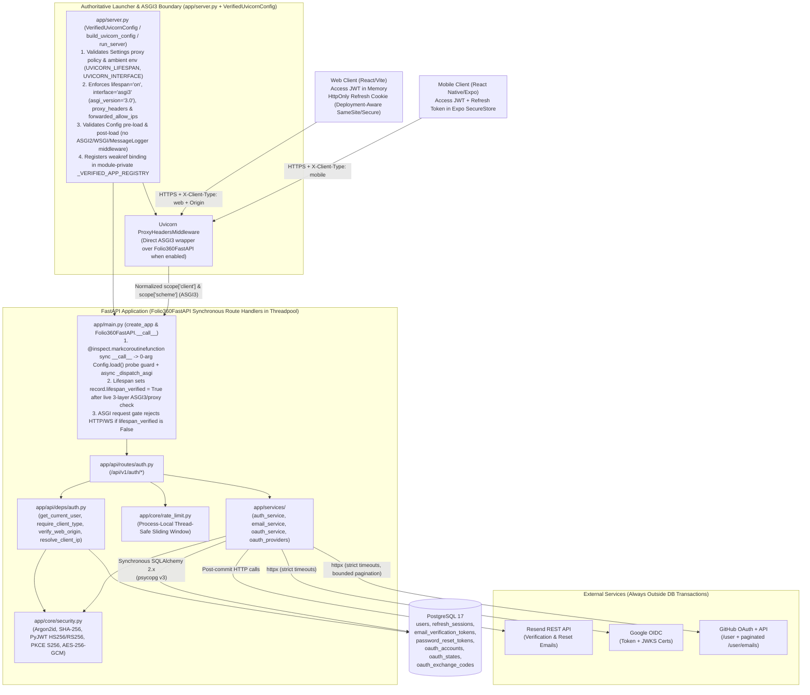
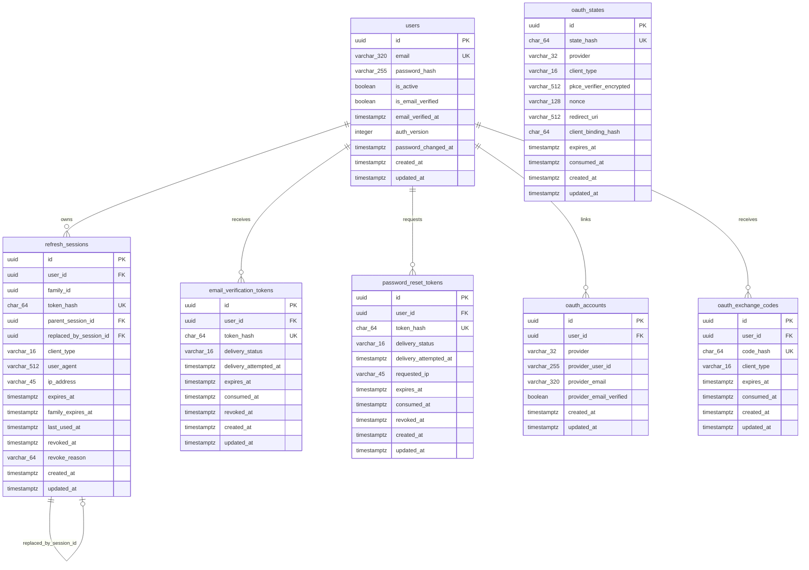

# Folio360 — Product Phase 0: Authentication Architecture Specification (`F360-P0-AUTH-SPEC-REV8`)

---

## 1. Document Status, Scope, Baseline, and Revision History

- **Document ID:** `F360-P0-AUTH-SPEC-REV8` (Mobile Verification Fallback Configuration Clarification)
- **Project:** Folio360 (Student360) Backend — Modular Monolith
- **Repository:** `/home/prajwal/projects/Folio360_backend` (`https://github.com/prajwalvasista2005/Folio360_backend.git`)
- **Approved Code Baseline:**
  - **Branch:** `main`
  - **Stage 2 Baseline Commit:** `206970f5923bd19d445cce905e6bbaf0b5c697ff` (`feat(stage2): add database foundation`)
  - **Latest Repository Commit (Docs / `.gitignore` Sync):** `54c155bd0ba74f3cc54473fd7b3fb0d0e52b8936` (`chore: sync Folio360 before Linux Mint migration`)
  - **Completed Prerequisite Stages:** Stage 0 (Environment & Repository — `f3dc5d3c0f85ea03570281a0483f968187ff0d9e`), Stage 1 (FastAPI Application Foundation — `6e4ae2128ba271800aae179fd01890a5c1438121`, 43 baseline tests), Stage 2 (PostgreSQL 17 + Synchronous SQLAlchemy 2.x + Alembic Foundation — `206970f5923bd19d445cce905e6bbaf0b5c697ff`, 38 baseline tests; **81 total baseline tests**).
- **Status:** Complete, implementation-ready Phase 0 authentication specification **awaiting independent review and explicit approval from the project owner before any Stage 3 implementation begins**. *(Note: All Stage 3 tests in §§20.2–20.6 are proposed implementation acceptance tests and have NOT been executed.)*
- **Scope:** End-to-end backend authentication for **web** (React/Vite) and **mobile** (React Native / Expo) clients covering email/password registration, email verification via Resend, login, JWT access tokens, rotating opaque refresh sessions, logout / logout-all, password recovery and authenticated password change, and Google OIDC + GitHub OAuth 2.0 login.
- **Out of Scope:** Frontend UI implementation, user profiles/portfolios, RBAC/roles, MFA/2FA, explicit cross-provider account linking (schema-prepared, endpoints deferred), session listing/individual revocation UI (`GET /sessions`, `DELETE /sessions/{id}` deferred), and Redis/message-broker/KMS infrastructure.

### Revision History
- **Rev 0:** Initial architecture review, existing repository audit, and 11 architectural decision proposals (Q1–Q11).
- **Rev 1 (`F360-P0-AUTH-SPEC-REV1`):** Locked approved Q1–Q11 decisions; separated Alembic migrations by stage (`0002`, `0003`, `0004`); formalized Resend delivery-failure/recovery contract; replaced timestamp JWT invalidation with integer `users.auth_version`; hardened 422 validation stripping, logging redaction, PostgreSQL `DETAIL:` mapping, and OAuth concurrency handling.
- **Rev 2 (`F360-P0-AUTH-SPEC-REV2`):** Added deployment-aware refresh-cookie policy (Development, Mode 1 Same-Site Production, Mode 2 Cross-Site Production); defined deadlock-free `users`-first row locking for `change-password` and `reset-password`; standardized `folio360_oauth_binding` cookie naming; refined GitHub email suitability terminology; added official OAuth/OIDC references; added AES-256-GCM PKCE verifier encryption at rest; added token-bearing frontend page referrer controls, safe `urllib.parse` OAuth redirect query building, and separate Git authorization governance.
- **Rev 3 (`F360-P0-AUTH-SPEC-REV3`):** Adopted single Uvicorn `ProxyHeadersMiddleware` trust boundary; added Google OIDC `aud`/`azp` validation; classified Google confidential web-server PKCE evidence with pre-release live verification gate; specified bounded GitHub `/user/emails` pagination; clarified Resend immediate first-retry vs. 10-second subsequent-failure backoff.
- **Rev 4 (`F360-P0-AUTH-SPEC-REV4`):** Introduced `app/server.py` launcher + `PROXY_HEADERS_ENABLED` / `TRUSTED_PROXY_IPS` settings and Google OIDC `GOOGLE_TRUSTED_ADDITIONAL_AUDIENCES` allowlist (`[]` default).
- **Rev 5 (`F360-P0-AUTH-SPEC-REV5`):** Removed `create_verified_app()`, separated three proxy verification concepts, introduced `VerifiedUvicornConfig(uvicorn.Config)` + module-private `_VERIFIED_APP_REGISTRY`, and added live production `lifespan` re-verification.
- **Rev 6 (`F360-P0-AUTH-SPEC-REV6`):** Closed Uvicorn `--lifespan off` / `lifespan="off"` / `lifespan="auto"` bypass via `Config.load()` pre-socket trap and `Folio360FastAPI.__call__()` request gate; fixed `VerifiedUvicornConfig.__init__` duplicate-keyword handling via `_UNSET` sentinel; separated 81 baseline tests from 27 Uvicorn security tests; added reproducible Uvicorn `0.54.0` GitHub source references.
- **Rev 7 (`F360-P0-AUTH-SPEC-REV7`):** Enforced explicit `interface="asgi3"` (`asgi_version == "3.0"`) in `VerifiedUvicornConfig` + `@inspect.markcoroutinefunction` on `Folio360FastAPI.__call__` (adding 8 proposed ASGI3 security tests for 35 total in §20.3); added §10.2 Web/Mobile post-verification navigation contract; made strict web login `Origin` validation explicit (`403 CSRF_ORIGIN_MISMATCH`).
- **Rev 8 (`F360-P0-AUTH-SPEC-REV8` — This Document):** Narrowly scoped clarification of mobile email-verification browser-fallback configuration without altering Q1–Q11, DB schema, endpoint contracts, Uvicorn ASGI3 enforcement, web login `Origin` validation, or Stage 3A/3B/3C boundaries (Modified Sections: §§1, 6, 9.3, 10.2, 17.3, 18.1–18.2, 20.4, 21, 22, 23):
  1. **Frontend-Owned Public Build-Time Allowlist (`VITE_EMAIL_VERIFICATION_MOBILE_LOGIN_URIS`) & Backend Deployment Parity (§10.2.C, §18.1–§18.2, §21):** Clarified that `POST /api/v1/auth/verify-email` remains purely non-authenticating and returns no redirect URL; the React/Vite `/verify-email` page enforces mobile-browser fallback locally via public build-time `VITE_EMAIL_VERIFICATION_MOBILE_LOGIN_URIS` (not a secret), kept in exact canonical parity with backend `EMAIL_VERIFICATION_MOBILE_LOGIN_URIS` via CI/deployment validation, with `folio360://auth/login` allowed only where explicitly configured and approved for that deployment.
  2. **Deterministic Parsed-Component URI Validation, Canonicalization & Fail-Safe Web Fallback (§10.2.C, §17.3, §23):** Specified pre-parse raw rejection rules, strict component parsing (`scheme`, `host`, `port`, `path`, empty `query`/`fragment`), canonical equality matching, prohibition on reading redirect destinations from query/API/user inputs or string concatenation, and fail-safe fallback to `{FRONTEND_BASE_URL}/login`.
  3. **Expanded Proposed Acceptance Tests (§20.4, §22):** Added 9 explicit proposed acceptance tests covering configured mobile URIs, unconfigured URIs, malicious schemes, unapproved hosts/paths, malformed/ambiguous URIs, fail-safe web fallback, frontend/backend parity mismatch detection, ignored arbitrary query parameters, and zero-session/zero-cookie/zero-token verification guarantees (keeping `81` baseline and `35` Uvicorn tests unchanged).

---

## 2. Existing Backend & Installed Runtime Inspection Findings

Direct read-only inspection of the repository at commit `54c155bd0ba74f3cc54473fd7b3fb0d0e52b8936` (Stage 2 code baseline `206970f5923bd19d445cce905e6bbaf0b5c697ff`) and the pinned packages in `.venv` (`uvicorn==0.54.0`, `fastapi==0.163.1`, `starlette==1.10.0`) confirms the following baseline contracts:

| Component | Inspected File / Canonical Source | Key Findings & Stage 3 Impact |
| :--- | :--- | :--- |
| Application factory, CORS & lifespan | [app/main.py](app/main.py) | `create_app(settings=None)` is import-safe; module-level `app = create_app()` requires no DB or auth secrets at import time. `CORSMiddleware` configures `allow_origins=settings.CORS_ORIGINS` and `allow_credentials=True` (lines 111–118). Stage 3A subclasses `FastAPI` as `Folio360FastAPI` (adding the zero-arg `Config.load()` probe guard, `@inspect.markcoroutinefunction` ASGI3 dispatch, and production ASGI request gate), mounts `auth.router`, attaches `app.state.rate_limiter`, and invokes `verify_production_asgi_trust_boundary(app, settings)` inside `lifespan`. `create_app()` **never** issues a proxy verification stamp. |
| Configuration | [app/core/config.py](app/core/config.py) | `Settings(BaseSettings)` uses `UPPER_SNAKE_CASE`, `SecretStr`, `hide_input_in_errors=True`, and `ENVIRONMENT: Literal["development", "testing", "production"]`. `Settings()` remains constructible with zero auth env vars in dev/test; production checks run in `validate_runtime_requirements()`. |
| Exception handling | [app/core/exceptions.py](app/core/exceptions.py) | Defines `AppException`, `ResourceNotFoundError`, `ValidationAppError`, and `{"error": {"message", "status_code", "details"}}`. Stage 3A adds: (1) custom `RequestValidationError` handler stripping Pydantic v2's `input` key; (2) optional `headers: Optional[dict[str, str]] = None` on `AppException`; (3) error codes placed strictly under `details["code"]` so `SENSITIVE_KEY_SUBSTRINGS` (`"auth"`, `"token"`, etc.) never redact them. |
| Security logging | [app/core/logging.py](app/core/logging.py) | `SecurityFilter`, `SecurityFormatter`, and `sanitize_log_text()` redact credentials, DB URIs, and heuristic SQL. Extend for `api_key`, `code_verifier`, `pkce_verifier`, `pkce_verifier_encrypted`, `oauth_pkce_encryption_key`, `id_token`, `cookie`, `set-cookie`, `exchange_code`, `oauth_code`, `new_password`, `current_password`, and Resend keys `\bre_[A-Za-z0-9_]{16,}\b`. |
| Database base, session & `users` | [app/db/base.py](app/db/base.py), [app/db/session.py](app/db/session.py), [app/models/user.py](app/models/user.py), [alembic/versions/0001_create_users.py](alembic/versions/0001_create_users.py) | Synchronous SQLAlchemy 2.x with `psycopg` v3, deterministic constraint naming (`pk_`, `uq_`, `ck_`, `ix_`, `fk_`), `TimestampMixin`, synchronous `get_db()`, and baseline `users` table (`id`, `email`, `is_active`, `created_at`, `updated_at` + 3 email `CHECK` constraints). |
| Uvicorn `0.54.0` proxy, lifespan, interface & worker architecture | https://github.com/Kludex/uvicorn/tree/0.54.0/uvicorn (also verified against installed `.venv` `uvicorn==0.54.0`) | (1) `Config.__init__` defaults `lifespan="auto"` (line 212), `interface="auto"` (line 218), and `proxy_headers=True` (line 225); (2) `LIFESPAN["off"]` maps to `LifespanOff` (`lifespan/off.py` lines 8–17), whose `startup()` is `pass`, while `LIFESPAN["auto"]` swallows `error_occurred` when `startup_failed` is `False` (`lifespan/on.py` lines 58, 92–95); (3) `Config.load()` executes `try: self.loaded_app = self.loaded_app() except TypeError:` (lines 513–518), then if `self.interface == "auto"` runs `iscoroutinefunction(getattr(self.loaded_app, "__call__", None))` (lines 525–533) — wrapping in `ASGI2Middleware` if `False` (lines 538–539) — before `ProxyHeadersMiddleware` (lines 543–544); (4) explicit `interface="asgi3"` skips auto-detection and makes `config.asgi_version == "3.0"` valid immediately (`config.py` lines 370–377), while `@inspect.markcoroutinefunction` on `Folio360FastAPI.__call__` makes both `uvicorn._compat.iscoroutinefunction` and Starlette `TestClient._is_asgi3` return `True`. Full table in §16.3. |
| Pinned dependencies | [requirements.in](requirements.in), [requirements.txt](requirements.txt) | **Zero new Python dependencies required:** `argon2-cffi==25.1.0`, `PyJWT==2.15.1`, `cryptography==50.0.2` (`AESGCM`), `httpx==0.28.1`, `resend==2.53.2`, `email-validator==2.4.0`, `fastapi==0.163.1`, `starlette==1.10.0`, `pydantic==2.14.3`, `SQLAlchemy==2.0.38`, `psycopg==3.3.9`, `alembic==1.20.1`, `uvicorn==0.54.0`, `pytest==9.2.0`, `pytest-mock==3.17.0`. |

---

## 3. Mandatory Product Requirements

1. **Dual-Client Support:** First-class support for web (React/Vite) and native mobile (React Native / Expo) clients without introducing Redis or separate auth microservices.
2. **Synchronous Architecture Preservation:** Synchronous SQLAlchemy 2.x (`psycopg` v3) and synchronous FastAPI route functions (`def`) executed in Starlette's worker threadpool. No async SQLAlchemy.
3. **Email/Password Registration & Mandatory Verification:** Registration with email + password, Resend verification email, and mandatory email verification before password login succeeds (verification must never auto-authenticate).
4. **Short-Lived Access JWTs + Rotating Opaque Refresh Sessions:** 15-minute access JWTs paired with PostgreSQL-backed single-use rotating refresh tokens (14-day rolling TTL, 30-day absolute family cap) with family-wide replay revocation.
5. **Immediate Global Access-Token Invalidation:** Integer `users.auth_version` matched against JWT `"ver"` claim in `get_current_user` (zero timestamp-precision race window).
6. **Password Recovery & Atomic Password Change:** Forgot-password / reset-password via Resend + deadlock-free atomic authenticated password change.
7. **Social Login (Google OIDC & GitHub OAuth 2.0):** Server-driven Authorization Code + PKCE (`S256`) using pinned `httpx`, `PyJWT[crypto]`, and `cryptography` (`AESGCM` for PKCE verifier encryption at rest), returning a 60-second single-use `oauth_exchange_code` (never tokens in redirect URLs).
8. **Deployment-Aware Web Cookie Policy:** Explicitly supports development, same-site production, and cross-site production without assuming a hosting provider, leaving Expo mobile JSON transport unchanged.
9. **Backward Compatibility:** Preserves all Stage 1 and Stage 2 routes, lifespan/readiness contracts, and all 81 existing baseline tests with zero regressions.

---

## 4. Approved Q1–Q11 Decisions (Binding)

| ID | Topic | Binding Decision |
| :--- | :--- | :--- |
| **Q1** | GitHub email policy | **Option A:** Require a **verified, syntactically valid, non-noreply email suitable for registration** (retrieved across all paginated `/user/emails` pages) for **new** GitHub OAuth accounts. Reject `@users.noreply.github.com` (and subdomains) with `verified_email_required`. Existing linked GitHub users authenticate by `(github, provider_user_id)` even if their GitHub email changes or disappears. |
| **Q2** | Account linking & auto-merge | **Option A:** Never auto-merge OAuth sign-ins into an existing `users` row solely by email equality; reject with `email_already_registered`. Explicit authenticated account-linking endpoints are deferred; `oauth_accounts` supports future multi-provider links. |
| **Q3** | Email verification HTTP method | **Option A:** `POST /api/v1/auth/verify-email` with JSON `{"token": "..."}`. Emails link to `{FRONTEND_BASE_URL}/verify-email?token=...`; frontend captures, scrubs URL, and submits `POST`. |
| **Q4** | Token storage & hashing | **Option A:** Random opaque tokens (`secrets.token_urlsafe(32)`) stored exclusively as lowercase hex SHA-256 (`CHAR(64)`) in PostgreSQL for email verification (24h), password reset (30m), refresh sessions, and OAuth exchange codes (60s). Single-use + explicit revocation. Argon2id exclusively for passwords. |
| **Q5** | Refresh token rotation & replay | **Option A:** Single-use rotation grouped by `family_id`, serialized via `SELECT ... FOR UPDATE`. Replay of a rotated token revokes the affected `family_id` (unrelated families untouched). 14-day rolling TTL, 30-day absolute `family_expires_at` cap. Clients implement single-flight refresh deduplication. |
| **Q6** | Web vs. mobile token transport | **Option A:** `X-Client-Type: web \| mobile`. **Web:** HttpOnly refresh cookie (deployment-aware `SameSite`/`Secure` per §12.3) + in-memory access JWT (never `localStorage`) + CSRF `X-Client-Type: web` and strict `Origin` allowlist checks. **Mobile:** access + refresh tokens in JSON stored in Expo `SecureStore`, zero cookies. |
| **Q7** | OAuth token handoff to client | **Option A:** Backend callback redirects to allowlisted client URI with safely appended 60-second single-use `code=<oauth_exchange_code>` (never auth tokens in redirect URLs), exchanged via `POST /api/v1/auth/oauth/exchange`. |
| **Q8** | OAuth & JWT library choice | **Option A:** Direct implementation with pinned `httpx`, `PyJWT[crypto]`, and `cryptography`. No `Authlib` or `itsdangerous`. |
| **Q9** | Rate limiting & email cooldown | **Option A:** Process-local thread-safe sliding-window IP rate limiter (consuming Uvicorn-normalized ASGI client IP verified via §19.1) + PostgreSQL-backed per-account email cooldowns (`>= 60s` between `'sent'`, `<= 3/hr`). No Redis. |
| **Q10** | Password reset & change sessions | **Option A:** Password reset atomically revokes **all** refresh sessions and increments `users.auth_version`. Password change atomically verifies `current_password` on the locked `users` row, rejects OAuth-only accounts (`400 PASSWORD_NOT_SET`), revokes old sessions, increments `users.auth_version`, and issues one fresh session + access JWT for the current client. |
| **Q11** | Enumeration policy & session UI | Duplicate `POST /register` returns `409 EMAIL_ALREADY_REGISTERED`. `POST /forgot-password` and `POST /resend-verification` always return generic `202 Accepted`. Defer `GET /sessions` and `DELETE /sessions/{session_id}`; retain `POST /logout-all`. |

---

## 5. Final Authentication Architecture



### Core Architectural Invariants
1. **Unbypassable Post-Load Uvicorn ASGI3, Proxy & Lifespan Verification:** `create_app()` in [app/main.py](app/main.py) **never** stamps or certifies Uvicorn proxy state. `VerifiedUvicornConfig` mandates `lifespan="on"` (`LifespanOn`), mandates `interface="asgi3"` (`asgi_version == "3.0"`), validates effective proxy settings, verifies the direct ASGI3 wrapper chain (`ProxyHeadersMiddleware -> Folio360FastAPI` or direct `Folio360FastAPI` with zero `ASGI2Middleware`/`WSGIMiddleware`/`MessageLoggerMiddleware`) after `super().load()`, and records a weakref binding in `_VERIFIED_APP_REGISTRY`. `Folio360FastAPI.__call__` is decorated with `@inspect.markcoroutinefunction`, preserving synchronous `Config.load()` 0-arg probing while dispatching 3-arg ASGI3 scopes via `_dispatch_asgi` (avoiding `ASGI2Middleware` / `_WrapASGI2` ambiguity). If raw `uvicorn` CLI or raw `uvicorn.Config` is used in production — **even with `--lifespan off`, `lifespan="auto"`, or any `--interface`** — startup fails closed inside `Config.load()` (before socket binding) and at the `Folio360FastAPI._dispatch_asgi` ASGI request entry gate before any request can be served (§19.1–§19.4).
2. **Strict DB-Transaction / External-Network Separation:** Resend, Google, and GitHub HTTP calls **never** execute inside an open PostgreSQL transaction or while holding `SELECT ... FOR UPDATE` locks.
3. **Threadpool Execution:** All routes in `app/api/routes/auth.py` are synchronous `def` handlers so synchronous SQLAlchemy, Argon2id, and `httpx`/Resend I/O run in Starlette's worker threadpool without blocking the asyncio event loop.
4. **PostgreSQL as Single Source of Security Truth:** Refresh rotation, replay detection, token single-use, email cooldowns, OAuth state/exchange-code consumption, and `auth_version` invalidation are all enforced atomically in PostgreSQL.

---

## 6. Module Responsibilities and Proposed Folder Structure

```text
app/
├── main.py                          # [Modified 3A] Folio360FastAPI (@inspect.markcoroutinefunction __call__, _dispatch_asgi, Config.load() probe guard, ASGI gate), create_app(), lifespan verification
├── server.py                        # [3A] VerifiedUvicornConfig (safe kwargs, lifespan='on', interface='asgi3'), build_uvicorn_config, run_server, _VERIFIED_APP_REGISTRY, & 3-layer ASGI3/proxy/lifespan verifier
├── api/
│   ├── deps/
│   │   ├── __init__.py
│   │   └── auth.py                  # [3A] get_current_user, require_client_type, verify_web_origin, resolve_client_ip, rate-limit deps
│   └── routes/
│       ├── health.py                # [Existing Stage 1/2 — unchanged]
│       └── auth.py                  # [3A, extended in 3B & 3C] /api/v1/auth/* synchronous endpoints
├── core/
│   ├── config.py                    # [Modified 3A, 3B, 3C] Auth, JWT, proxy policy, deployment-aware cookies, Resend, mobile verification return URIs (backend parity anchor EMAIL_VERIFICATION_MOBILE_LOGIN_URIS), OAuth settings
│   ├── exceptions.py                # [Modified 3A] RequestValidationError input stripper, headers support, auth error classes
│   ├── logging.py                   # [Modified 3A, 3C] Extended secret/token/cookie/Resend/PKCE redaction patterns
│   ├── rate_limit.py                # [3A] Thread-safe in-memory sliding-window IP limiter
│   └── security.py                  # [3A, extended in 3C] Argon2id + dummy hash, SHA-256 tokens, PyJWT HS256, PKCE S256, AES-256-GCM
├── models/
│   ├── __init__.py                  # [Modified 3A, 3B, 3C] Export all ORM models for Alembic metadata
│   ├── user.py                      # [Modified 3A] Additive auth columns + constraints
│   ├── refresh_session.py           # [3A] RefreshSession ORM model
│   ├── email_verification_token.py  # [3A] EmailVerificationToken ORM model
│   ├── password_reset_token.py      # [3B] PasswordResetToken ORM model
│   └── oauth.py                     # [3C] OAuthAccount, OAuthState, OAuthExchangeCode ORM models
├── schemas/
│   ├── __init__.py
│   ├── auth.py                      # [3A, extended in 3B] Pydantic v2 request/response schemas
│   └── oauth.py                     # [3C] OAuth exchange schemas & provider identity DTOs
└── services/
    ├── __init__.py
    ├── auth_service.py              # [3A, extended in 3B] Core auth, sessions, atomic password reset & change, resend cooldown logic
    ├── email_service.py             # [3A, extended in 3B] Resend wrapper + templates + sanitized result
    ├── oauth_providers.py           # [3C] Google OIDC (JWKS + trusted-audience/azp validation) & GitHub OAuth (/user + paginated /user/emails)
    └── oauth_service.py             # [3C] Encrypted PKCE state, binding cookie, safe redirect builder, atomic provisioning, exchange code
```

---

## 7. Database Schema and Relationships



### Detailed Table & Constraint Specifications

All tables inherit `TimestampMixin` (`created_at`, `updated_at`) and use `Base`'s deterministic naming conventions (`pk_`, `uq_`, `ck_`, `ix_`, `fk_`).

#### 7.1 `users` (Extended in Stage 3A)
- **Existing (`0001_create_users`):** `id` (`UUID`, PK), `email` (`VARCHAR(320)`, `NOT NULL`, `UNIQUE`), `is_active` (`BOOLEAN`, `NOT NULL`, `server_default=true`), `created_at`, `updated_at`, plus `ck_users_email_lowercase_trimmed`, `ck_users_email_not_empty`, `ck_users_email_no_whitespace`.
- **Added (`0002_add_core_auth_tables`):**
  - `password_hash`: `VARCHAR(255)`, `NULL` (Argon2id hash; `NULL` for OAuth-only users).
  - `is_email_verified`: `BOOLEAN`, `NOT NULL`, `server_default=false`.
  - `email_verified_at`: `TIMESTAMPTZ`, `NULL`.
  - `auth_version`: `INTEGER`, `NOT NULL`, `server_default=0` (matched against JWT `"ver"` claim).
  - `password_changed_at`: `TIMESTAMPTZ`, `NULL` (audit timestamp only).
- **New Constraints:**
  - `ck_users_email_verified_at_consistency`: `(is_email_verified = false AND email_verified_at IS NULL) OR (is_email_verified = true AND email_verified_at IS NOT NULL)`
  - `ck_users_auth_version_non_negative`: `auth_version >= 0`

#### 7.2 `email_verification_tokens` (Stage 3A)
- Columns: `id` (`UUID`, PK), `user_id` (`UUID`, `NOT NULL`, `FK -> users.id ON DELETE CASCADE`), `token_hash` (`CHAR(64)`, `NOT NULL`, `UNIQUE`), `delivery_status` (`VARCHAR(16)`, `NOT NULL`, `server_default='pending'`), `delivery_attempted_at` (`TIMESTAMPTZ`, `NULL`), `expires_at` (`TIMESTAMPTZ`, `NOT NULL`), `consumed_at` (`TIMESTAMPTZ`, `NULL`), `revoked_at` (`TIMESTAMPTZ`, `NULL`), `created_at`, `updated_at`.
- Constraints: `ck_email_verification_tokens_delivery_status` (`delivery_status IN ('pending', 'sent', 'failed')`), `ck_email_verification_tokens_hash_hex` (`token_hash ~ '^[0-9a-f]{64}$'`), `ck_email_verification_tokens_not_both_consumed_revoked` (`NOT (consumed_at IS NOT NULL AND revoked_at IS NOT NULL)`).
- Indexes: `ix_email_verification_tokens_user_created` on `(user_id, created_at DESC)`; `ix_email_verification_tokens_expires_at` on `(expires_at)`.

#### 7.3 `refresh_sessions` (Stage 3A)
- Columns: `id` (`UUID`, PK), `user_id` (`UUID`, `NOT NULL`, `FK -> users.id ON DELETE CASCADE`), `family_id` (`UUID`, `NOT NULL`), `token_hash` (`CHAR(64)`, `NOT NULL`, `UNIQUE`), `parent_session_id` (`UUID`, `NULL`, `FK -> refresh_sessions.id ON DELETE SET NULL`), `replaced_by_session_id` (`UUID`, `NULL`, `FK -> refresh_sessions.id ON DELETE SET NULL`), `client_type` (`VARCHAR(16)`, `NOT NULL`), `user_agent` (`VARCHAR(512)`, `NULL`), `ip_address` (`VARCHAR(45)`, `NULL`), `expires_at` (`TIMESTAMPTZ`, `NOT NULL`), `family_expires_at` (`TIMESTAMPTZ`, `NOT NULL`), `last_used_at` (`TIMESTAMPTZ`, `NULL`), `revoked_at` (`TIMESTAMPTZ`, `NULL`), `revoke_reason` (`VARCHAR(64)`, `NULL`), `created_at`, `updated_at`.
- Constraints: `ck_refresh_sessions_client_type` (`client_type IN ('web', 'mobile')`), `ck_refresh_sessions_hash_hex` (`token_hash ~ '^[0-9a-f]{64}$'`), `ck_refresh_sessions_expiry_bounds` (`expires_at <= family_expires_at`), `ck_refresh_sessions_revoke_reason_consistency` (`(revoked_at IS NULL AND revoke_reason IS NULL) OR (revoked_at IS NOT NULL AND revoke_reason IS NOT NULL)`).
- Indexes: `ix_refresh_sessions_user_active` on `(user_id, revoked_at)`; `ix_refresh_sessions_family_id` on `(family_id)`; `ix_refresh_sessions_expires_at` on `(expires_at)`.

#### 7.4 `password_reset_tokens` (Stage 3B)
- Columns: `id` (`UUID`, PK), `user_id` (`UUID`, `NOT NULL`, `FK -> users.id ON DELETE CASCADE`), `token_hash` (`CHAR(64)`, `NOT NULL`, `UNIQUE`), `delivery_status` (`VARCHAR(16)`, `NOT NULL`, `server_default='pending'`), `delivery_attempted_at` (`TIMESTAMPTZ`, `NULL`), `requested_ip` (`VARCHAR(45)`, `NULL`), `expires_at` (`TIMESTAMPTZ`, `NOT NULL`), `consumed_at` (`TIMESTAMPTZ`, `NULL`), `revoked_at` (`TIMESTAMPTZ`, `NULL`), `created_at`, `updated_at`.
- Constraints: `ck_password_reset_tokens_delivery_status` (`delivery_status IN ('pending', 'sent', 'failed')`), `ck_password_reset_tokens_hash_hex` (`token_hash ~ '^[0-9a-f]{64}$'`), `ck_password_reset_tokens_not_both_consumed_revoked` (`NOT (consumed_at IS NOT NULL AND revoked_at IS NOT NULL)`).
- Indexes: `ix_password_reset_tokens_user_created` on `(user_id, created_at DESC)`; `ix_password_reset_tokens_expires_at` on `(expires_at)`.

#### 7.5 `oauth_accounts` (Stage 3C)
- Columns: `id` (`UUID`, PK), `user_id` (`UUID`, `NOT NULL`, `FK -> users.id ON DELETE CASCADE`), `provider` (`VARCHAR(32)`, `NOT NULL`), `provider_user_id` (`VARCHAR(255)`, `NOT NULL`), `provider_email` (`VARCHAR(320)`, `NULL`), `provider_email_verified` (`BOOLEAN`, `NOT NULL`, `server_default=false`), `created_at`, `updated_at`.
- Constraints: `uq_oauth_accounts_provider_subject` (`UNIQUE (provider, provider_user_id)`), `uq_oauth_accounts_user_provider` (`UNIQUE (user_id, provider)`), `ck_oauth_accounts_provider` (`provider IN ('google', 'github')`), `ck_oauth_accounts_provider_user_id_not_empty`.
- Index: `ix_oauth_accounts_user_id` on `(user_id)`.

#### 7.6 `oauth_states` (Stage 3C)
- Columns: `id` (`UUID`, PK), `state_hash` (`CHAR(64)`, `NOT NULL`, `UNIQUE`), `provider` (`VARCHAR(32)`, `NOT NULL`), `client_type` (`VARCHAR(16)`, `NOT NULL`), `pkce_verifier_encrypted` (`VARCHAR(512)`, `NOT NULL` — AES-256-GCM ciphertext per §17.1; scrubbed to `'[CONSUMED]'` on use), `nonce` (`VARCHAR(128)`, `NULL`), `redirect_uri` (`VARCHAR(512)`, `NOT NULL`), `client_binding_hash` (`CHAR(64)`, `NULL` — SHA-256 hex of **`folio360_oauth_binding`** cookie value; raw value never stored), `expires_at` (`TIMESTAMPTZ`, `NOT NULL` — 10 minutes), `consumed_at` (`TIMESTAMPTZ`, `NULL`), `created_at`, `updated_at`.
- Constraints: `ck_oauth_states_provider`, `ck_oauth_states_client_type`, `ck_oauth_states_state_hash_hex`, `ck_oauth_states_client_binding_hash_hex`, `ck_oauth_states_google_nonce`, `ck_oauth_states_pkce_not_empty`.
- Index: `ix_oauth_states_expires_at` on `(expires_at)`.

#### 7.7 `oauth_exchange_codes` (Stage 3C)
- Columns: `id` (`UUID`, PK), `user_id` (`UUID`, `NOT NULL`, `FK -> users.id ON DELETE CASCADE`), `code_hash` (`CHAR(64)`, `NOT NULL`, `UNIQUE`), `client_type` (`VARCHAR(16)`, `NOT NULL`), `expires_at` (`TIMESTAMPTZ`, `NOT NULL` — 60 seconds), `consumed_at` (`TIMESTAMPTZ`, `NULL`), `created_at`, `updated_at`.
- Constraints: `ck_oauth_exchange_codes_client_type`, `ck_oauth_exchange_codes_hash_hex`.
- Indexes: `ix_oauth_exchange_codes_user_id`, `ix_oauth_exchange_codes_expires_at`.

---

## 8. Migration Plan (Separated by Stage: 3A, 3B, 3C)

```text
0001_create_users (Stage 2 baseline — immutable)
  └── 0002_add_core_auth_tables (Stage 3A)
        └── 0003_add_password_reset_tokens (Stage 3B)
              └── 0004_add_oauth_tables (Stage 3C)
```

| Stage | Revision ID & Filename | Down Revision | Upgrade Scope | Downgrade Scope |
| :--- | :--- | :--- | :--- | :--- |
| **3A** | `0002_add_core_auth_tables` (`alembic/versions/0002_add_core_auth_tables.py`) | `0001_create_users` | `ALTER TABLE users` (5 columns + 2 CHECK constraints); `CREATE TABLE email_verification_tokens`; `CREATE TABLE refresh_sessions` | `DROP TABLE refresh_sessions`, `email_verification_tokens`; drop 2 constraints & 5 columns on `users` |
| **3B** | `0003_add_password_reset_tokens` (`alembic/versions/0003_add_password_reset_tokens.py`) | `0002_add_core_auth_tables` | `CREATE TABLE password_reset_tokens` | `DROP TABLE password_reset_tokens` |
| **3C** | `0004_add_oauth_tables` (`alembic/versions/0004_add_oauth_tables.py`) | `0003_add_password_reset_tokens` | `CREATE TABLE oauth_accounts`, `oauth_states` (`pkce_verifier_encrypted`), `oauth_exchange_codes` | `DROP TABLE oauth_exchange_codes`, `oauth_states`, `oauth_accounts` |

### Mandatory Migration Verification Rules (Every Stage)
1. Clean DB `alembic upgrade head` from empty `base`.
2. Upgrade from populated Stage 2 `0001_create_users` baseline (`is_email_verified=False`, `email_verified_at=None`, `auth_version=0`, `password_hash=None` via `server_default`).
3. Round-trip reversibility: `upgrade head -> downgrade <parent_rev> -> upgrade head`.
4. `alembic check` returns exit code `0`.
5. Least-privilege `folio360_app` DML permissions verified on all new tables created by `folio360_migrator`.

---

## 9. Complete API Contract

All endpoints live under `API_V1_PREFIX` (`/api/v1`) and preserve the Stage 1 error envelope:

```json
{
  "error": {
    "message": "Human-readable safe public message",
    "status_code": 401,
    "details": {
      "code": "INVALID_CREDENTIALS"
    }
  }
}
```

### 9.1 Endpoint Matrix

| Stage | Method & Path | Auth | Required Headers / Params | Success Status |
| :--- | :--- | :--- | :--- | :--- |
| 3A | `POST /api/v1/auth/register` | Public | — | `201 Created` |
| 3A | `POST /api/v1/auth/verify-email` | Public | — | `200 OK` |
| 3A | `POST /api/v1/auth/resend-verification` | Public | — | `202 Accepted` |
| 3A | `POST /api/v1/auth/login` | Public | `X-Client-Type: web \| mobile` (+ `Origin` on web) | `200 OK` |
| 3A | `POST /api/v1/auth/refresh` | Refresh token (cookie/body) | `X-Client-Type` (+ `Origin` on web) | `200 OK` |
| 3A | `POST /api/v1/auth/logout` | Refresh token (cookie/body) | `X-Client-Type` (+ `Origin` on web) | `200 OK` |
| 3A | `POST /api/v1/auth/logout-all` | Bearer Access JWT | `Authorization: Bearer <jwt>` (+ `Origin` if `X-Client-Type: web`) | `200 OK` |
| 3A | `GET /api/v1/auth/me` | Bearer Access JWT | `Authorization: Bearer <jwt>` | `200 OK` |
| 3B | `POST /api/v1/auth/forgot-password` | Public | — | `202 Accepted` |
| 3B | `POST /api/v1/auth/reset-password` | Public | — | `200 OK` |
| 3B | `POST /api/v1/auth/change-password` | Bearer Access JWT | `Authorization`, `X-Client-Type` (+ `Origin` on web) | `200 OK` |
| 3C | `GET /api/v1/auth/oauth/{provider}/start` | Public | Query: `client_type`, `redirect_uri` | `302 Found` |
| 3C | `GET /api/v1/auth/oauth/{provider}/callback` | Provider redirect | Query: `code`, `state` (or `error`) | `302 Found` |
| 3C | `POST /api/v1/auth/oauth/exchange` | Public (exchange code) | `X-Client-Type` (+ `Origin` on web) | `200 OK` |

### 9.2 Stable Machine-Readable Error Code Catalog (`error.details.code`)

| HTTP Status | `error.details.code` | Meaning / Trigger |
| :--- | :--- | :--- |
| `400` | `INVALID_CLIENT_TYPE` | Missing or invalid `X-Client-Type` header (`web` or `mobile`). |
| `400` | `INVALID_VERIFICATION_TOKEN` | Verification token invalid, expired, revoked, or already consumed. |
| `400` | `INVALID_RESET_TOKEN` | Password reset token invalid, expired, revoked, or already consumed. |
| `400` | `PASSWORD_NOT_SET` | `change-password` attempted on an OAuth-only account (`password_hash IS NULL`). |
| `400` | `SAME_PASSWORD_NOT_ALLOWED` | New password matches current password in `change-password`. |
| `400` | `INVALID_OAUTH_PROVIDER` | Provider path param is not `google` or `github`. |
| `400` | `INVALID_REDIRECT_URI` | `redirect_uri` not an exact match in configured allowlist for `client_type`. |
| `400` | `INVALID_OAUTH_EXCHANGE_CODE` | Exchange code unknown, expired, consumed, or `client_type` mismatch. |
| `401` | `INVALID_CREDENTIALS` | Wrong email/password on login, or wrong `current_password` on `change-password`. |
| `401` | `INVALID_ACCESS_TOKEN` | Missing/malformed/expired JWT, signature/iss/aud failure, `auth_version` mismatch, or unknown user (`WWW-Authenticate: Bearer`). |
| `401` | `INVALID_REFRESH_TOKEN` | Missing/unknown/expired/revoked refresh token, or `client_type` mismatch. |
| `401` | `REFRESH_TOKEN_REUSE_DETECTED` | Previously rotated refresh token replayed; entire session family revoked. |
| `403` | `EMAIL_NOT_VERIFIED` | Password login before email verification (checked only after valid password verification). |
| `403` | `ACCOUNT_INACTIVE` | User has `is_active = false`. |
| `403` | `CSRF_ORIGIN_MISMATCH` | Web cookie-issuing or cookie-bearing request (including `POST /login`, `/refresh`, `/logout`, `/logout-all`, `/change-password`, and `/oauth/exchange` when `X-Client-Type: web`) failed strict `Origin` allowlist check. |
| `409` | `EMAIL_ALREADY_REGISTERED` | `POST /register` email already exists. |
| `422` | `VALIDATION_ERROR` | Pydantic validation failure (`input` stripped). |
| `429` | `RATE_LIMIT_EXCEEDED` | IP rate limit triggered (`Retry-After` header included). |
| `503` | `SERVICE_UNAVAILABLE` | Downstream dependency unavailable. |

> **OAuth Callback Error Redirect Query Codes** (appended safely via §17.2 as `error=<code>` on `redirect_uri`): `oauth_cancelled`, `invalid_oauth_state`, `oauth_provider_error`, `verified_email_required`, `email_already_registered`, `account_inactive`.

### 9.3 Detailed Endpoint Contracts

1. **`POST /api/v1/auth/register` (3A):** Request `{"email", "password"}` (email trimmed/lowercased, valid `EmailStr`, `<= 320` chars; password 12–128 chars, UTF-8 bytes `<= 128`, non-whitespace, `!= email`). Returns `201 Created` with `{"message", "user": {id, email, is_active, is_email_verified, has_password, created_at}, "verification_email_sent": true | false}`. Errors: `409 EMAIL_ALREADY_REGISTERED`, `422`, `429`.
2. **`POST /api/v1/auth/verify-email` (3A):** Request `{"token"}` (no arbitrary redirect parameter accepted). Locks `users` row then token row (`FOR UPDATE`), verifies active/unexpired and `user.is_active`, consumes token, sets `is_email_verified=True` and `email_verified_at=now()`, revokes other active verification tokens, commits. Returns `200 OK` `{"message": "Email verified successfully.", "email_verified": true}` (zero redirect URL field returned). **Must never auto-authenticate** (sets zero `Set-Cookie` headers, returns zero access/refresh tokens, and creates zero `refresh_sessions` rows). Post-verification navigation back to login is performed exclusively by the frontend using trusted local build-time configuration per §10.2, never via a backend redirect or API-supplied URL.
3. **`POST /api/v1/auth/resend-verification` (3A):** Request `{"email"}`. Always returns `202 Accepted` `{"message": "If an unverified account exists for this email, a verification link has been sent."}` following the exact retry/cooldown rules in §11.
4. **`POST /api/v1/auth/login` (3A):** Header `X-Client-Type: web | mobile`; body `{"email", "password"}`.
   - **Web `Origin` Enforcement (`X-Client-Type: web`):** Must validate `Origin` via `verify_web_origin` against the exact `settings.CORS_ORIGINS` allowlist before credential processing or session creation. Missing, empty, `"null"`, or untrusted `Origin` returns `403 CSRF_ORIGIN_MISMATCH` with zero cookies set and zero `refresh_sessions` rows created.
   - **Mobile Contract (`X-Client-Type: mobile`):** Remains cookie-free and does **not** require a browser `Origin` header.
   - **Authentication & Response:** Always runs Argon2id verification (against dummy hash if missing / OAuth-only) before checking `is_email_verified` (`403 EMAIL_NOT_VERIFIED`) or `is_active` (`403 ACCOUNT_INACTIVE`), returning generic `401 INVALID_CREDENTIALS` on email/password mismatch. Web sets `folio360_refresh_token` HttpOnly cookie (§12.3) and returns `{"access_token", "token_type": "bearer", "expires_in": 900, "user": {...}}`; mobile sets zero cookies and adds `"refresh_token"` and `"refresh_expires_in": 1209600`.
5. **`POST /api/v1/auth/refresh` (3A):** Header `X-Client-Type` (+ `Origin` on web). Web reads `folio360_refresh_token` cookie; mobile reads `{"refresh_token"}`. Serializes via `FOR UPDATE`, rotates session, revokes family on replay (`401 REFRESH_TOKEN_REUSE_DETECTED`, clears web cookie), returns same shape as `/login`.
6. **`POST /api/v1/auth/logout` (3A):** Header `X-Client-Type` (+ `Origin` on web). Idempotently revokes active session (`logout`), clears web cookie with matching attributes, returns `200 OK`.
7. **`POST /api/v1/auth/logout-all` (3A):** Bearer Access JWT (+ `Origin` if `X-Client-Type: web`). Locks `users` (`FOR UPDATE`), increments `auth_version += 1`, revokes all active refresh sessions (`logout_all`), commits, clears web cookie if web. Returns `200 OK`.
8. **`GET /api/v1/auth/me` (3A):** Bearer Access JWT. Returns `id`, `email`, `is_active`, `is_email_verified`, `has_password`, `created_at`, `updated_at` (plus `oauth_providers: list[str]` in 3C).
9. **`POST /api/v1/auth/forgot-password` (3B):** Body `{"email"}`. Always returns `202 Accepted`. Eligible only when `is_active=True`, `is_email_verified=True`, `password_hash IS NOT NULL`. Uses identical §11 delivery/retry state machine.
10. **`POST /api/v1/auth/reset-password` (3B):** Body `{"token", "new_password"}`. Atomic `users`-first locked transaction (§13.1). Returns `200 OK`.
11. **`POST /api/v1/auth/change-password` (3B):** Bearer Access JWT + `X-Client-Type` (+ `Origin` on web); body `{"current_password", "new_password"}`. Atomic `users`-first locked transaction (§13.2). Returns `200 OK` with `"message"` + fresh client-specific access JWT and refresh session.
12. **`GET /api/v1/auth/oauth/{provider}/start` (3C):** Query `client_type`, `redirect_uri`. `302 Found` to provider; sets **`folio360_oauth_binding`** cookie on `web`.
13. **`GET /api/v1/auth/oauth/{provider}/callback` (3C):** Validates state + **`folio360_oauth_binding`** (web), clears **`folio360_oauth_binding`**, exchanges code, provisions/resolves user, redirects `302 Found` with safely appended `code=...` or `error=...` (§17.2).
14. **`POST /api/v1/auth/oauth/exchange` (3C):** Header `X-Client-Type` (+ `Origin` on web); body `{"code"}`. Consumes 60s code atomically (`FOR UPDATE`), creates fresh `refresh_session`, returns same shape as `/login`.

---

## 10. Email Registration, Verification Flow, Frontend Hygiene & Return Contract

```mermaid
sequenceDiagram
    participant Client as "Web / Mobile Client"
    participant API as "FastAPI (/api/v1/auth)"
    participant DB as "PostgreSQL 17"
    participant Resend as "Resend API"

    Client->>API: "POST /register {email, password}"
    API->>API: "Normalize email, validate password, Argon2id hash"
    API->>DB: "BEGIN: INSERT users + INSERT email_verification_tokens (delivery_status='pending') -> COMMIT"
    alt "UniqueViolation on users.email"
        DB-->>API: "IntegrityError (uq_users_email)"
        API-->>Client: "409 Conflict {code: EMAIL_ALREADY_REGISTERED}"
    else "Committed"
        API->>Resend: "Send verification email ({FRONTEND_BASE_URL}/verify-email?token=<raw>)"
        alt "Resend 2xx"
            API->>DB: "UPDATE token SET delivery_status='sent', delivery_attempted_at=now() -> COMMIT"
            API-->>Client: "201 Created {user, verification_email_sent: true}"
        else "Resend error / timeout"
            API->>DB: "UPDATE token SET delivery_status='failed', delivery_attempted_at=now() -> COMMIT"
            API-->>Client: "201 Created {user, verification_email_sent: false}"
        end
    end

    Note over Client,API: "Client opens verification link, scrubs token from URL/state, submits POST"
    Client->>API: "POST /verify-email {token}"
    API->>DB: "BEGIN: lock user -> lock token -> consumed_at, is_email_verified=true -> COMMIT"
    API-->>Client: "200 OK {email_verified: true} (Zero tokens / zero Set-Cookie / no redirect field)"
    Note over Client: "Frontend navigates locally: Web -> {FRONTEND_BASE_URL}/login; Mobile -> in-app Login or validated VITE_EMAIL_VERIFICATION_MOBILE_LOGIN_URIS with fallback to web login (§10.2)"
    Client->>API: "POST /login {email, password} (+ X-Client-Type + Origin on web)"
```

### 10.1 Mandatory Frontend Rules for Token-Bearing Pages (`/verify-email`, `/reset-password`, `/auth/oauth/callback`)
1. Serve with HTTP header `Referrer-Policy: no-referrer` (plus `<meta name="referrer" content="no-referrer">`).
2. Load **zero** third-party analytics, telemetry, session-replay, or advertising scripts on token-bearing pages.
3. Avoid unnecessary external subresources that could receive the URL through referrer leakage.
4. Never log token-bearing URLs in client telemetry or server/proxy access logs.
5. Capture `token` (or `code`) into JS memory on mount and immediately strip it from browser URL/history via `window.history.replaceState({}, document.title, window.location.pathname)`.
6. Consume tokens exclusively via the approved `POST` APIs (`/verify-email`, `/reset-password`, `/oauth/exchange`).

### 10.2 Post-Verification Navigation and Return Contract (Web & Mobile) (Rev8 Clarification)

The email verification pipeline strictly preserves the non-authenticating 7-step flow:
1. User registers with email and password (`POST /api/v1/auth/register`).
2. Backend creates an unverified account (`is_email_verified=False`).
3. Resend delivers the verification email whose link is constructed exclusively from the validated backend setting `FRONTEND_BASE_URL` (`{FRONTEND_BASE_URL}/verify-email?token=<raw_token>` — never embedding caller-supplied redirect targets).
4. User opens the verification link.
5. Client captures the token, scrubs the URL/navigation state, and submits `POST /api/v1/auth/verify-email` with `{"token": "..."}`.
6. Backend validates the token, marks `is_email_verified=True` and `email_verified_at=now()`, consumes the token, and returns `200 OK` `{"message": "Email verified successfully.", "email_verified": true}` with **zero tokens, zero `Set-Cookie` headers, zero created sessions, and no redirect destination field**.
7. User returns to the login experience and authenticates normally via `POST /api/v1/auth/login`. **Email verification must never automatically authenticate the user.**

#### A. Web Return Contract (React / Vite)
- **Success (`200 OK` from `POST /verify-email`):** The verification page displays confirmation (or proceeds directly) and navigates/redirects the user **strictly** to the website's configured login page (`{FRONTEND_BASE_URL}/login`, optionally appending only a static non-sensitive indicator such as `?verified=1` or router state).
- **No Auto-Authentication:** Must never mint, issue, store, or persist an access token, refresh token, or session cookie.
- **Open-Redirect Prevention:** Must **never** read or follow arbitrary redirect destinations (`redirect`, `redirect_uri`, `next`, `return_to`, `url`, etc.) from query parameters, URL fragments, API responses, or `document.referrer`.
- **Failure (`400 INVALID_VERIFICATION_TOKEN`):** Displays a safe error message offering only to request a new verification email (`POST /api/v1/auth/resend-verification`) or navigate to `{FRONTEND_BASE_URL}/login`.

#### B. Mobile Return Contract (React Native / Expo)
Consistent with the existing Expo architecture (`expo-router` / `expo-linking` deep links and `https://` Universal/App Links):
1. **Primary Mechanism (Production Recommended) — Universal Links (iOS) / App Links (Android):**
   - Configure iOS `associatedDomains` (`applinks:<frontend-host>`) and Android verified `intentFilters` (`autoVerify: true`) for the `{FRONTEND_BASE_URL}/verify-email` path so tapping the Resend email link opens the verification route directly inside the Expo app.
   - The Expo screen captures `token`, strips it from route params/state, submits `POST /api/v1/auth/verify-email`, and upon `200 OK` navigates directly to the in-app Login screen (e.g., `router.replace("/(auth)/login")`) without issuing or persisting any authenticated session.
2. **Fallback Mechanism (Mobile Browser Return) — Frontend-Enforced Allowlist Validation:**
   - When `{FRONTEND_BASE_URL}/verify-email?token=<raw_token>` opens in a mobile browser rather than inside the native app (e.g., local development, unverified Universal Links, or app-hand-off fallback), the React/Vite verification page first captures `token`, scrubs the URL (§10.1), and submits `POST /api/v1/auth/verify-email`. It **never** forwards the verification `token`, nor any access/refresh token, into a mobile deep link.
   - Upon `200 OK`, if offering or triggering a return link/navigation back to the Expo mobile app's login screen, the frontend obtains the candidate mobile login destination **exclusively** from its own public build-time allowlist `VITE_EMAIL_VERIFICATION_MOBILE_LOGIN_URIS` and validates it locally per §10.2.C before rendering or navigating.
   - If `VITE_EMAIL_VERIFICATION_MOBILE_LOGIN_URIS` is unset, empty, contains no valid entry after §10.2.C validation, or the native app cannot be opened (e.g., desktop browser or app not installed), the frontend falls back safely to the configured web login URL (`{FRONTEND_BASE_URL}/login`).
   - In all cases, zero authentication tokens or session cookies are created or placed in URLs; the user logs in explicitly on the mobile Login screen via `POST /api/v1/auth/login` (`X-Client-Type: mobile`).

#### C. Configuration Ownership, Deployment Parity & Strict URI Validation Rules (Rev8 Clarification)

1. **Frontend Build-Time Ownership (`VITE_EMAIL_VERIFICATION_MOBILE_LOGIN_URIS`):**
   - `VITE_EMAIL_VERIFICATION_MOBILE_LOGIN_URIS` (JSON array or comma-separated URI list compiled at Vite build time) is **public build-time frontend configuration** — **NOT a runtime secret**.
   - The frontend verification page validates entries from `VITE_EMAIL_VERIFICATION_MOBILE_LOGIN_URIS` locally before offering/opening a mobile return destination.
   - **Prohibition on Untrusted Destination Inputs & Concatenation:** The frontend **must never** accept, derive, merge, or override a return destination from any query parameter (`redirect`, `redirect_uri`, `next`, `return_to`, `mobile_uri`, etc.), URL fragment, `POST /api/v1/auth/verify-email` response body, email-link parameter, or other user-controlled value, and **must never** construct deep links via string concatenation with untrusted values.

2. **Relationship to Backend `EMAIL_VERIFICATION_MOBILE_LOGIN_URIS` & Deployment Parity Validation:**
   - Because `POST /api/v1/auth/verify-email` never redirects and returns no redirect target, `VITE_EMAIL_VERIFICATION_MOBILE_LOGIN_URIS` is the runtime enforcement boundary in the browser fallback.
   - Backend `EMAIL_VERIFICATION_MOBILE_LOGIN_URIS` (in [app/core/config.py](app/core/config.py)) serves as the canonical backend deployment reference for the same environment and is validated at backend startup via the identical §10.2.C rules.
   - **Deployment Parity Requirement:** For every deployment, `VITE_EMAIL_VERIFICATION_MOBILE_LOGIN_URIS` and `EMAIL_VERIFICATION_MOBILE_LOGIN_URIS` **must** contain the exact same canonical set of approved mobile login destinations.
   - **Automated Deployment Parity Check:** CI / release pipelines parse both `EMAIL_VERIFICATION_MOBILE_LOGIN_URIS` and `VITE_EMAIL_VERIFICATION_MOBILE_LOGIN_URIS` with the identical validator/canonicalizer below and fail the build/deployment if either contains any rejected entry or if `canonical_set(VITE_EMAIL_VERIFICATION_MOBILE_LOGIN_URIS) != canonical_set(EMAIL_VERIFICATION_MOBILE_LOGIN_URIS)`.
   - **Explicit Approval Policy for `folio360://auth/login`:** The default custom-scheme URI `folio360://auth/login` is permitted **only** in deployments where it is explicitly configured and approved in both `EMAIL_VERIFICATION_MOBILE_LOGIN_URIS` and `VITE_EMAIL_VERIFICATION_MOBILE_LOGIN_URIS` (e.g., local development/testing or builds whose Expo `scheme` is `folio360`). It is never hardcoded as an unconfigurable fallback in production if omitted from configuration.

3. **Exact Parsed-Component Validation & Canonicalization Rules:**
   Comparison **must not** rely on naive raw string matching alone or loose prefix matching (which can be bypassed by casing, default ports, dot-segments, userinfo `@`, encoded slashes, or trailing query/fragment suffixes). Both backend/CI (`urllib.parse.urlsplit`) and frontend (`new URL(...)` preceded by raw-string pre-checks) enforce the following deterministic pipeline:
   - **Step 1 — Pre-Parse Raw Rejection:** Reject if the candidate is not a string, empty after inspection, or contains:
     - leading, trailing, or embedded ASCII/Unicode whitespace;
     - ASCII control characters (`0x00–0x1F`, `0x7F`);
     - backslashes (`\`), wildcards (`*`), userinfo (`@`), query delimiters (`?`), fragment delimiters (`#`);
     - dot-segments (`/..`, `/./`, trailing `/..`, `/.`) or consecutive path slashes (`//` outside the `scheme://` authority separator);
     - percent-encoded slash/backslash/dot traversal (`%2f`, `%5c`, `%2e`, `%00` case-insensitive) or raw non-ASCII homoglyph/control ambiguities.
   - **Step 2 — Structured Parse & Scheme Policy:** Parse URI cleanly (`scheme`, `netloc`/`hostname`, `port`, `path`, `query`, `fragment`). Normalize `scheme = raw_scheme.lower()`.
     - **Reject** all dangerous or unsupported schemes: `javascript`, `data`, `vbscript`, `file`, `blob`, `about`, `intent`, `mailto`, `tel`, `ftp`, and `http` (rejected in `ENVIRONMENT="production"`).
     - **Allow** only `https` (Universal/App Link login URI matching `{FRONTEND_BASE_URL}`) or an explicitly approved custom app scheme conforming to RFC 3986 (`^[a-z][a-z0-9+.-]*$`, non-empty `host`).
   - **Step 3 — Authority Validation (`username`, `password`, `host`, `port`):**
     - `username` and `password` must be absent (`None` / `""`).
     - `host` (`hostname`) must be non-empty; normalize to lowercase ASCII (`host.lower()`, rejecting punycode/whitespace ambiguity).
     - For custom app schemes (e.g., `folio360://auth/login`), `port` must be `None` (reject custom-scheme ports).
     - For `https`, reject redundant explicit default port `:443` (canonical `https` omits `:443`) and allow a non-default port only if identically configured in the canonical allowlist.
   - **Step 4 — Path, Query & Fragment Validation:**
     - `path` must be non-empty, start with `/`, contain no trailing `/` (except single `"/"` if explicitly configured, though login routes like `/login` require non-root exact paths), contain no `//`, and match exact case-sensitive path segments (e.g., `/login`).
     - `query` and `fragment` must both be strictly empty (`""`).
   - **Step 5 — Canonical Representation & Exact Set Match:**
     - Emit canonical URI string `f"{scheme}://{host}{f':{port}' if port else ''}{path}"` and parsed 4-tuple `(scheme, host, port, path)`.
     - Validation succeeds **only** if both the canonical string and parsed 4-tuple match an entry in the configured allowlist (`VITE_EMAIL_VERIFICATION_MOBILE_LOGIN_URIS` on frontend; `EMAIL_VERIFICATION_MOBILE_LOGIN_URIS` on backend/CI).
   - **Step 6 — Fail-Safe Web Fallback:** Any validation failure, empty/missing configuration, or failure to launch the mobile app falls back safely to the configured web login URL (`{FRONTEND_BASE_URL}/login`).

---

## 11. Resend Delivery-Failure, First-Retry, and Recovery Contract

### 11.1 Four Explicit Delivery States
1. **Pending delivery (in-flight):** `delivery_status = 'pending'` AND `created_at >= now() - EMAIL_PENDING_STALE_SECONDS` (`30s`).
2. **Stale pending delivery (crashed process):** `delivery_status = 'pending'` AND `created_at < now() - EMAIL_PENDING_STALE_SECONDS` (`30s`).
3. **Failed delivery:** `delivery_status = 'failed'` with `delivery_attempted_at` set.
4. **Successful delivery:** `delivery_status = 'sent'` with `delivery_attempted_at` set.

```mermaid
stateDiagram-v2
    [*] --> pending : "Tx 1 COMMIT (token inserted under users FOR UPDATE)"
    pending --> sent : "Resend 2xx -> Tx 2 UPDATE ('sent')"
    pending --> failed : "Resend error/timeout -> Tx 2 UPDATE ('failed')"
    pending --> stale_pending : "Process crash before Tx 2 (>30s)"
    sent --> [*] : "Resets failure streak to 0; enforces 60s gap & 3/hr cap"
    failed --> [*] : "1st failure -> 0s immediate retry; 2nd+ consecutive failure -> 10s backoff"
    stale_pending --> [*] : "Revoked on retry (>30s); allows fresh send"
```

### 11.2 End-to-End Retry Sequence & Transaction Boundaries
1. **Initial Delivery (`POST /register` or first `POST /forgot-password`):**
   - **Tx 1:** Insert `User` (on `/register`) + token (`delivery_status='pending'`) and commit.
   - **External Call (outside transaction):** Call Resend (`5.0s` timeout).
   - **Tx 2:** Update token to `'sent'` or `'failed'`, `delivery_attempted_at = now()`, commit.
   - `/register` returns `201 Created` with `verification_email_sent: true | false` (unverified account stays committed, never duplicated or rolled back). `/forgot-password` returns `202 Accepted`.
2. **Retry Evaluation (`POST /resend-verification` & subsequent `POST /forgot-password`):**
   - **Tx 1 (Serialized Under `users` Row Lock):**
     - Look up `User`; if missing or ineligible -> return `202 Accepted`.
     - `SELECT * FROM users WHERE id = :uid FOR UPDATE` (serializes concurrent resend requests).
     - Check in order:
       1. **In-Flight Pending Guard:** Latest non-revoked token has `delivery_status = 'pending'` and `created_at >= now() - 30s` -> suppress (`202`).
       2. **Successful-Send Limits:** `COUNT(*) WHERE delivery_status = 'sent' AND delivery_attempted_at > now() - 60 minutes >= 3` -> suppress (`202`); latest `'sent'` token has `delivery_attempted_at > now() - 60 seconds` -> suppress (`202`).
       3. **Consecutive-Failure Sequence:** Let `last_sent_at` be `created_at` of the latest `'sent'` token (or `-infinity` if none), and `consecutive_failures = COUNT(*) WHERE user_id = :uid AND delivery_status = 'failed' AND created_at > last_sent_at`:
          - `consecutive_failures == 0` (normal send or recovery from stale `'pending'` `> 30s`) -> **allowed immediately**.
          - `consecutive_failures == 1` (**First Retry After Known Initial Failure**) -> **allowed immediately (0s wait; no 10s delay)**.
          - `consecutive_failures >= 2` (**Subsequent Failed Retries**) -> require `latest_failed.delivery_attempted_at <= now() - 10 seconds` (`EMAIL_FAILED_RETRY_BACKOFF_SECONDS = 10`); otherwise suppress (`202`).
       4. Revoke prior unconsumed/unrevoked tokens for `user.id`, insert new `'pending'` token, **commit Tx 1** (releasing lock before network I/O).
   - **External Call (outside transaction):** Call Resend (`5.0s` timeout).
   - **Tx 2:** Update token to `'sent'` or `'failed'`, `delivery_attempted_at = now()`, commit, return `202 Accepted`.

---

## 12. Login, Access-Token, Refresh-Session, and Deployment-Aware Cookie Design

### 12.1 Access Token (JWT) & `auth_version` Invalidation
- **Algorithm:** `HS256` with `JWT_SECRET_KEY` (`>= 32` chars in production); lifetime `15` minutes (`900s`).
- **Required Claims:** `sub` (User UUID), `ver` (integer `users.auth_version`), `type` (`"access"`), `iss`, `aud`, `iat`, `exp`, `jti`.
- **`get_current_user` Validation:** Enforces `algorithms=["HS256"]`, `issuer`, `audience`, required claims, `payload["type"] == "access"`, strict `type(payload["ver"]) is int` (rejecting `bool`/`str`/`float`), `user.auth_version == payload["ver"]` (`401 INVALID_ACCESS_TOKEN`), and `user.is_active is True` (`403 ACCOUNT_INACTIVE`).

### 12.2 Refresh-Session Rotation, Replay Detection & Concurrency
- Opaque random tokens stored solely as lowercase hex SHA-256 (`CHAR(64)`).
- Rolling `expires_at = min(now + 14 days, family_expires_at)`; absolute `family_expires_at = initial_login_time + 30 days`.
- `POST /refresh` locks `refresh_sessions` by `token_hash` (`SELECT ... FOR UPDATE`), validates `client_type`, revokes entire `family_id` on replay of any rotated token (`401 REFRESH_TOKEN_REUSE_DETECTED`; unrelated families untouched), validates expiry and `user.is_active`, inserts child session, marks parent `revoked_at = now()`, `revoke_reason = 'rotated'`, `replaced_by_session_id = child.id`, and commits atomically.
- Concurrent `/refresh` calls with the same token serialize on `FOR UPDATE`; clients **must** implement single-flight refresh deduplication (§18.3).

### 12.3 Deployment-Aware Web Refresh-Cookie Policy (Includes Web Login `Origin` Enforcement)

| Deployment Profile | Example Topology | `REFRESH_COOKIE_SAMESITE` | `REFRESH_COOKIE_SECURE` | `HttpOnly` & `Path` | CORS & CSRF Controls |
| :--- | :--- | :--- | :--- | :--- | :--- |
| **Development / Testing** | `http://localhost:5173` + `http://localhost:8000` | `"lax"` (default) | `False` (default) | `HttpOnly=True`, `Path=/api/v1/auth` | `CORS_ORIGINS` + `allow_credentials=True` + `X-Client-Type: web` + strict `Origin` check on `/login`, `/refresh`, `/logout`, `/logout-all`, `/change-password`, `/oauth/exchange` |
| **Mode 1 — Same-Site Production** (`COOKIE_DEPLOYMENT_MODE="same_site"`) | `https://app.folio360.com` + `https://api.folio360.com` or reverse-proxied same origin | `"lax"` (default) or `"strict"` | **`True` (mandatory)** | `HttpOnly=True`, `Path=/api/v1/auth`, optional `Domain` | Exact `https://` `CORS_ORIGINS` (no `"*"`), `Access-Control-Allow-Credentials: true`, strict `Origin` + `X-Client-Type: web` on all web cookie-issuing/cookie-bearing routes (including `/login`) |
| **Mode 2 — Cross-Site Production** (`COOKIE_DEPLOYMENT_MODE="cross_site"`) | `https://frontend.host-a.app` + `https://api.host-b.com` (different registrable sites) | **`"none"` (mandatory)** | **`True` (mandatory)** | `HttpOnly=True`, `Path=/api/v1/auth`, `Domain=None` | Exact `https://` `CORS_ORIGINS` (no `"*"`), `Access-Control-Allow-Credentials: true`, strict `Origin` + `X-Client-Type: web` on all web cookie-issuing/cookie-bearing routes (including `/login`) |

- **Web Login `Origin` Check:** When `POST /api/v1/auth/login` receives `X-Client-Type: web`, `verify_web_origin` requires the `Origin` header to be present and an exact match in `settings.CORS_ORIGINS`; missing or untrusted origins fail immediately with `403 CSRF_ORIGIN_MISMATCH` without creating sessions or setting cookies. `X-Client-Type: mobile` never issues cookies and requires no `Origin` header.
- **Browser Third-Party Cookie Restriction Caveat (Mode 2):** `SameSite=None; Secure` is necessary for cross-site cookies, **not** a guarantee of universal browser compatibility. Safari ITP, Firefox ETP, Brave Shields, and Chrome privacy settings may still block/partition cross-site cookies. **Mode 1 (same-site deployment)** is strongly recommended in production whenever feasible; Mode 2 is supported for split-origin/preview setups with this documented caveat.
- **`folio360_oauth_binding` Cookie:** Always `HttpOnly=True`, `SameSite=Lax`, `Path=/api/v1/auth/oauth`, `Max-Age=600`, `Secure=True` in production (works in both Mode 1 and Mode 2 because `/oauth/{provider}/start` and `/callback` are top-level `GET` navigations on the backend's own origin).
- **Mobile Contract Unchanged:** Expo clients (`X-Client-Type: mobile`) never receive or send cookies in any deployment mode.
- **Startup Validation:** Reject `SameSite=None` with `Secure=False` in all environments; in `production`, reject `Secure=False`, `cross_site` without `SameSite=None`, `same_site` with `SameSite=None`, `cross_site` with non-`None` `Domain`, or `CORS_ORIGINS` containing `"*"`, HTTP origins, or trailing slashes.

---

## 13. Password Recovery and Password-Change Concurrency & Transaction Safety

All credential-mutating and global-revocation operations (`change-password`, `reset-password`, `logout-all`) obey one strict deadlock-free lock hierarchy: **always lock `users` (`SELECT ... FROM users WHERE id = :uid FOR UPDATE`) first** before modifying `password_hash`, `auth_version`, `password_reset_tokens`, or `refresh_sessions`.

### 13.1 Password Reset (`POST /api/v1/auth/reset-password`)
1. Hash token; lightweight read maps `token_hash -> user_id` (missing -> `400 INVALID_RESET_TOKEN`).
2. **Single atomic transaction:**
   - Lock `users` row first (`FOR UPDATE`); verify `user.is_active` (`403 ACCOUNT_INACTIVE`).
   - Lock `password_reset_tokens` row (`WHERE token_hash = :h AND user_id = :uid FOR UPDATE`); verify `consumed_at IS NULL`, `revoked_at IS NULL`, `expires_at > now()` (else `400 INVALID_RESET_TOKEN`).
   - Hash `new_password` with Argon2id; update `user.password_hash`, `user.password_changed_at = now()`, `user.auth_version += 1`; mark token `consumed_at = now()`; revoke all other active reset tokens for `user.id`; revoke **all** active `refresh_sessions` (`password_reset`).
   - Commit atomically.

### 13.2 Authenticated Password Change (`POST /api/v1/auth/change-password`)
1. `get_current_user` validates Bearer JWT and extracts `user.id` and `token_ver`.
2. **Single atomic transaction:**
   - Lock `users` row (`FOR UPDATE`).
   - Re-verify on the locked row: `user.is_active is True` (`403`), `user.auth_version == token_ver` (`401 INVALID_ACCESS_TOKEN` if raced by a concurrent change/reset), and `user.password_hash is not None` (`400 PASSWORD_NOT_SET`).
   - Verify `current_password` via Argon2id against `user.password_hash` **from the locked row** (`401 INVALID_CREDENTIALS` on mismatch).
   - Reject identical password (`400 SAME_PASSWORD_NOT_ALLOWED`).
   - Hash `new_password` with Argon2id; update `user.password_hash`, `user.password_changed_at = now()`, `user.auth_version += 1`; revoke **all** existing active `refresh_sessions` (`password_changed`); insert **one fresh** `refresh_session` (new `family_id`, `client_type`) for the current client.
   - Commit atomically.
3. Post-commit: mint fresh access JWT with the committed post-increment `user.auth_version` and return client-specific credentials.

---

## 14. Google OAuth / OIDC Flow & Additional-Audience Trust Policy (Stage 3C)

1. **`GET /api/v1/auth/oauth/google/start`:** Validates `client_type` and exact allowlisted `redirect_uri`; generates `state`, `nonce`, and PKCE `code_verifier` -> `S256` `code_challenge`; encrypts `code_verifier` with AES-256-GCM (AAD `f"google:{state_hash}"`, §17.1); sets **`folio360_oauth_binding`** on `web` (storing only `sha256` in `client_binding_hash`); persists `oauth_states` (10m TTL); redirects `302` to `https://accounts.google.com/o/oauth2/v2/auth` with `scope=openid email profile`, `response_type=code`, `state`, `nonce`, `code_challenge`, `code_challenge_method=S256`.
2. **`GET /api/v1/auth/oauth/google/callback`:**
   - **Tx 1 (Before External I/O):** Lock `oauth_states` (`FOR UPDATE`), validate `provider == 'google'`, unconsumed, unexpired, and (on `web`) constant-time match of `sha256(request.cookies.get("folio360_oauth_binding")) == client_binding_hash`. Decrypt `pkce_verifier_encrypted` with AAD `f"google:{state_hash}"` (any decryption failure -> `?error=invalid_oauth_state`). Mark `consumed_at = now()`, set `pkce_verifier_encrypted = '[CONSUMED]'`, commit. Always clear **`folio360_oauth_binding`** on web response.
   - **External HTTP (Outside DB Transaction, 5s timeout):** `POST https://oauth2.googleapis.com/token` with `code`, `client_id`, `client_secret`, backend `redirect_uri`, `grant_type=authorization_code`, `code_verifier`.

### 14.1 Complete Google ID-Token, Audience (`aud`), and Authorized-Presenter (`azp`) Trust Policy
- **Selected Policy: Option B — Explicit Trusted-Audience Allowlist (`GOOGLE_TRUSTED_ADDITIONAL_AUDIENCES: list[str] = []`, Default Empty `[]`):**
  - By default (`GOOGLE_TRUSTED_ADDITIONAL_AUDIENCES = []`), enforces a strict single-client policy where any audience other than `settings.GOOGLE_CLIENT_ID` is rejected.
  - Rejects wildcard `"*"`, empty/whitespace strings, non-string primitives, malformed JSON, or duplicates in `GOOGLE_TRUSTED_ADDITIONAL_AUDIENCES` at startup.
- **Validation Sequence (`validate_google_id_token` & `validate_google_audience_and_azp`):**
  1. **Signature:** Verify `RS256` signature via Google JWKS (`https://www.googleapis.com/oauth2/v3/certs`, cached via `PyJWKClient`).
  2. **Issuer (`iss`):** Strictly in `{"https://accounts.google.com", "accounts.google.com"}`.
  3. **Temporal (`exp`, `iat`, `nbf`):** `exp` and `iat` required and valid; `nbf` validated if present; leeway `<= 30s`.
  4. **Audience (`aud`) & Authorized Presenter (`azp`) — OIDC Core 1.0 §3.1.3.7:**
     - Reject if `"aud"` is missing or `None`.
     - If `isinstance(aud, str)`: reject if empty or leading/trailing whitespace; `aud_list = [aud]`.
     - Else if `isinstance(aud, list)`: reject if empty (`len(aud) == 0`) or if any item is not a `str` (`type(item) is not str`) or is empty/whitespace-padded; `aud_list = aud`.
     - Else: reject.
     - **Duplicate Check:** Reject if `len(aud_list) != len(set(aud_list))`.
     - **Primary Client Presence:** Reject unless `any(hmac.compare_digest(item, expected_client_id) for item in aud_list)`.
     - **Additional-Audience Trust Check:** Let `trusted_audiences = {expected_client_id} | set(trusted_additional_audiences)`. Reject if any `item` in `aud_list` is not in `trusted_audiences` (**even when `azp == expected_client_id`**).
     - **`azp` Check:** If `len(aud_list) > 1`, require `"azp"` present and non-`None`. Whenever `"azp"` is present in `claims` (single or multiple audiences), require `type(azp) is str`, `bool(azp.strip())`, and `hmac.compare_digest(azp, expected_client_id)`.
  5. **Nonce, Subject & Verified Email:** Constant-time `nonce` match, non-empty `sub`, syntactically valid `email`, and strict boolean `email_verified is True`.
  6. **Tx 2:** Resolve `(google, sub)` or atomically provision via `SAVEPOINT` with strict no-auto-merge (`email_already_registered`), issue 60s `oauth_exchange_code`, and redirect `302` to safely constructed `redirect_uri` (§17.2).

---

## 15. GitHub OAuth 2.0 Flow & Bounded Email Pagination (Stage 3C)

1. **`GET /api/v1/auth/oauth/github/start`:** Identical allowlist validation, `state`, AES-256-GCM encrypted PKCE `S256` (`code_challenge` + `code_challenge_method=S256`), and **`folio360_oauth_binding`** web cookie (`nonce = None`). Redirects `302` to `https://github.com/login/oauth/authorize` with `scope=read:user user:email`.
2. **`GET /api/v1/auth/oauth/github/callback`:**
   - **Tx 1:** Single-use state lock/consumption, **`folio360_oauth_binding`** check (web), AES-256-GCM decryption (AAD `f"github:{state_hash}"`), scrub to `'[CONSUMED]'`, commit, clear **`folio360_oauth_binding`** on web response.
   - **External HTTP (`5.0s` timeout, `follow_redirects=False`):**
     - `POST https://github.com/login/oauth/access_token` (`Accept: application/json`) with `client_id`, `client_secret`, `code`, backend `redirect_uri`, `code_verifier`.
     - `GET https://api.github.com/user` (`Accept: application/vnd.github+json`, `Authorization: Bearer <token>`, `X-GitHub-Api-Version: 2022-11-28`) -> immutable numeric `id` as `str(data["id"])`.
   - **Existing Linked User Fast-Path:** If `(provider='github', provider_user_id=str(github_id))` exists in `oauth_accounts`, authenticate directly (checking `user.is_active`) regardless of subsequent GitHub email changes.
   - **Bounded, Validated Paginated Retrieval of `GET /user/emails` (New Account Creation):**
     1. Start at `https://api.github.com/user/emails?per_page=100&page=1` (`GITHUB_EMAILS_PER_PAGE = 100`, `GITHUB_EMAILS_MAX_PAGES = 10`, `follow_redirects=False`).
     2. Track `visited_urls: set[str]` and `all_entries: list[dict]`.
     3. Loop `page_idx` in `1..GITHUB_EMAILS_MAX_PAGES`:
        - Record current URL in `visited_urls`; `GET` with `5.0s` timeout. Timeout, network error, non-200 status, or non-list JSON -> fail safely (`error=oauth_provider_error`).
        - Append validated dict items to `all_entries`.
        - Inspect RFC 8288 `Link` header via `response.links.get("next")`: if absent, exit loop.
        - Validate `next_url = response.links["next"]["url"]` via `urllib.parse.urlsplit`: must have `username is None`, `password is None`, exact GitHub API scheme+host (`https://api.github.com`), exact `path == "/user/emails"`, and `next_url not in visited_urls` (rejects loops/SSRF/token exfiltration -> `error=oauth_provider_error`).
        - If `page_idx == GITHUB_EMAILS_MAX_PAGES` while a valid `"next"` link still exists -> fail safely (`error=oauth_provider_error`), never creating an account from an incomplete list.
   - **Deterministic Selection of Verified, Syntactically Valid, Non-Noreply Email Suitable for Registration:**
     - Filter across all retrieved pages for strict boolean `verified is True`, normalize `email = entry["email"].strip().lower()`, require `length <= 320`, no whitespace, valid `EmailStr`, and reject noreply domains (`users.noreply.github.com`, `*.users.noreply.github.com`, `noreply.github.com`).
     - Deduplicate across pages by normalized `email` (preserving `primary = True` if any verified occurrence has `primary is True`).
     - Prefer suitable verified `primary is True`; otherwise lexicographically smallest lowercase `email`; if none -> `error=verified_email_required` (zero partial account created).
     - Provision atomically via `SAVEPOINT` with strict no-auto-merge (`email_already_registered`).

---

## 16. Official OAuth/OIDC Documentation and Reproducible Uvicorn `0.54.0` References

### 16.1 Google Identity References

| Official URL | Documented Behavior | Folio360 Requirement |
| :--- | :--- | :--- |
| https://developers.google.com/identity/protocols/oauth2/web-server | Confidential server-side Authorization Code flow (`https://accounts.google.com/o/oauth2/v2/auth`, `POST https://oauth2.googleapis.com/token`), `client_secret`, `state`, exact `redirect_uri`. *(See §16.4 for PKCE evidence classification.)* | Backend-initiated `/oauth/google/start` and `/callback` exchanging `code` server-side with `client_secret` and exact backend `redirect_uri`. |
| https://developers.google.com/identity/protocols/oauth2/native-app | Documents PKCE (`code_challenge`, `code_challenge_method=S256` / `plain`, `code_verifier`) for installed/native apps and external system browsers. | Mobile uses `expo-web-browser`; PKCE `S256` generation follows RFC 7636. |
| https://developers.google.com/identity/openid-connect/openid-connect | OIDC `scope=openid email profile`, `nonce`, immutable `sub`, `email_verified`, Discovery document `https://accounts.google.com/.well-known/openid-configuration` (`"code_challenge_methods_supported": ["plain", "S256"]`, `"jwks_uri": "https://www.googleapis.com/oauth2/v3/certs"`), `iss` (`https://accounts.google.com` or `accounts.google.com`). | Store/verify `nonce`, key on `sub`, require strict boolean `email_verified is True`, validate `RS256` signature via Google JWKS. |
| https://developers.google.com/identity/gsi/web/guides/verify-google-id-token | Server-side ID token verification: RS256 signature with Google public keys, `iss`, `aud`, `exp`. | Verified via `PyJWT[crypto]` + `PyJWKClient` + explicit `validate_google_audience_and_azp` (§14.1). |

### 16.2 GitHub OAuth & REST API References

| Official URL | Documented Behavior | Folio360 Requirement |
| :--- | :--- | :--- |
| https://docs.github.com/en/apps/oauth-apps/building-oauth-apps/authorizing-oauth-apps | Web application flow (`GET https://github.com/login/oauth/authorize`, `POST https://github.com/login/oauth/access_token`), `Accept: application/json`, `state`, 10-minute code expiry, PKCE parameters. | 10-minute `oauth_states`, single-use `state`, JSON token exchange, PKCE `S256`. |
| https://github.blog/changelog/2025-07-14-pkce-support-for-oauth-and-github-app-authentication/ | July 14, 2025 official changelog: RFC 7636 PKCE supported for both OAuth Apps and GitHub Apps authorization code flow; **only `S256` accepted** (`plain` rejected); `code_verifier` required on exchange whenever `code_challenge` was sent. | Enforce `code_challenge_method=S256` + `code_verifier` on GitHub OAuth flow. |
| https://docs.github.com/en/apps/oauth-apps/building-oauth-apps/scopes-for-oauth-apps | `user:email` grants read-only access to primary/secondary/private email addresses; `read:user` grants read-only profile access. | Request least-privilege `scope=read:user user:email`. |
| https://docs.github.com/en/rest/users/users | `GET https://api.github.com/user` returns authenticated user profile with immutable numeric `id`. | Key `oauth_accounts.provider_user_id` on `str(id)`. |
| https://docs.github.com/en/rest/users/emails | `GET https://api.github.com/user/emails` (`user:email` scope, supports `per_page` max 100 and `page`) returns `{email, primary, verified, visibility}`. | Request `per_page=100&page=1`, paginate completely within bounds, apply deterministic suitability filter (§15). |
| https://docs.github.com/en/rest/using-the-rest-api/using-pagination-in-the-rest-api | Official REST pagination via RFC 8288 `Link` header (`rel="next"`), `per_page` up to `100`. | Follow validated `Link` `rel="next"` URLs up to `GITHUB_EMAILS_MAX_PAGES = 10` (§15). |

### 16.3 Protocol Standards & Reproducible Official Uvicorn (`0.54.0`) + Starlette (`1.10.0`) References

#### A. Protocol Standards & Official Uvicorn Documentation URLs
- **OpenID Connect Core 1.0, Section 3.1.3.7 (ID Token Validation):** https://openid.net/specs/openid-connect-core-1_0.html#IDTokenValidation
- **RFC 7636 (PKCE)** & **RFC 9700 (OAuth 2.0 Security Best Current Practice):** https://datatracker.ietf.org/doc/html/rfc7636 and https://datatracker.ietf.org/doc/html/rfc9700
- **RFC 8288 (Web Linking):** https://datatracker.ietf.org/doc/html/rfc8288
- **ASGI 3.0 Specification & Lifespan Protocol:** https://asgi.readthedocs.io/en/latest/specs/main.html
- **Uvicorn Official Settings & CLI Documentation** (`FORWARDED_ALLOW_IPS`, `UVICORN_*`, `--proxy-headers`, `--forwarded-allow-ips`, `--lifespan`, `--interface`, `--workers`, `--factory`): https://uvicorn.dev/settings/ (and https://www.uvicorn.org/settings/)
- **Uvicorn Official Deployment Documentation** (Running behind reverse proxies & multi-worker deployment): https://uvicorn.dev/deployment/ (and https://www.uvicorn.org/deployment/)
- **Uvicorn Canonical GitHub Repository (Pinned `0.54.0`):** https://github.com/Kludex/uvicorn/tree/0.54.0

#### B. Version-Pinned Uvicorn `0.54.0` (and Starlette `1.10.0` / FastAPI `0.163.1`) Source Reference Table

Every module below was directly inspected in the pinned `.venv` installation (`uvicorn==0.54.0`, `starlette==1.10.0`, `fastapi==0.163.1`):

| Module & Canonical Source Reference | Inspected Classes / Functions & Lines | Verified Behaviour Relied Upon | Public Documented vs. Internal Implementation Detail |
| :--- | :--- | :--- | :--- |
| **`uvicorn/config.py`**<br>https://github.com/Kludex/uvicorn/blob/0.54.0/uvicorn/config.py | `InterfaceType` (line 42), `LIFESPAN` (lines 65–69), `STARTUP_FAILURE = 3` (line 81), `Config.__init__` (lines 196–369), `Config.asgi_version` (lines 370–377), `Config.load()` (lines 439–546) | (1) `Config.__init__` defaults `lifespan="auto"` (line 212), **`interface="auto"` (line 218)**, `proxy_headers=True` (line 225), and `forwarded_allow_ips = os.environ.get("FORWARDED_ALLOW_IPS", "127.0.0.1,::1")` (lines 362–363).<br>(2) `Config.asgi_version` maps `{"asgi2": "2.0", "asgi3": "3.0", "wsgi": "3.0"}` (raises `KeyError` when `interface == "auto"` pre-load, succeeds with `"3.0"` immediately when `interface="asgi3"`).<br>(3) `Config.load()` sets `self.lifespan_class` (line 509), imports `self.loaded_app` (line 511), runs `try: self.loaded_app = self.loaded_app() except TypeError:` (lines 513–518 — catching **only** `TypeError`).<br>(4) If `self.interface == "auto"` (lines 525–533), inspects `call = getattr(self.loaded_app, "__call__", None); use_asgi_3 = iscoroutinefunction(call)` and sets `self.interface = "asgi3" if use_asgi_3 else "asgi2"`. If `"asgi2"`, wraps `self.loaded_app = ASGI2Middleware(self.loaded_app)` (lines 538–539). **Explicit `interface="asgi3"` skips lines 525–539 entirely.**<br>(5) At `TRACE_LOG_LEVEL`, wraps `MessageLoggerMiddleware(self.loaded_app)` (lines 541–542); if `self.proxy_headers`, wraps `ProxyHeadersMiddleware` (lines 543–544) and sets `self.loaded = True` (line 546). | **Public:** `Config` constructor args (`proxy_headers`, `forwarded_allow_ips`, `lifespan`, `interface`, `factory`, `workers`), `FORWARDED_ALLOW_IPS` default, `asgi_version`.<br>**Internal:** `STARTUP_FAILURE = 3`, `Config.load()` zero-arg `self.loaded_app()` catching only `TypeError`, `interface == "auto"` fallback to `ASGI2Middleware`, `MessageLoggerMiddleware`, `self.lifespan_class`, `self.loaded_app`. |
| **`uvicorn/_compat.py`**<br>https://github.com/Kludex/uvicorn/blob/0.54.0/uvicorn/_compat.py | `iscoroutinefunction` (lines 10–13) | Imports `inspect.iscoroutinefunction` on Python `>= 3.14` and `asyncio.iscoroutinefunction` on Python `< 3.14`. Decorating `def __call__` with `@inspect.markcoroutinefunction` makes **both** `inspect.iscoroutinefunction` and `asyncio.iscoroutinefunction` return `True` (on Python 3.12+ / 3.13). | **Internal:** Compatibility wrapper determining ASGI3 coroutine detection in `uvicorn/config.py`. |
| **`uvicorn/middleware/asgi2.py`**<br>https://github.com/Kludex/uvicorn/blob/0.54.0/uvicorn/middleware/asgi2.py | `ASGI2Middleware` (lines 9–15) | Stores `self.app = app` and implements `async def __call__(scope, receive, send)` by calling `instance = self.app(scope); await instance(receive, send)`. If Uvicorn wrapped `Folio360FastAPI` in `ASGI2Middleware`, single-arg `app(scope)` calls would fail and `ProxyHeadersMiddleware.app` would no longer be `Folio360FastAPI`. | **Internal:** `ASGI2Middleware` wrapper class. |
| **`uvicorn/lifespan/on.py`**<br>https://github.com/Kludex/uvicorn/blob/0.54.0/uvicorn/lifespan/on.py | `LifespanOn.__init__` (lines 31–45), `LifespanOn.startup()` (lines 47–63), `LifespanOn.main()` (lines 78–101) | Passes `scope = {"type": "lifespan", "asgi": {"version": self.config.asgi_version, ...}, "state": self.state}` to `self.config.loaded_app` (lines 80–86). In `startup()` (line 58), sets `self.should_exit = True` only when `self.startup_failed or (self.error_occurred and self.config.lifespan == "on")`; `"auto"` ignores pre-complete exceptions (lines 92–95). | **Public:** `lifespan="on"` vs `"auto"` semantics.<br>**Internal:** `LifespanOn` state flags (`startup_failed`, `error_occurred`, `should_exit`). |
| **`uvicorn/lifespan/off.py`**<br>https://github.com/Kludex/uvicorn/blob/0.54.0/uvicorn/lifespan/off.py | `LifespanOff` (lines 8–17) | When `lifespan="off"`, sets `self.should_exit = False`, `self.state = {}`, and defines `async def startup(self) -> None: pass`, never invoking `lifespan(app)`. Blocked prior to socket creation by `Config.load()` and at ASGI request time by `Folio360FastAPI._dispatch_asgi`. | **Public:** `--lifespan off` disables lifespan events.<br>**Internal:** `LifespanOff` no-op `startup()`. |
| **`uvicorn/server.py`**<br>https://github.com/Kludex/uvicorn/blob/0.54.0/uvicorn/server.py | `Server._serve()` (lines 92–114), `Server.startup()` (lines 115–206) | `Server._serve()` calls `if not config.loaded: config.load()`, instantiates `self.lifespan = config.lifespan_class(config)`, and calls `await self.startup()`. `Server.startup()` runs `await self.lifespan.startup()`, exits (`STARTUP_FAILURE = 3`) if `self.lifespan.should_exit`, and only then binds/listens on sockets. | **Public:** `Server(config).run()` / `serve()`.<br>**Internal:** `_serve()` / `startup()` ordering and `sys.exit(STARTUP_FAILURE)`. |
| **`uvicorn/middleware/proxy_headers.py`**<br>https://github.com/Kludex/uvicorn/blob/0.54.0/uvicorn/middleware/proxy_headers.py | `ProxyHeadersMiddleware` (lines 9–63), `_TrustedHosts` (lines 105–187) | Direct ASGI3 middleware (`async def __call__(scope, receive, send) -> None`) storing `self.app` (line 25) and `self.trusted_hosts = _TrustedHosts(trusted_hosts)` (line 26). Rewrites `scope["client"]` right-to-left and `scope["scheme"]` before `return await self.app(scope, receive, send)`. | **Public:** `ProxyHeadersMiddleware` `X-Forwarded-For` / `X-Forwarded-Proto` handling.<br>**Internal:** `.app`, `.trusted_hosts.always_trust`, `.trusted_literals`, `.trusted_hosts`, `.trusted_networks`. |
| **`uvicorn/protocols/http/*` & `uvicorn/protocols/websockets/*`** | `h11_impl.py:411,422`, `httptools_impl.py:422,433`, `websockets_impl.py:257,272`, `websockets_sansio_impl.py:409`, `wsproto_impl.py:362` | All HTTP and WebSocket protocols dispatch to ASGI3 via `result = await app(scope, receive, send)` and require `result is None`. | **Internal:** ASGI3 protocol-level dispatch loop. |
| **`uvicorn/_subprocess.py` & `uvicorn/supervisors/multiprocess.py`** | `spawn` (`_subprocess.py:18`), `get_subprocess()` (`21–51`), `Process` / `Multiprocess` (`multiprocess.py:26–282`) | Spawns worker processes (`spawn`) by pickling `VerifiedUvicornConfig` (`config.loaded == False`); each child worker calls `Server._serve()` -> `config.load()` -> `lifespan.startup()`. Parent `keep_subprocess_alive()` terminates all workers when `process.exitcode == STARTUP_FAILURE`. | **Public:** `--workers` supervision.<br>**Internal:** `spawn` pickling and `STARTUP_FAILURE` propagation. |
| **`uvicorn/main.py`**<br>https://github.com/Kludex/uvicorn/blob/0.54.0/uvicorn/main.py | `main` Click command (lines 61–500), `run()` (lines 503–641) | `auto_envvar_prefix="UVICORN"` binds CLI options `--lifespan` (185–190), **`--interface` (191–197)**, `--proxy-headers` (232–236), and `--forwarded-allow-ips` (250–257) to `UVICORN_LIFESPAN`, **`UVICORN_INTERFACE`**, `UVICORN_PROXY_HEADERS`, and `UVICORN_FORWARDED_ALLOW_IPS`. | **Public:** CLI options, `UVICORN_*` env var prefix, `uvicorn.run()`. |
| **`starlette/testclient.py` & `starlette/_utils.py`** (`starlette==1.10.0`) | `_is_asgi3` (`testclient.py:56–59`), `TestClient.__init__` (`459–463`), `is_async_callable` (`_utils.py:61–65`) | `TestClient.__init__` calls `_is_asgi3(app)` -> `is_async_callable(app)` -> `iscoroutinefunction(app.__call__)`. Without `@inspect.markcoroutinefunction` on `Folio360FastAPI.__call__`, `TestClient` would wrap `Folio360FastAPI` in `_WrapASGI2` (breaking all dev/test `TestClient` tests even though Uvicorn used `interface="asgi3"`). | **Internal:** Starlette `TestClient` ASGI3 vs. ASGI2 detection. |

### 16.4 Explicit Evidence Classification — Google Confidential Web-Server PKCE

| Classification | Statement |
| :--- | :--- |
| **Confirmed Provider Behaviour** | Google's OIDC Discovery document (`https://accounts.google.com/.well-known/openid-configuration`) advertises `"code_challenge_methods_supported": ["plain", "S256"]`; Google documents PKCE `S256` for installed/native apps (`native-app`); Google documents confidential server-side authorization code exchange with `client_secret` (`web-server`). |
| **Protocol-Level Requirement / Recommendation** | RFC 7636 and RFC 9700 recommend PKCE `S256` for confidential clients alongside `client_secret`. |
| **Folio360 Security Policy** | Stage 3C sends `code_challenge` + `code_challenge_method=S256` on `/oauth/google/start` and `code_verifier` alongside `client_secret` on token exchange. |
| **Unverified Assumption (Mandatory Pre-Release Verification Gate)** | Google's `web-server` page does not explicitly document combining `client_secret` + PKCE `code_verifier` for confidential Web Application credentials, and no live Google OAuth credentials were exercised during this specification phase. **Before Stage 3C production release acceptance**, execute a controlled live integration verification against a real Google Cloud Web Application OAuth client confirming (1) valid `code_verifier` + `client_secret` succeeds, and (2) mismatched `code_verifier` is rejected (`invalid_grant`). |

---

## 17. Security Analysis, Cryptographic Design, and Threat Mitigations

### 17.1 PKCE Verifier Protection at Rest (AES-256-GCM)
- **Algorithm:** AES-256-GCM via installed `cryptography.hazmat.primitives.ciphers.aead.AESGCM` (zero new dependencies).
- **Key:** 256-bit (32 raw bytes) base64url-encoded in `OAUTH_PKCE_ENCRYPTION_KEY` (`SecretStr`); optional `OAUTH_PKCE_ENCRYPTION_KEY_PREVIOUS` for zero-downtime key rotation across the 10-minute `oauth_states` window.
- **Nonce & AAD:** Fresh 12-byte `os.urandom(12)` nonce per row; AAD `f"{provider}:{state_hash}".encode("utf-8")`.
- **Storage & Scrubbing:** Stored in `oauth_states.pkce_verifier_encrypted` as `v1:<urlsafe_b64_no_padding(nonce || ciphertext || tag)>`, scrubbed to `'[CONSUMED]'` on use. Any decryption failure logs only sanitized metadata (`event="oauth_pkce_decrypt_failed"`, `provider`, `state_id`) and redirects with `error=invalid_oauth_state`.

### 17.2 Safe OAuth Redirect URI Query Construction
Prohibit string concatenation. `build_oauth_redirect_url(redirect_uri, *, code=None, error=None)` validates exact string match against `OAUTH_ALLOWED_WEB_REDIRECT_URIS` / `OAUTH_ALLOWED_MOBILE_REDIRECT_URIS`, parses via `urllib.parse.urlsplit` + `parse_qsl(parts.query, keep_blank_values=True)`, strips any existing `"code"`/`"error"` keys, appends the single `("code", code)` or `("error", error)` pair, re-encodes with `urlencode`, and reconstructs via `urlunsplit`.

### 17.3 Threat-Mitigation Summary

| Threat | Mitigation |
| :--- | :--- |
| **Plaintext secret echo in 422** | Custom `RequestValidationError` handler in [app/core/exceptions.py](app/core/exceptions.py) strips Pydantic v2 `input` and sanitizes `ctx`. |
| **PostgreSQL `DETAIL:` leakage** | Inspect only `exc.orig.diag.constraint_name` on `IntegrityError`; map known constraints to safe `AppException` codes. |
| **Log secret leakage** | Extended [app/core/logging.py](app/core/logging.py) redaction (`re_...`, `code_verifier`, `pkce_verifier*`, `oauth_pkce_encryption_key`, `id_token`, `cookie`, `set-cookie`, `exchange_code`, `oauth_code`, `new_password`, `current_password`). |
| **CSRF on web refresh cookies & login** | Deployment-aware `SameSite` (`Lax` or `None; Secure`) + mandatory `X-Client-Type: web` + strict `Origin` match against exact `CORS_ORIGINS` allowlist on `POST /login`, `/refresh`, `/logout`, `/logout-all`, `/change-password`, and `/oauth/exchange`. |
| **Open redirect / session confusion after email verification** | `POST /verify-email` never creates sessions, sets cookies, or returns redirect URLs; web returns strictly to `{FRONTEND_BASE_URL}/login` ignoring arbitrary URL params; mobile browser fallback validates exclusively against public build-time `VITE_EMAIL_VERIFICATION_MOBILE_LOGIN_URIS` (checked for canonical deployment parity against backend `EMAIL_VERIFICATION_MOBILE_LOGIN_URIS`) using strict parsed-component canonicalization (§10.2.C), rejecting untrusted query/API/user destinations and failing safe to `{FRONTEND_BASE_URL}/login` (Rev8 Clarification). |
| **OAuth Login CSRF** | **`folio360_oauth_binding`** cookie (`HttpOnly`, `SameSite=Lax`, `Path=/api/v1/auth/oauth`, 10m TTL, `Secure` in prod) verified via SHA-256 against `oauth_states.client_binding_hash`, then cleared. |
| **OIDC multi-audience token substitution** | Every audience in `aud` must belong to `{GOOGLE_CLIENT_ID} \| set(GOOGLE_TRUSTED_ADDITIONAL_AUDIENCES)` (default empty allowlist), duplicates rejected, and `azp == GOOGLE_CLIENT_ID` enforced (§14.1). |
| **Raw Uvicorn CLI / programmatic `Config` / `--lifespan off` / ASGI2-autodetect bypass** | `create_app()` never self-stamps; `VerifiedUvicornConfig` mandates `lifespan="on"` (`LifespanOn`) and `interface="asgi3"` (`asgi_version == "3.0"`) without duplicate kwargs; `@inspect.markcoroutinefunction` on `Folio360FastAPI.__call__` prevents `ASGI2Middleware`/`_WrapASGI2`; raw `Config.load()` in production aborts via uncaught `RuntimeError` before socket binding; `lifespan` live-verifies all 3 layers (including direct ASGI3 wrapper shape) and sets `record.lifespan_verified = True`; and `Folio360FastAPI._dispatch_asgi` blocks unverified `"http"`/`"websocket"` scopes (§19.1–§19.4). |

---

## 18. Web and Mobile Client Integration Contract

### 18.1 Web Client (React / Vite)
- Send `X-Client-Type: web` and `credentials: "include"` on cookie-issuing and cookie-bearing routes (`POST /login`, `/refresh`, `/logout`, `/logout-all`, `/change-password`, `/oauth/exchange`); browsers automatically include the `Origin` header, which must match `CORS_ORIGINS` (`403 CSRF_ORIGIN_MISMATCH` otherwise).
- Hold `access_token` in JS memory only (never `localStorage`/`sessionStorage`).
- Enforce §10.1 referrer/script/history rules on `/verify-email`, `/reset-password`, and `/auth/oauth/callback`.
- **Post-Verification Navigation (§10.2):** After `POST /api/v1/auth/verify-email` returns `200 OK`:
  - Never auto-authenticate, never read redirect targets from query parameters, fragments, or API responses, and never concatenate untrusted strings into navigation URLs.
  - On standard web sessions, redirect/navigate strictly to `{FRONTEND_BASE_URL}/login`.
  - When executing the mobile-browser fallback flow, validate the mobile login deep link locally against the public build-time allowlist `VITE_EMAIL_VERIFICATION_MOBILE_LOGIN_URIS` using the exact §10.2.C parsed-component canonicalization rules (kept in exact deployment parity with backend `EMAIL_VERIFICATION_MOBILE_LOGIN_URIS`), falling back safely to `{FRONTEND_BASE_URL}/login` if invalid, empty, or unavailable.

### 18.2 Mobile Client (React Native / Expo)
- Send `X-Client-Type: mobile` (zero cookies, no browser `Origin` header required on `POST /login`, `/refresh`, `/logout`, `/change-password`, `/oauth/exchange`).
- Store `access_token` and `refresh_token` in `expo-secure-store`.
- OAuth via `WebBrowser.openAuthSessionAsync` returning 60s single-use `code` exchanged at `POST /api/v1/auth/oauth/exchange`.
- **Post-Verification Return (§10.2):** Handle `{FRONTEND_BASE_URL}/verify-email` via Universal Links / App Links directly inside the app and navigate to the in-app Login screen (`/(auth)/login`), or when opened in a mobile browser let the web verification page validate return navigation locally against `VITE_EMAIL_VERIFICATION_MOBILE_LOGIN_URIS` (§10.2.C, kept in deployment parity with backend `EMAIL_VERIFICATION_MOBILE_LOGIN_URIS`, allowing `folio360://auth/login` only where explicitly configured and approved for that deployment) with fail-safe fallback to `{FRONTEND_BASE_URL}/login`. Never automatically authenticate.

### 18.3 Single-Flight Refresh Deduplication (Both Clients)
- Both Web and Mobile clients **must** deduplicate concurrent 401 refresh retries behind a single shared in-flight `refreshPromise` so concurrent API requests never trigger single-use refresh replay revocation (`401 REFRESH_TOKEN_REUSE_DETECTED`).

---

## 19. Unbypassable Uvicorn ASGI3, Proxy & Lifespan Enforcement

### 19.1 Three Distinct Verification Concepts (Never Interchangeable)

| Concept | Function in `app/server.py` | What It Inspects | What It Certifies |
| :--- | :--- | :--- | :--- |
| **1. Configured Proxy, Lifespan & Interface Policy Validation** | `validate_proxy_policy(settings: Settings, environ: Mapping[str, str]) -> VerifiedProxyPolicy` | `settings.PROXY_HEADERS_ENABLED`, `settings.TRUSTED_PROXY_IPS`, and ambient `environ` (`FORWARDED_ALLOW_IPS`, `UVICORN_FORWARDED_ALLOW_IPS`, `UVICORN_PROXY_HEADERS`, `UVICORN_LIFESPAN`, `UVICORN_INTERFACE`). | That `Settings` and ambient Uvicorn env vars are internally consistent, contain no wildcards (`"*"`), no hostname literals, no empty entries, only valid IPv4/IPv6 addresses or CIDR networks, `UVICORN_LIFESPAN` (if set) is strictly `"on"`, and **`UVICORN_INTERFACE` (if set) is strictly `"asgi3"`**. **Does NOT certify Uvicorn's `Config` or middleware.** |
| **2. Effective `uvicorn.Config` Validation (Including Lifespan & ASGI3 Enforcement)** | `validate_effective_uvicorn_config(config: uvicorn.Config, policy: VerifiedProxyPolicy) -> None` | The live `config` type and attributes: `config.proxy_headers`, `config.forwarded_allow_ips`, `config.lifespan`, **`config.interface`**, **`config.asgi_version`**, and (when `config.loaded` is `True`) `config.lifespan_class`. | That `isinstance(config, VerifiedUvicornConfig)` is `True`, `config.proxy_headers == policy.proxy_headers`, `config.forwarded_allow_ips == policy.forwarded_allow_ips_csv`, `config.lifespan == "on"` (`"off"`/`"auto"` rejected), **`config.interface == "asgi3"`** (`"auto"`/`"asgi2"`/`"wsgi"` rejected), **`config.asgi_version == "3.0"`**, and (once loaded) `config.lifespan_class is LifespanOn`. |
| **3. Post-Load ASGI3 Dispatch & Middleware Wrapper Verification** | `verify_loaded_asgi_middleware(loaded_app: ASGIApplication, fastapi_app: FastAPI, policy: VerifiedProxyPolicy) -> None` | The actual post-`config.load()` outer ASGI callable (`config.loaded_app`), absence of `ASGI2Middleware`/`WSGIMiddleware`/`MessageLoggerMiddleware`, `Folio360FastAPI` ASGI3 coroutine compatibility, and `_TrustedHosts` internals (`ProxyHeadersMiddleware.app`, `always_trust`, `trusted_literals`, `trusted_hosts`, `trusted_networks`). | That `isinstance(fastapi_app, Folio360FastAPI)`, `uvicorn._compat.iscoroutinefunction(getattr(fastapi_app, "__call__", None)) is True`, **no** `ASGI2Middleware`, `WSGIMiddleware`, or `MessageLoggerMiddleware` wraps the app; and when `policy.proxy_headers is True`: `loaded_app` is `ProxyHeadersMiddleware` directly wrapping `fastapi_app` (`loaded_app.app is fastapi_app`), `always_trust is False`, `trusted_literals == set()`, and IP/network sets match `policy`; when `False`: `loaded_app is fastapi_app`. |

---

### 19.2 Factory Trust Boundary & `Folio360FastAPI` ASGI3 Guard ([app/main.py](app/main.py))

1. **No Factory Self-Stamping:** `create_app(settings: Settings | None = None) -> Folio360FastAPI` in [app/main.py](app/main.py) is the sole application factory and **never** creates, attaches, or registers any proxy verification record.
2. **Why Both Explicit `interface="asgi3"` AND `@inspect.markcoroutinefunction` Are Required (Verified Against `uvicorn==0.54.0` & `starlette==1.10.0`):**
   - `uvicorn/config.py` lines 513–518 always call `self.loaded_app()` with **0 arguments**, catching **only `TypeError`**. If `__call__` were `async def`, calling `app()` with 0 arguments would return an unawaited coroutine object instead of raising `RuntimeError`/`TypeError` synchronously, breaking the pre-socket probe trap.
   - Conversely, if `__call__` were a plain synchronous `def`, `uvicorn/config.py` lines 525–533 (`iscoroutinefunction(app.__call__)`) under default `interface="auto"` would classify the app as `"asgi2"` and wrap it in `ASGI2Middleware`, AND `starlette/testclient.py` lines 56–59 & 459–463 (`_is_asgi3(app)`) would wrap it in `_WrapASGI2`, breaking `TestClient` calls and `ProxyHeadersMiddleware.app is fastapi_app`.
   - **Complete Resolution:** Decorating synchronous `def __call__(self, *args: Any, **kwargs: Any) -> Any` with `@inspect.markcoroutinefunction` (Python 3.12+ stdlib; verified in `uvicorn._compat.iscoroutinefunction`, `inspect.iscoroutinefunction`, `asyncio.iscoroutinefunction`, and `starlette.testclient._is_asgi3`) **and** enforcing `interface="asgi3"` in `VerifiedUvicornConfig` solves every boundary simultaneously:

```python
import inspect
from fastapi import FastAPI
from starlette.types import Receive, Scope, Send


class Folio360FastAPI(FastAPI):
    """FastAPI subclass enforcing pre-socket Config.load() and ASGI3 lifespan gates."""

    @inspect.markcoroutinefunction
    def __call__(self, *args: Any, **kwargs: Any) -> Any:
        # 1. Zero-argument Uvicorn Config.load() probe (uvicorn/config.py:514)
        if not args and not kwargs:
            settings: Settings = getattr(self.state, "settings", None) or get_settings()
            if (
                settings.ENVIRONMENT == "production"
                and _ACTIVE_VERIFIED_CONFIG_LOAD.get() is None
            ):
                raise RuntimeError(
                    "Unverified Uvicorn Config.load() rejected in production: "
                    "launch via app.server (VerifiedUvicornConfig)."
                )
            raise TypeError("Folio360FastAPI instance is not a factory")

        # 2. Strict ASGI3 (scope, receive, send) invocation
        if len(args) != 3 or kwargs:
            raise TypeError(
                "Folio360FastAPI requires ASGI3 (scope, receive, send) invocation."
            )
        scope, receive, send = args
        return self._dispatch_asgi(scope, receive, send)

    async def _dispatch_asgi(
        self, scope: Scope, receive: Receive, send: Send
    ) -> None:
        if scope.get("type") in {"http", "websocket"}:
            settings: Settings = getattr(self.state, "settings", None) or get_settings()
            if settings.ENVIRONMENT == "production":
                assert_production_lifespan_verified(self)
        await super().__call__(scope, receive, send)
```

3. **Three Complementary Traps Maintained:**
   - **Guard 1 (Factory call during raw `Config.load()`):** Inside `create_app()`, if `settings.ENVIRONMENT == "production"` and `create_app()` is invoked directly by `uvicorn.config.Config.load` (`sys._getframe(1).f_code is uvicorn.config.Config.load.__code__`) while `_ACTIVE_VERIFIED_CONFIG_LOAD.get() is None`, `create_app()` raises `RuntimeError` immediately (uncaught by `except TypeError:` on line 515). Direct calls to `create_app(prod_settings)` in tests outside `Config.load()` still return an unverified `Folio360FastAPI`.
   - **Guard 2 (Zero-arg probe on pre-created `Folio360FastAPI` during raw `Config.load()`):** Handled synchronously in `Folio360FastAPI.__call__()` above (`RuntimeError` in unverified production `Config.load()`, `TypeError` otherwise).
   - **Guard 3 (Fail-Closed ASGI3 `"http"` / `"websocket"` Request Gate):** In `Folio360FastAPI._dispatch_asgi()`, any production `"http"` or `"websocket"` scope calls `assert_production_lifespan_verified(self)` (verifying `_VERIFIED_APP_REGISTRY.get(id(self))` matches `os.getpid()` and `record.lifespan_verified is True`), raising `RuntimeError` before `super().__call__` runs.

---

### 19.3 `VerifiedUvicornConfig` Constructor, Pre/Post-Load & `lifespan` Verification (`app/server.py`)

```python
_UNSET = object()
_ACTIVE_VERIFIED_CONFIG_LOAD: ContextVar[VerifiedUvicornConfig | None] = ContextVar(
    "_ACTIVE_VERIFIED_CONFIG_LOAD", default=None
)


@dataclass
class _VerifiedBindingRecord:
    app_id: int
    pid: int
    app_ref: weakref.ReferenceType[Folio360FastAPI]
    config_ref: weakref.ReferenceType[VerifiedUvicornConfig]
    loaded_app_ref: weakref.ReferenceType[Any]
    policy: VerifiedProxyPolicy
    lifespan_verified: bool = False


_VERIFIED_APP_REGISTRY: dict[int, _VerifiedBindingRecord] = {}


class VerifiedUvicornConfig(uvicorn.Config):
    def __init__(
        self,
        app: ASGIApplication | Callable[..., Any] | str,
        *,
        settings: Settings | None = None,
        proxy_headers: bool | object = _UNSET,
        forwarded_allow_ips: list[str] | str | None | object = _UNSET,
        lifespan: LifespanType | object = _UNSET,
        interface: InterfaceType | object = _UNSET,
        **kwargs: Any,
    ) -> None:
        effective_settings = settings or (
            getattr(app.state, "settings", None)
            if isinstance(app, FastAPI)
            else get_settings()
        )
        # 1. Validate authoritative Settings proxy, lifespan & interface policy (Concept 1)
        policy = validate_proxy_policy(effective_settings, os.environ)

        # 2. Validate explicit proxy_headers override if supplied
        if proxy_headers is not _UNSET:
            if type(proxy_headers) is not bool or proxy_headers != policy.proxy_headers:
                raise RuntimeError(
                    f"Conflicting proxy_headers override: expected {policy.proxy_headers!r} "
                    "matching Settings.PROXY_HEADERS_ENABLED."
                )

        # 3. Validate explicit forwarded_allow_ips override if supplied
        if forwarded_allow_ips is not _UNSET:
            normalized_override = normalize_forwarded_allow_ips_override(
                forwarded_allow_ips,
                proxy_headers_enabled=policy.proxy_headers,
            )
            if normalized_override != policy.forwarded_allow_ips_csv:
                raise RuntimeError(
                    "Conflicting forwarded_allow_ips override: must match canonical "
                    "Settings.TRUSTED_PROXY_IPS."
                )

        # 4. Validate explicit lifespan override if supplied (lifespan='on' mandatory)
        if lifespan is not _UNSET and lifespan != "on":
            raise RuntimeError(
                f"Invalid lifespan override {lifespan!r}: production configuration "
                "requires lifespan='on'."
            )

        # 5. Validate explicit interface override if supplied (interface='asgi3' mandatory)
        if interface is not _UNSET and interface != "asgi3":
            raise RuntimeError(
                f"Invalid interface override {interface!r}: production configuration "
                "requires interface='asgi3'."
            )

        self._expected_proxy_policy = policy

        # 6. Invoke parent constructor passing each governed keyword EXACTLY ONCE.
        super().__init__(
            app,
            proxy_headers=policy.proxy_headers,
            forwarded_allow_ips=policy.forwarded_allow_ips_csv,
            lifespan="on",
            interface="asgi3",
            **kwargs,
        )

        # 7. Validate effective Uvicorn Config attributes immediately post-init (Concept 2)
        validate_effective_uvicorn_config(self, policy)

    def load(self) -> None:
        # Fail before super().load() if config attributes were mutated post-init (e.g., interface='asgi2'/'auto')
        validate_effective_uvicorn_config(self, self._expected_proxy_policy)

        token = _ACTIVE_VERIFIED_CONFIG_LOAD.set(self)
        try:
            super().load()
        finally:
            _ACTIVE_VERIFIED_CONFIG_LOAD.reset(token)

        # Unwrap outer ProxyHeadersMiddleware only (reject ASGI2Middleware / WSGIMiddleware / MessageLoggerMiddleware)
        if isinstance(self.loaded_app, ProxyHeadersMiddleware):
            fastapi_app = self.loaded_app.app
        else:
            fastapi_app = self.loaded_app

        if not isinstance(fastapi_app, Folio360FastAPI):
            raise RuntimeError(
                f"Expected inner ASGI3 application to be Folio360FastAPI, got {type(fastapi_app).__name__}."
            )

        app_settings: Settings = getattr(fastapi_app.state, "settings", None) or get_settings()

        # Run all 3 verification concepts post-load inside the serving worker process
        policy = validate_proxy_policy(app_settings, os.environ)
        if policy != self._expected_proxy_policy:
            raise RuntimeError("Worker proxy policy drifted from parent VerifiedUvicornConfig policy.")

        validate_effective_uvicorn_config(self, policy)
        verify_loaded_asgi_middleware(self.loaded_app, fastapi_app, policy)

        _VERIFIED_APP_REGISTRY[id(fastapi_app)] = _VerifiedBindingRecord(
            app_id=id(fastapi_app),
            pid=os.getpid(),
            app_ref=weakref.ref(fastapi_app),
            config_ref=weakref.ref(self),
            loaded_app_ref=weakref.ref(self.loaded_app),
            policy=policy,
            lifespan_verified=False,
        )
```

#### Exact Rules for `validate_effective_uvicorn_config(config: uvicorn.Config, policy: VerifiedProxyPolicy)`
1. `if not isinstance(config, VerifiedUvicornConfig): raise RuntimeError(...)`
2. `if type(config.proxy_headers) is not bool or config.proxy_headers != policy.proxy_headers: raise RuntimeError(...)`
3. `if config.forwarded_allow_ips != policy.forwarded_allow_ips_csv: raise RuntimeError(...)`
4. `if config.lifespan != "on": raise RuntimeError("Effective Uvicorn config must have lifespan='on'.")`
5. **`if config.interface != "asgi3": raise RuntimeError("Effective Uvicorn config must have interface='asgi3'.")`** (Unconditionally rejects `"auto"`, `"asgi2"`, `"wsgi"`, and any other value.)
6. **`if config.asgi_version != "3.0": raise RuntimeError("Effective Uvicorn asgi_version must be '3.0'.")`**
7. When `config.loaded is True`:
   - `if getattr(config, "lifespan_class", None) is not LifespanOn: raise RuntimeError("Effective Uvicorn config must select LifespanOn.")`

#### Exact Rules for `verify_loaded_asgi_middleware(loaded_app, fastapi_app, policy)`
1. Reject if `isinstance(loaded_app, (ASGI2Middleware, WSGIMiddleware, MessageLoggerMiddleware))` or `isinstance(fastapi_app, (ASGI2Middleware, WSGIMiddleware, MessageLoggerMiddleware))`.
2. Require `isinstance(fastapi_app, Folio360FastAPI)` and `uvicorn._compat.iscoroutinefunction(getattr(fastapi_app, "__call__", None)) is True`.
3. When `policy.proxy_headers is True`: require `isinstance(loaded_app, ProxyHeadersMiddleware)` and `loaded_app.app is fastapi_app` (exact 1-hop ASGI3 wrapper), plus `always_trust is False`, `trusted_literals == set()`, and exact `trusted_hosts`/`trusted_networks` match.
4. When `policy.proxy_headers is False`: require `loaded_app is fastapi_app` and `not isinstance(loaded_app, ProxyHeadersMiddleware)`.

#### Exact Rules for `verify_production_asgi_trust_boundary(app: FastAPI, settings: Settings)` (Called in `lifespan(app)`)
1. Always runs `current_policy = validate_proxy_policy(settings, os.environ)`.
2. When `settings.ENVIRONMENT == "production"`:
   - Looks up `record = _VERIFIED_APP_REGISTRY.get(id(app))`, verifying `record is not None`, `record.pid == os.getpid()`, and `record.app_ref() is app`.
   - Dereferences `live_config = record.config_ref()` and `live_loaded_app = record.loaded_app_ref()`, verifying neither is `None`, `live_config.loaded is True`, and `live_config.loaded_app is live_loaded_app`.
   - Re-runs `current_policy == record.policy`, `validate_effective_uvicorn_config(live_config, current_policy)` (confirming `lifespan == "on"`, `LifespanOn`, `interface == "asgi3"`, `asgi_version == "3.0"`), and `verify_loaded_asgi_middleware(live_loaded_app, app, current_policy)` (confirming no `ASGI2Middleware` and intact ASGI3 dispatch chain).
   - Sets **`record.lifespan_verified = True`**.

---

### 19.4 Why Every Bypass Scenario Is Closed Before Any Request Is Served

| Bypass Attempt | How It Is Intercepted and Blocked Before Serving Requests |
| :--- | :--- |
| **1. Raw CLI `--factory --forwarded-allow-ips="*"` (with any `--lifespan` or `--interface`)** | `uvicorn.Config.load()` calls `create_app()` on line 514 with `_ACTIVE_VERIFIED_CONFIG_LOAD == None` -> `create_app()` raises uncaught `RuntimeError` inside `Config.load()` before socket binding. Even outside `Config.load()`, `lifespan(app)` finds no `_VERIFIED_APP_REGISTRY` record and aborts startup (`sys.exit(3)`). |
| **2. Raw CLI `--factory ... --lifespan off` (or `UVICORN_LIFESPAN=off`)** | (a) `UVICORN_LIFESPAN=off` is rejected by `validate_proxy_policy`. (b) Raw `Config.load()` line 514 raises uncaught `RuntimeError` before `LifespanOff.startup()` or `loop.create_server()`. (c) `Folio360FastAPI._dispatch_asgi` rejects any `"http"`/`"websocket"` scope if `lifespan_verified` is not `True`. |
| **3. Raw programmatic `uvicorn.Config(..., lifespan="off"\|"auto", interface="auto"\|"asgi2"\|"wsgi"\|"asgi3")`** | Fails in `Config.load()` (`RuntimeError` on line 514 0-arg probe of `Folio360FastAPI.__call__`), fails `validate_effective_uvicorn_config`, fails `lifespan(app)`, and is blocked at `_dispatch_asgi`. |
| **4. Controlled launcher with conflicting `--lifespan`, `--interface`, `--proxy-headers`, `--forwarded-allow-ips`, or `UVICORN_*` env vars** | `validate_proxy_policy`, `VerifiedUvicornConfig.__init__`, `build_uvicorn_config`, and `app.server` CLI parser reject any mismatch (`interface != "asgi3"`, `lifespan != "on"`, conflicting proxy args) before `super().__init__`; post-init mutations are caught before `super().load()` in `VerifiedUvicornConfig.load()`. |
| **5. Multi-worker (`--workers N`) worker drift or tampering** | `Multiprocess` pickles `VerifiedUvicornConfig` (`interface="asgi3"`, `lifespan="on"`) across `spawn.Process`; each worker runs `VerifiedUvicornConfig.load()` and `LifespanOn.startup()` executing Concepts 1–3 independently. Any failure exits with `STARTUP_FAILURE` (`3`), stopping the parent `Multiprocess` supervisor. |

---

### 19.5 Supported Production Launch Contract & Deployment Examples

**One Authoritative Production Launch Entrypoint:** Production deployments (Docker, systemd, PaaS) **must** start the server via `python -m app.server` (which uses `build_uvicorn_config` + `VerifiedUvicornConfig` with mandatory `lifespan="on"` and `interface="asgi3"`).

#### 1. Direct Deployment (No Reverse Proxy)
```bash
export ENVIRONMENT=production
export PROXY_HEADERS_ENABLED=false
export TRUSTED_PROXY_IPS=""
python -m app.server --host 0.0.0.0 --port 8000
```

#### 2. Behind a Trusted Reverse Proxy (Single Worker)
```bash
export ENVIRONMENT=production
export PROXY_HEADERS_ENABLED=true
export TRUSTED_PROXY_IPS="10.0.0.1,172.16.0.0/12"
python -m app.server --host 0.0.0.0 --port 8000
```

#### 3. Multi-Worker Deployment (Behind a Trusted Reverse Proxy)
```bash
export ENVIRONMENT=production
export PROXY_HEADERS_ENABLED=true
export TRUSTED_PROXY_IPS="10.0.0.1,172.16.0.0/12"
python -m app.server --host 0.0.0.0 --port 8000 --workers 4
```

#### Unsupported Raw Uvicorn Commands & Overridden Flags (Rejected Before Serving Requests)
- `uvicorn app.main:app ...`
- `uvicorn app.main:create_app --factory ...`
- Any invocation with `--lifespan off`, `--lifespan auto`, `UVICORN_LIFESPAN=off`, `UVICORN_LIFESPAN=auto`, `--interface auto`, `--interface asgi2`, `--interface wsgi`, `UVICORN_INTERFACE=auto`, `UVICORN_INTERFACE=asgi2`, `UVICORN_INTERFACE=wsgi`, `--forwarded-allow-ips="*"`, `FORWARDED_ALLOW_IPS="*"`, or `UVICORN_FORWARDED_ALLOW_IPS="*"`.

---

### 19.6 Request-Time Client IP Resolution & Process-Local IP Rate Limiter
- `resolve_client_ip(request: Request) -> str` reads **only** normalized `request.client.host` (never reads `X-Forwarded-For`).
- Parses `ipaddress.ip_address(request.client.host)` and returns canonical `str(ip)`; returns `"unknown"` if `request.client` is `None`/empty, or `"invalid-client-ip"` (with a sanitized warning) if `request.client.host` is not a valid IP address.
- Sliding-window IP rate limits (`429 RATE_LIMIT_EXCEEDED` + `Retry-After`, max 50,000 keys):
  - `/register`, `/resend-verification`, `/forgot-password`: **5 / 15 min / IP**.
  - `/login`, `/verify-email`, `/reset-password`, `/oauth/exchange`: **10 / 15 min / IP**.
  - `/oauth/{provider}/start`, `/oauth/{provider}/callback`: **20 / 15 min / IP**.
  - `/refresh`, `/change-password`: **30 / 15 min / IP**.

---

## 20. Testing Strategy, Classification, and Proposed Acceptance Criteria

All tests listed in §§20.2–20.6 are **proposed implementation acceptance tests** (not yet implemented or executed) designed to run against the isolated test PostgreSQL database (`folio360_test`) using synchronous `TestClient` and mocked external HTTP boundaries (zero live Resend/Google/GitHub calls in automated tests).

Test categories and counts are strictly separated as follows:
- **§20.1 Baseline Stage 1 & Stage 2 Regression Tests:** **81 existing baseline tests** (43 Stage 1 + 38 Stage 2).
- **§20.2 Per-Stage Database Migration Tests:** 5 mandatory migration verification checks per stage (`0002`, `0003`, `0004`).
- **§20.3 Uvicorn Proxy, Lifespan, Constructor & ASGI3 Security Verification Tests (Stage 3A — Proposed):** **35 explicit proposed tests** (`13` Part A proxy/startup + `6` Part B lifespan + `8` Part C constructor + `8` Part D ASGI3 interface/dispatch).
- **§20.4 Other Stage 3A Authentication Tests (Proposed):** Cookie deployment modes, web login `Origin` enforcement, email verification no-auto-login, frontend/backend parity & return-destination validation (**9 proposed tests**), registration/login, Resend delivery/retry state machine (8 tests), `auth_version` & refresh-session rotation/replay/concurrency, 422 input stripping, and log redaction.
- **§20.5 Stage 3B Password Recovery & Change Concurrency Tests (Proposed):** Atomic reset/change locking, 3 concurrency race tests, rollback atomicity, and OAuth-only rejection.
- **§20.6 Stage 3C OAuth/OIDC Tests (Proposed):** 10 Google OIDC `aud`/`azp` tests, 9 GitHub `/user/emails` pagination tests, AES-256-GCM PKCE encryption tests, `folio360_oauth_binding` cookie tests, safe redirect query builder tests, no-auto-merge, and concurrent OAuth provisioning tests.

### 20.1 Category 1 — Baseline Stage 1 & Stage 2 Regression Tests (81 Existing Baseline Tests)
- **Scope:** All 43 Stage 1 tests and 38 Stage 2 tests (**81 baseline tests total**).
- **Requirement:** Must continue passing with `0` failures and `0` skips (`create_app()` remains import-safe and usable with `TestClient` in `"development"` and `"testing"` environments without requiring `VerifiedUvicornConfig`; `@inspect.markcoroutinefunction` keeps `TestClient._is_asgi3(app)` `True`). Never classified as Uvicorn proxy/ASGI3 tests.

### 20.2 Category 2 — Per-Stage Database Migration Tests (Proposed)
- Clean DB `alembic upgrade head` from `base`, upgrade from populated `0001_create_users` baseline, `upgrade -> downgrade -> upgrade` round-trip, `alembic check` exit code `0`, and least-privilege `folio360_app` DML verification.

### 20.3 Category 3 — Uvicorn Proxy, Lifespan, Constructor & ASGI3 Security Verification Tests (Stage 3A — 35 Explicit Proposed Tests)

#### Part A: Core Proxy & Startup Trust-Boundary Tests (Proposed Tests 1–13)

| # | Test Scenario | Setup | Action | Expected Result | Security Property Protected |
| :--- | :--- | :--- | :--- | :--- | :--- |
| **1** | **Raw Uvicorn CLI with `--factory` and wildcard forwarded trust** | `ENVIRONMENT="production"`, valid settings (`PROXY_HEADERS_ENABLED=True`, `TRUSTED_PROXY_IPS=["10.0.0.1"]`). | Invoke raw `uvicorn.Config("app.main:create_app", factory=True, proxy_headers=True, forwarded_allow_ips="*")` and call `config.load()` / `LifespanOn(config).startup()`. | `config.load()` (and `LifespanOn.startup()`) fails with `RuntimeError` before any socket is bound or request is served. | Prevents raw `uvicorn --factory --forwarded-allow-ips="*"` CLI bypass. |
| **2** | **Raw Uvicorn CLI with conflicting `--proxy-headers` value** | `ENVIRONMENT="production"`, `PROXY_HEADERS_ENABLED=False`, `TRUSTED_PROXY_IPS=[]` (or `True` with `--no-proxy-headers`). | Invoke raw `uvicorn.Config("app.main:create_app", factory=True, proxy_headers=True, forwarded_allow_ips="10.0.0.1")` or `app.server` CLI with conflicting `--proxy-headers` / `--no-proxy-headers`. | Rejected with `RuntimeError` / non-zero exit before serving requests. | Prevents CLI `--proxy-headers` / `--no-proxy-headers` drift from `Settings`. |
| **3** | **Raw programmatic `uvicorn.Config` with wildcard forwarded trust** | `ENVIRONMENT="production"`, valid `settings` (`PROXY_HEADERS_ENABLED=True`, `TRUSTED_PROXY_IPS=["10.0.0.1"]`). | Construct `app = create_app(settings)` and raw `config = uvicorn.Config(app, proxy_headers=True, forwarded_allow_ips="*")`, then call `config.load()` / `LifespanOn(config).startup()`. | `config.load()` raises `RuntimeError` on the zero-arg `app()` probe (and `lifespan(app)` raises `RuntimeError` if called directly). | Prevents raw programmatic `uvicorn.Config(..., forwarded_allow_ips="*")` bypass. |
| **4** | **Raw programmatic `uvicorn.Config` with conflicting proxy-header configuration** | `ENVIRONMENT="production"`, `settings` with `PROXY_HEADERS_ENABLED=True`, `TRUSTED_PROXY_IPS=["10.0.0.1"]`. | Construct raw `config = uvicorn.Config(create_app(settings), proxy_headers=False)` (or `forwarded_allow_ips="10.0.0.2"`) and call `config.load()`. | Raises `RuntimeError` before startup completes. | Prevents raw programmatic `uvicorn.Config` from overriding `PROXY_HEADERS_ENABLED` or `TRUSTED_PROXY_IPS`. |
| **5** | **Safe `Settings` policy combined with unsafe programmatic override on launcher** | Valid `settings` (`PROXY_HEADERS_ENABLED=True`, `TRUSTED_PROXY_IPS=["10.0.0.1"]`). | Call `build_uvicorn_config(settings, forwarded_allow_ips="*")` or `VerifiedUvicornConfig(create_app(settings), settings=settings, forwarded_allow_ips="*")`. | Raises `RuntimeError` in `VerifiedUvicornConfig.__init__` before `super().__init__` or `config.load()`. | Prevents unsafe keyword overrides on the controlled launcher. |
| **6** | **Factory-created application cannot self-certify outer Uvicorn configuration** | `ENVIRONMENT="production"`, valid `settings`. | Call `app = create_app(settings)` directly and inspect `_VERIFIED_APP_REGISTRY.get(id(app))` and `app.state`. | `_VERIFIED_APP_REGISTRY.get(id(app))` is `None`; no verification stamp exists on `app.state`. | Enforces factory trust boundary: `create_app()` never self-certifies. |
| **7** | **Production lifespan rejects application without valid effective-configuration verification** | `ENVIRONMENT="production"`, valid `settings`, `app = create_app(settings)`. | Enter `TestClient(app)` without `VerifiedUvicornConfig.load()`. | `lifespan(app)` raises `RuntimeError("Unverified ASGI startup...")` before yielding. | Guarantees fail-closed production `lifespan` when `VerifiedUvicornConfig.load()` did not run. |
| **8** | **Production lifespan rejects verification record that does not match actual application/configuration** | `ENVIRONMENT="production"`, valid `config = build_uvicorn_config(settings)` (`config.load()` completed). | Mutate `config.forwarded_allow_ips = "*"`, `config.proxy_headers = not settings.PROXY_HEADERS_ENABLED`, or replace `config.loaded_app` before running `lifespan(app)`. | `verify_production_asgi_trust_boundary(app, settings)` detects the live mismatch via `config_ref()` / `loaded_app_ref()` and raises `RuntimeError`. | Prevents post-load mutation or cross-instance replay of a verification record. |
| **9** | **Controlled launcher starts valid direct deployment** | `ENVIRONMENT="production"`, `PROXY_HEADERS_ENABLED=False`, `TRUSTED_PROXY_IPS=[]`. | Call `config = build_uvicorn_config(settings)` and run `LifespanOn(config).startup()`. | `config.proxy_headers is False`, `config.interface == "asgi3"`, `config.loaded_app is app`, `record.lifespan_verified is True`, and spoofed `X-Forwarded-For` is ignored. | Preserves safe direct-deployment ASGI3 startup and IP resolution. |
| **10** | **Controlled launcher starts valid trusted-reverse-proxy deployment** | `ENVIRONMENT="production"`, `PROXY_HEADERS_ENABLED=True`, `TRUSTED_PROXY_IPS=["10.0.0.1", "172.16.0.0/12"]`. | Call `config = build_uvicorn_config(settings)` and run `LifespanOn(config).startup()`. | `isinstance(config.loaded_app, ProxyHeadersMiddleware)` is `True`, `config.interface == "asgi3"`, `always_trust is False`, `trusted_literals == set()`, `record.lifespan_verified is True`. | Preserves safe reverse-proxy ASGI3 startup. |
| **11** | **Multi-worker startup validates each worker's effective configuration** | `ENVIRONMENT="production"`, `PROXY_HEADERS_ENABLED=True`, `TRUSTED_PROXY_IPS=["10.0.0.1"]`, `workers=2`. | Build `config = build_uvicorn_config(settings, app="app.main:create_app", factory=True, workers=2)`, round-trip via `pickle.loads(pickle.dumps(config))`, run `worker_config.load()` and `LifespanOn(worker_config).startup()`. | `worker_config.load()` verifies policy, `Config` (`lifespan='on'`, `interface='asgi3'`), `LifespanOn`, and `ProxyHeadersMiddleware` inside the worker, and `LifespanOn` sets `lifespan_verified = True`. | Guarantees every spawned worker independently verifies its effective config and middleware. |
| **12** | **Worker with mismatched or unsafe configuration fails before serving requests** | `ENVIRONMENT="production"`, multi-worker `worker_config = pickle.loads(pickle.dumps(config))`. | Inject `FORWARDED_ALLOW_IPS="*"` or mutate `worker_config.forwarded_allow_ips = "*"` or `worker_config.lifespan = "off"` or `worker_config.interface = "asgi2"` in the worker before `worker_config.load()`. | Worker `load()` / `startup()` fails (`RuntimeError` -> `STARTUP_FAILURE == 3`), stopping the parent `Multiprocess` supervisor. | Prevents a compromised or drifted worker subprocess from serving traffic. |
| **13** | **Valid single-hop and multi-hop trusted proxy resolution** | `config = build_uvicorn_config(settings)` (`TRUSTED_PROXY_IPS=["10.0.0.1", "10.0.0.2"]`), `LifespanOn(config).startup()` completed. | Send requests through `config.loaded_app` from peer `10.0.0.1` with single-hop `X-Forwarded-For: spoof, 203.0.113.10`, multi-hop `X-Forwarded-For: spoof, 203.0.113.10, 10.0.0.2`, missing header, and malformed non-IP header. | Single-hop and multi-hop resolve `203.0.113.10`; missing header keeps `10.0.0.1`; malformed non-IP maps to `"invalid-client-ip"`. | Preserves right-to-left client-IP extraction and rate-limit bucket integrity. |

#### Part B: Lifespan-Disable Bypass & Effective-Lifespan Verification Tests (Proposed Tests 14–19)

| # | Test Scenario | Setup | Action | Expected Result | Security Property Protected |
| :--- | :--- | :--- | :--- | :--- | :--- |
| **14** | **Raw Uvicorn CLI with `--lifespan off` and wildcard forwarded trust** | `ENVIRONMENT="production"`, valid settings (`PROXY_HEADERS_ENABLED=True`, `TRUSTED_PROXY_IPS=["10.0.0.1"]`). | Simulate raw CLI `uvicorn app.main:create_app --factory --forwarded-allow-ips="*" --lifespan off` via `config = uvicorn.Config("app.main:create_app", factory=True, proxy_headers=True, forwarded_allow_ips="*", lifespan="off")` and run `config.load()`. | `config.load()` raises an uncaught `RuntimeError` when invoking `create_app()` on line 514 before `LifespanOff` or socket creation can run. | Closes the `--lifespan off` CLI bypass. |
| **15** | **Raw programmatic `uvicorn.Config` with `lifespan="off"`** | `ENVIRONMENT="production"`, valid `settings`, `app = create_app(settings)`. | Construct `config = uvicorn.Config(app, proxy_headers=True, forwarded_allow_ips="10.0.0.1", lifespan="off")` and attempt `config.load()` AND attempt sending an HTTP scope directly to `app` after `LifespanOff(config).startup()`. | `config.load()` raises `RuntimeError` on the zero-arg `app()` probe; direct HTTP scope invocation on `app` raises `RuntimeError` at `_dispatch_asgi` because `lifespan_verified` is `False`. | Closes programmatic `uvicorn.Config(..., lifespan="off")` at both `Config.load()` and ASGI request entry. |
| **16** | **Raw programmatic `uvicorn.Config` with `lifespan="auto"` where it could skip startup** | `ENVIRONMENT="production"`, valid `settings`, `app = create_app(settings)`. | (a) Pass `config = uvicorn.Config(app, lifespan="auto")` to `validate_effective_uvicorn_config(config, policy)` or `config.load()`; (b) mutate a loaded `VerifiedUvicornConfig`'s `config.lifespan = "auto"` before `lifespan(app)`. | Both (a) and (b) raise `RuntimeError` (`Effective Uvicorn config must have lifespan='on'`); requests are rejected if `lifespan_verified` is `False`. | Prevents `lifespan="auto"` from swallowing startup errors. |
| **17** | **Controlled launcher with conflicting lifespan override** | Valid `settings` (`PROXY_HEADERS_ENABLED=False`). | Call `build_uvicorn_config(settings, lifespan="off")`, `build_uvicorn_config(settings, lifespan="auto")`, `python -m app.server --lifespan off`, or set `UVICORN_LIFESPAN=off` / `UVICORN_LIFESPAN=auto`. | Raises `RuntimeError` immediately before `super().__init__` or server startup. | Prevents CLI, programmatic, or `UVICORN_LIFESPAN` overrides from weakening `lifespan="on"`. |
| **18** | **Controlled launcher with valid `lifespan="on"`** | `ENVIRONMENT="production"`, valid `settings`. | Call `config = build_uvicorn_config(settings)` and `config_explicit = build_uvicorn_config(settings, lifespan="on")`, then run `LifespanOn(config).startup()`. | `config.lifespan == "on"`, `config.lifespan_class is LifespanOn`, `LifespanOn(config).startup()` succeeds, and `record.lifespan_verified is True`. | Confirms `lifespan="on"` and `LifespanOn` are enforced and functional. |
| **19** | **Production startup/request gate fails closed whenever lifespan verification cannot be guaranteed** | `ENVIRONMENT="production"`, valid `config = build_uvicorn_config(settings)` (`config.load()` run, so `_VERIFIED_APP_REGISTRY` entry exists with `lifespan_verified=False`), but `LifespanOn(config).startup()` is skipped (simulating `LifespanOff`) or `config.lifespan_class` is mutated to `LifespanOff`. | Send a `GET /api/v1/health` HTTP ASGI scope to `config.loaded_app` without running `LifespanOn.startup()`, or run `lifespan(app)` with `config.lifespan_class = LifespanOff`. | HTTP request raises `RuntimeError` at `_dispatch_asgi` (`lifespan_verified is False`); `lifespan(app)` raises `RuntimeError` on `lifespan_class is not LifespanOn`. Zero requests are served. | Guarantees no request is ever served in production unless `LifespanOn` actually executed and completed verification. |

#### Part C: `VerifiedUvicornConfig` Constructor Argument-Handling Tests (Proposed Tests 20–27)

| # | Test Scenario | Setup | Action | Expected Result | Security Property Protected |
| :--- | :--- | :--- | :--- | :--- | :--- |
| **20** | **Explicit matching `proxy_headers`** | `settings` with `PROXY_HEADERS_ENABLED=True`, `TRUSTED_PROXY_IPS=["10.0.0.1"]`. | Call `config = VerifiedUvicornConfig(create_app(settings), settings=settings, proxy_headers=True)`. | Succeeds without `TypeError`; `config.proxy_headers is True`. | Validates explicit matching `proxy_headers` without duplicate-keyword error. |
| **21** | **Explicit matching `forwarded_allow_ips`** | `settings` with `PROXY_HEADERS_ENABLED=True`, `TRUSTED_PROXY_IPS=["10.0.0.1", "172.16.0.0/12"]`. | Call `config = VerifiedUvicornConfig(create_app(settings), settings=settings, forwarded_allow_ips="10.0.0.1,172.16.0.0/12")` (and with list `["10.0.0.1", "172.16.0.0/12"]`). | Succeeds without `TypeError`; `config.forwarded_allow_ips == "10.0.0.1,172.16.0.0/12"`. | Validates explicit matching `forwarded_allow_ips` without duplicate-keyword error. |
| **22** | **All governed explicit values supplied together (`proxy_headers`, `forwarded_allow_ips`, `lifespan="on"`, `interface="asgi3"`)** | `settings` with `PROXY_HEADERS_ENABLED=True`, `TRUSTED_PROXY_IPS=["10.0.0.1"]`. | Call `config = VerifiedUvicornConfig(create_app(settings), settings=settings, proxy_headers=True, forwarded_allow_ips="10.0.0.1", lifespan="on", interface="asgi3")`. | Succeeds without `TypeError`; `config.proxy_headers is True`, `config.forwarded_allow_ips == "10.0.0.1"`, `config.lifespan == "on"`, `config.interface == "asgi3"`. | Confirms combined explicit security arguments work cleanly together. |
| **23** | **Conflicting `proxy_headers` override** | `settings` with `PROXY_HEADERS_ENABLED=False`, `TRUSTED_PROXY_IPS=[]`. | Call `VerifiedUvicornConfig(create_app(settings), settings=settings, proxy_headers=True)`. | Raises `RuntimeError("Conflicting proxy_headers override...")`. | Rejects `proxy_headers` overrides that contradict `Settings`. |
| **24** | **Conflicting `forwarded_allow_ips` override** | `settings` with `PROXY_HEADERS_ENABLED=True`, `TRUSTED_PROXY_IPS=["10.0.0.1"]`. | Call `VerifiedUvicornConfig(create_app(settings), settings=settings, forwarded_allow_ips="10.0.0.2")` and with `forwarded_allow_ips="*"`. | Raises `RuntimeError` / `ValueError`. | Rejects `forwarded_allow_ips` overrides that contradict `Settings` or use `"*"`. |
| **25** | **Duplicate-keyword regression on `VerifiedUvicornConfig` & `build_uvicorn_config`** | `settings` with `PROXY_HEADERS_ENABLED=True`, `TRUSTED_PROXY_IPS=["10.0.0.1"]`. | Call `build_uvicorn_config(settings, proxy_headers=True, forwarded_allow_ips="10.0.0.1", lifespan="on", interface="asgi3")`. | Returns `VerifiedUvicornConfig` cleanly; **never** raises `TypeError: got multiple values for keyword argument`. | Regression guard against duplicate keyword forwarding to `super().__init__`. |
| **26** | **Default values when no overrides are supplied** | `settings` with `PROXY_HEADERS_ENABLED=True`, `TRUSTED_PROXY_IPS=["10.0.0.1"]`. | Call `config = VerifiedUvicornConfig(create_app(settings), settings=settings)`. | `config.proxy_headers is True`, `config.forwarded_allow_ips == "10.0.0.1"`, `config.lifespan == "on"`, `config.interface == "asgi3"`, `config.asgi_version == "3.0"`. | Confirms authoritative `Settings` values populate `Config` when no overrides are given. |
| **27** | **Preservation of unrelated supported Uvicorn arguments & rejection of unknown arguments** | Valid `settings`. | (a) Call `config = VerifiedUvicornConfig(create_app(settings), settings=settings, host="0.0.0.0", port=9001, timeout_keep_alive=15, access_log=False)`; (b) call `VerifiedUvicornConfig(create_app(settings), settings=settings, unknown_uvicorn_arg=123)`. | (a) `config.host == "0.0.0.0"`, `config.port == 9001`, `config.timeout_keep_alive == 15`, `config.access_log is False`; (b) raises `TypeError` for `unknown_uvicorn_arg`. | Preserves normal Uvicorn configuration ergonomics while rejecting unknown kwargs. |

#### Part D: Explicit ASGI3 Interface Enforcement, Zero-Arg Probe & Dispatch Verification Tests (Proposed Tests 28–35)

| # | Test Scenario | Setup | Action | Expected Result | Security Property Protected |
| :--- | :--- | :--- | :--- | :--- | :--- |
| **28** | **Verified configuration explicitly sets `interface="asgi3"` and `asgi_version == "3.0"`** | Valid `settings`. | Inspect `config = build_uvicorn_config(settings)` and `config_explicit = VerifiedUvicornConfig(create_app(settings), settings=settings, interface="asgi3")`. | Both succeed without `TypeError`; `config.interface == "asgi3"`, `config.asgi_version == "3.0"`, and `config_explicit.interface == "asgi3"`. | Guarantees production launcher explicitly configures ASGI3 without relying on `"auto"`. |
| **29** | **Invalid or overridden `interface` configuration rejected** | Valid `settings`. | Attempt `build_uvicorn_config(settings, interface=v)` and `VerifiedUvicornConfig(..., interface=v)` for `v in ("auto", "asgi2", "wsgi")`; invoke `app.server` CLI `--interface asgi2` / `--interface auto`; set `UVICORN_INTERFACE=asgi2` / `auto`; and mutate `config.interface = "auto"` or `"asgi2"` before `config.load()` / `lifespan(app)`. | All constructor/CLI/env attempts raise `RuntimeError`; post-init mutation fails inside `VerifiedUvicornConfig.load()` before `super().load()`; post-load mutation fails in `lifespan(app)`. | Prevents downgrading or re-enabling auto-detection via programmatic, CLI, env, or mutation paths. |
| **30** | **Zero-argument `Folio360FastAPI.__call__()` probe and ASGI3 coroutine-function identity** | `prod_settings = Settings(ENVIRONMENT="production", ...)` and `dev_settings = Settings(ENVIRONMENT="development")`; `prod_app = create_app(prod_settings)`, `dev_app = create_app(dev_settings)`. | Call `prod_app()` outside `_ACTIVE_VERIFIED_CONFIG_LOAD`; call `dev_app()`; call `prod_app()` inside active `_ACTIVE_VERIFIED_CONFIG_LOAD`; call `prod_app({"type": "http"})` (1-arg ASGI2); inspect `inspect.iscoroutinefunction`, `asyncio.iscoroutinefunction`, `uvicorn._compat.iscoroutinefunction`, and `starlette.testclient._is_asgi3` on `prod_app.__call__` / `prod_app`. | Unverified `prod_app()` synchronously raises `RuntimeError` (not returning a coroutine); `dev_app()` and verified `prod_app()` synchronously raise `TypeError`; 1-arg call synchronously raises `TypeError`; all four coroutine/ASGI3 predicates return `True`. | Proves zero-arg `Config.load()` trapping and ASGI3 identity work simultaneously. |
| **31** | **Loaded application is never wrapped in `ASGI2Middleware`, `WSGIMiddleware`, or `MessageLoggerMiddleware`** | `ENVIRONMENT="production"`, valid `settings` (both `PROXY_HEADERS_ENABLED=False` and `True`). | Run `config = build_uvicorn_config(settings); config.load()` (also test `verify_loaded_asgi_middleware` when `ASGI2Middleware(app)` or `MessageLoggerMiddleware(app)` is injected). | `isinstance(config.loaded_app, ASGI2Middleware)` is `False`; unwrapped app is `Folio360FastAPI`; injected `ASGI2Middleware` / `WSGIMiddleware` / `MessageLoggerMiddleware` raises `RuntimeError`. | Confirms Uvicorn never misclassifies the app as ASGI2 or alters middleware structure. |
| **32** | **Proxy-enabled configuration retains direct `ProxyHeadersMiddleware -> Folio360FastAPI` ASGI3 structure** | `ENVIRONMENT="production"`, `PROXY_HEADERS_ENABLED=True`, `TRUSTED_PROXY_IPS=["10.0.0.1"]`. | Run `config = build_uvicorn_config(settings); config.load()` and `LifespanOn(config).startup()`. | `isinstance(config.loaded_app, ProxyHeadersMiddleware)` is `True`; `config.loaded_app.app is fastapi_app`; `isinstance(fastapi_app, Folio360FastAPI)` is `True`; `trusted_hosts` matches policy exactly. | Preserves exact trusted-proxy ASGI3 wrapping boundary. |
| **33** | **Proxy-disabled configuration retains direct `Folio360FastAPI` ASGI3 structure** | `ENVIRONMENT="production"`, `PROXY_HEADERS_ENABLED=False`, `TRUSTED_PROXY_IPS=[]`. | Run `config = build_uvicorn_config(settings); config.load()` and `LifespanOn(config).startup()`. | `isinstance(config.loaded_app, Folio360FastAPI)` is `True`; `not isinstance(config.loaded_app, (ProxyHeadersMiddleware, ASGI2Middleware))`; `config.loaded_app is fastapi_app`. | Preserves direct no-proxy ASGI3 dispatch without extra wrappers. |
| **34** | **Actual HTTP and WebSocket ASGI3 dispatch succeeds (and unverified WS fails closed)** | Verified `config = build_uvicorn_config(settings)` (`config.load()` + `LifespanOn(config).startup()`) for both `PROXY_HEADERS_ENABLED=True` and `False`; plus unverified `app = create_app(prod_settings)`. | (a) Dispatch an `"http"` ASGI3 scope (`GET /api/v1/health`) through `config.loaded_app`, asserting status `200`, normalized client IP, and `await config.loaded_app(...) is None`; (b) mount a temporary test `@app.websocket("/_ws-test")` route and dispatch a `"websocket"` ASGI3 scope (`websocket.connect` -> `websocket.accept` -> text frame echo -> `websocket.disconnect`), asserting return value `None`; (c) dispatch `"websocket"` scope to unverified `prod_app`. | Both HTTP and WebSocket ASGI3 dispatches complete normally returning `None`; unverified production `"websocket"` scope raises `RuntimeError` at `_dispatch_asgi`. | Verifies real ASGI3 HTTP + WebSocket execution and fail-closed WS protection. |
| **35** | **Raw Uvicorn startup in production remains rejected across all `interface` modes** | `ENVIRONMENT="production"`, valid `settings`. | Attempt `uvicorn.Config("app.main:create_app", factory=True, interface=i, lifespan=ls).load()` and `uvicorn.Config(create_app(settings), interface=i, lifespan=ls).load()` for `i in ("auto", "asgi2", "asgi3", "wsgi")` and `ls in ("auto", "on", "off")`. | Every combination raises `RuntimeError` inside `Config.load()` before socket binding or request dispatch. | Confirms explicit ASGI3 configuration cannot be exploited to re-enable raw Uvicorn startup. |

### 20.4 Category 4 — Other Stage 3A Authentication Tests (Proposed — Not Executed)
- **Web Login `Origin` Validation Tests (5 Proposed Tests):**
  1. `POST /api/v1/auth/login` with `X-Client-Type: web` and exact allowlisted `Origin` (`CORS_ORIGINS`) succeeds (`200 OK`), returns access token, and sets HttpOnly `folio360_refresh_token` cookie.
  2. `POST /api/v1/auth/login` with `X-Client-Type: web` and missing `Origin` fails with `403 CSRF_ORIGIN_MISMATCH` (sets zero cookies, creates zero `refresh_sessions`, and does not bypass via valid/invalid password).
  3. `POST /api/v1/auth/login` with `X-Client-Type: web` and untrusted/`"null"`/trailing-slash `Origin` fails with `403 CSRF_ORIGIN_MISMATCH` (sets zero cookies).
  4. `POST /api/v1/auth/login` with `X-Client-Type: mobile` and no `Origin` header succeeds (`200 OK`), returns JSON `access_token` + `refresh_token`, and sets zero cookies.
  5. `POST /api/v1/auth/login` with `X-Client-Type: web`, valid `Origin`, and wrong password/missing user returns generic `401 INVALID_CREDENTIALS` (preserving timing-safe dummy Argon2id verification and generic error semantics).
- **Email Verification No-Auto-Login, Parity & Return-Destination Validation Tests (9 Proposed Tests — Rev8 Clarification):**
  1. **Configured Mobile URI Accepted:** A destination explicitly configured in `VITE_EMAIL_VERIFICATION_MOBILE_LOGIN_URIS` (e.g., `folio360://auth/login` or configured `https://app.folio360.com/login` Universal Link) passes §10.2.C parsed-component canonicalization and is accepted.
  2. **Unconfigured URI Rejected:** Any URI not present in the configured allowlist (even syntactically valid `myapp://auth/login` or `https://app.folio360.com/other`) is rejected.
  3. **Malicious Scheme Rejected:** Dangerous or unapproved schemes (`javascript:alert(1)`, `data:text/html,...`, `vbscript:`, `file:///etc/passwd`, `intent://...`, `http://` in production) are rejected.
  4. **Unapproved Host or Path Rejected:** URIs matching scheme but with an unapproved host (`folio360://evil/login`), extra path segment (`folio360://auth/login/admin`), trailing slash (`folio360://auth/login/`), or query/fragment (`folio360://auth/login?next=...`, `#...`) are rejected.
  5. **Malformed & Ambiguous URIs Rejected:** Empty strings, whitespace-padded entries, control characters, userinfo (`folio360://user@auth/login`), backslashes (`\`), dot-segments (`folio360://auth/../evil`), percent-encoded slashes/dots (`%2f`, `%5c`, `%2e`), wildcards (`*`), redundant `:443`, and custom-scheme ports are rejected.
  6. **Fail-Safe Fallback to Web Login:** When `VITE_EMAIL_VERIFICATION_MOBILE_LOGIN_URIS` is unset, empty, invalid after §10.2.C validation, or the native app is unavailable, navigation falls back safely to the configured web login URL (`{FRONTEND_BASE_URL}/login`).
  7. **Backend / Frontend Allowlist Parity Mismatch Detected:** The documented CI/deployment parity validator detects and fails whenever `canonical_set(EMAIL_VERIFICATION_MOBILE_LOGIN_URIS) != canonical_set(VITE_EMAIL_VERIFICATION_MOBILE_LOGIN_URIS)` or either contains an invalid entry.
  8. **Arbitrary Verification-Link Redirect Parameters Ignored:** Query/fragment redirect parameters (`?next=`, `?redirect=`, `?redirect_uri=`, `?return_to=`, `#...`) on `/verify-email` cannot alter the post-verification web (`{FRONTEND_BASE_URL}/login`) or mobile return destination, and `email_service.py` constructs links strictly from validated `FRONTEND_BASE_URL`.
  9. **Zero Session / Token / Cookie on Verification:** Successful `POST /api/v1/auth/verify-email` returns `200 OK` `{"message": "Email verified successfully.", "email_verified": true}`, sets zero `Set-Cookie` headers, returns no `access_token`/`refresh_token`, and creates zero `refresh_sessions` rows (subsequent `POST /login` succeeds only after verification).
- **Deployment-Aware Cookie & Startup Validation Tests:** Dev defaults (`SameSite=Lax`, `Secure=False`), Mode 1 same-site prod (`SameSite=Lax`, `Secure=True`), Mode 2 cross-site prod (`SameSite=None`, `Secure=True`, `Domain=None`), startup rejection of invalid cookie/CORS/`EMAIL_VERIFICATION_MOBILE_LOGIN_URIS` configs, and zero cookies for `X-Client-Type: mobile`.
- **Resend Delivery Failure, First-Retry & Cooldown Tests (8 Proposed Tests):** (1) Initial delivery failure (`201`, `verification_email_sent: false`) followed by immediate 0s retry succeeds; (2) first recovery retry failure followed by request within 10s suppressed (`202`); (3) retry after `>= 10s` succeeds; (4) successful delivery (`'sent'`) activates 60s cooldown; (5) 3 `'sent'` emails within a rolling hour suppresses 4th (`202`); (6) `'pending'` delivery becoming stale (`> 30s`) recovers on retry; (7) two-thread concurrent resend requests serialized via `users` `FOR UPDATE`; (8) delivery failure never duplicates user account.
- **`auth_version` & Refresh Rotation Concurrency Tests:** Integer `ver` validation (rejecting mismatched `ver`, `bool`, `str`), same-second `POST /logout-all` invalidation, family replay revocation (`401 REFRESH_TOKEN_REUSE_DETECTED`) preserving unrelated families, 30-day absolute cap, and two-thread concurrent `/refresh` serialization via `FOR UPDATE`.
- **Registration, Login & Sanitization Tests:** Email normalization, password length/byte bounds, `409 EMAIL_ALREADY_REGISTERED`, timing-safe login verification before `403 EMAIL_NOT_VERIFIED`, 422 `RequestValidationError` stripping Pydantic `input`, `IntegrityError` constraint mapping, and log redaction.

### 20.5 Category 5 — Stage 3B Password Recovery & Change Concurrency Tests (Proposed)
- Two-thread concurrent `change-password` vs `change-password`, concurrent `reset-password` vs `reset-password` (same token and two distinct tokens), concurrent `reset-password` vs `change-password`, mid-transaction rollback atomicity, OAuth-only rejection (`400 PASSWORD_NOT_SET` on `change-password`; silent `202` on `forgot-password`), and `0003` migration tests.

### 20.6 Category 6 — Stage 3C OAuth/OIDC Tests (Proposed)
- **Google OIDC Audience (`aud`), Trusted Additional Audiences & `azp` Tests (10 Proposed Tests):** (1) `aud` as expected client ID string; (2) `aud` as 1-element array; (3) multi-audience with only allowlisted `GOOGLE_TRUSTED_ADDITIONAL_AUDIENCES` + valid `azp`; (4) multi-audience with untrusted additional audience rejected even when `azp == GOOGLE_CLIENT_ID`; (5) missing `azp` on multi-audience token rejected; (6) incorrect `azp` rejected; (7) unexpected `azp` on single-audience token rejected; (8) empty audience rejected; (9) malformed audience types rejected; (10) duplicate audience values rejected (`len(aud) != len(set(aud))`); plus JWKS signature, `iss`, `exp`, `nbf`, `nonce`, `sub`, and `email_verified is True`.
- **GitHub Paginated `/user/emails` & Provisioning Tests (9 Proposed Tests):** First-page match, later-page match (`Link` `rel="next"`), no suitable email across pages (`verified_email_required`), cross-page duplicate handling, repeated pagination link loop rejection, malformed/cross-host pagination URL rejection, page-limit reached (`GITHUB_EMAILS_MAX_PAGES`) fail-closed rejection, timeout rejection, and non-200 API error rejection; plus existing linked user bypass, no auto-merge (`email_already_registered`), and two-thread concurrent first-time OAuth callback.
- **PKCE AEAD, Binding Cookie & Redirect Builder Tests:** AES-256-GCM encrypt/decrypt, AAD mismatch, `_PREVIOUS` key rotation, **`folio360_oauth_binding`** lifecycle, safe `urllib.parse` redirect query builder, 60s single-use `oauth_exchange_code`, and `0004` migration tests.

---

## 21. Configuration and Environment Variables

### 21.1 Backend Environment Variables (`app/core/config.py`)

All new backend fields live in `Settings` ([app/core/config.py](app/core/config.py)) using `SecretStr` for secrets. `Settings()` remains constructible with zero auth env vars in dev/test; production requirements are enforced in `validate_runtime_requirements()`.

| Env Variable | Type | Default (Dev/Test) | Production Requirement | Stage |
| :--- | :--- | :--- | :--- | :--- |
| `JWT_SECRET_KEY` | `SecretStr \| None` | `None` | **Required**, `>= 32` chars | 3A |
| `JWT_ISSUER` | `str` | `"folio360"` | Non-empty | 3A |
| `JWT_AUDIENCE` | `str` | `"folio360-api"` | Non-empty | 3A |
| `JWT_ACCESS_TOKEN_EXPIRE_MINUTES` | `int` | `15` (`ge=1, le=60`) | Same | 3A |
| `REFRESH_TOKEN_EXPIRE_DAYS` | `int` | `14` (`ge=1, le=30`) | Same | 3A |
| `REFRESH_TOKEN_ABSOLUTE_EXPIRE_DAYS` | `int` | `30` (`ge=1, le=90`, `>= REFRESH_TOKEN_EXPIRE_DAYS`) | Same | 3A |
| `COOKIE_DEPLOYMENT_MODE` | `Literal["same_site", "cross_site"]` | `"same_site"` | Explicit `"same_site"` or `"cross_site"` | 3A |
| `REFRESH_COOKIE_NAME` | `str` | `"folio360_refresh_token"` | Non-empty | 3A |
| `REFRESH_COOKIE_SECURE` | `bool` | `False` | **Must be `True`** | 3A |
| `REFRESH_COOKIE_SAMESITE` | `Literal["lax", "strict", "none"]` | `"lax"` | `"lax"`/`"strict"` in `same_site`; `"none"` in `cross_site` | 3A |
| `REFRESH_COOKIE_DOMAIN` | `str \| None` | `None` | Optional in `same_site`; must be `None` in `cross_site` | 3A |
| `FRONTEND_BASE_URL` | `str` | `"http://localhost:5173"` | **Required**, `https://` | 3A |
| `EMAIL_VERIFICATION_MOBILE_LOGIN_URIS` | `list[str]` | `["folio360://auth/login"]` | Backend deployment reference & startup-validated CI parity anchor matching `VITE_EMAIL_VERIFICATION_MOBILE_LOGIN_URIS` (§10.2.C). Must pass §10.2.C rules; `folio360://auth/login` permitted only where explicitly configured and approved for that deployment. | 3A |
| `EMAIL_VERIFICATION_EXPIRE_HOURS` | `int` | `24` (`ge=1, le=72`) | Same | 3A |
| `EMAIL_COOLDOWN_SECONDS` | `int` | `60` | Same | 3A |
| `EMAIL_MAX_PER_HOUR` | `int` | `3` | Same | 3A |
| `EMAIL_FAILED_RETRY_BACKOFF_SECONDS` | `int` | `10` | Applies to 2nd+ consecutive failed retries | 3A |
| `EMAIL_PENDING_STALE_SECONDS` | `int` | `30` | Same | 3A |
| `EMAIL_SEND_TIMEOUT_SECONDS` | `float` | `5.0` (`ge=1.0, le=15.0`) | Same | 3A |
| `RESEND_API_KEY` | `SecretStr \| None` | `None` | **Required** | 3A |
| `EMAIL_FROM_ADDRESS` | `str` | `"no-reply@folio360.local"` | **Required**, verified Resend sender | 3A |
| `RATE_LIMIT_ENABLED` | `bool` | `True` | **Must be `True`** | 3A |
| `PROXY_HEADERS_ENABLED` | `bool` | `False` | `False` (direct) or `True` (with valid `TRUSTED_PROXY_IPS`) | 3A |
| `TRUSTED_PROXY_IPS` | `list[str]` | `[]` | Empty when `PROXY_HEADERS_ENABLED=False`; exact IPs/CIDRs (never `"*"` or hostnames) when `True` | 3A |
| `PASSWORD_RESET_EXPIRE_MINUTES` | `int` | `30` (`ge=5, le=120`) | Same | 3B |
| `BACKEND_BASE_URL` | `str` | `"http://localhost:8000"` | **Required**, `https://` | 3C |
| `OAUTH_BINDING_COOKIE_NAME` | `str` | `"folio360_oauth_binding"` | Default `"folio360_oauth_binding"` | 3C |
| `OAUTH_PKCE_ENCRYPTION_KEY` | `SecretStr \| None` | `None` | **Required** when OAuth enabled; base64url 32 bytes | 3C |
| `OAUTH_PKCE_ENCRYPTION_KEY_PREVIOUS` | `SecretStr \| None` | `None` | Optional 32-byte rotation key | 3C |
| `GOOGLE_CLIENT_ID` | `str \| None` | `None` | Required when Google OAuth enabled | 3C |
| `GOOGLE_CLIENT_SECRET` | `SecretStr \| None` | `None` | Required when Google OAuth enabled | 3C |
| `GOOGLE_TRUSTED_ADDITIONAL_AUDIENCES` | `list[str]` | `[]` | Default `[]` (strict single-client); exact non-empty client IDs if configured (never `"*"`) | 3C |
| `GITHUB_CLIENT_ID` | `str \| None` | `None` | Required when GitHub OAuth enabled | 3C |
| `GITHUB_CLIENT_SECRET` | `SecretStr \| None` | `None` | Required when GitHub OAuth enabled | 3C |
| `OAUTH_ALLOWED_WEB_REDIRECT_URIS` | `list[str]` | `["http://localhost:5173/auth/oauth/callback"]` | Exact `https://` URLs only | 3C |
| `OAUTH_ALLOWED_MOBILE_REDIRECT_URIS` | `list[str]` | `["folio360://auth/callback"]` | Exact app deep-link / universal-link URIs | 3C |
| `OAUTH_STATE_EXPIRE_MINUTES` | `int` | `10` | Same | 3C |
| `OAUTH_EXCHANGE_CODE_EXPIRE_SECONDS` | `int` | `60` | Same | 3C |
| `OAUTH_HTTP_TIMEOUT_SECONDS` | `float` | `5.0` | Same | 3C |
| `GITHUB_EMAILS_PER_PAGE` | `int` | `100` (`ge=1, le=100`) | Same | 3C |
| `GITHUB_EMAILS_MAX_PAGES` | `int` | `10` (`ge=1, le=20`) | Same | 3C |

### 21.2 Frontend Public Build-Time Configuration (React / Vite — Non-Secret)

| Env Variable | Type | Default (Dev) | Confidentiality & Production Requirement | Stage |
| :--- | :--- | :--- | :--- | :--- |
| `VITE_EMAIL_VERIFICATION_MOBILE_LOGIN_URIS` | JSON array or CSV `string` | `["folio360://auth/login"]` (dev only; empty or explicit approved URIs in prod) | **Public build-time config (NOT a secret).** Enforced locally by `/verify-email` per §10.2.C. Must match backend `EMAIL_VERIFICATION_MOBILE_LOGIN_URIS` canonically via CI/deployment parity validation. Invalid/empty values fail safe to `{FRONTEND_BASE_URL}/login`. | 3A |

---

## 22. Incremental Implementation Plan, Stage Gates, and Git Governance

### Stage Execution Gates (Implementation Not Yet Authorized)
1. **Stage 3A — Core Auth, Email Verification & Rotating Refresh Sessions (`0002_add_core_auth_tables`):**
   - Scope: 422 `RequestValidationError` input stripping, `AppException.headers`, extended log redaction, `app/server.py` (`VerifiedUvicornConfig` with `_UNSET` sentinel keyword handling, mandatory `lifespan="on"`, and mandatory `interface="asgi3"`, `build_uvicorn_config`, `run_server`, `_VERIFIED_APP_REGISTRY`, 3-layer ASGI3/proxy/lifespan verification) + `Folio360FastAPI` (`@inspect.markcoroutinefunction __call__`, `_dispatch_asgi`, `Config.load()` guard, ASGI3 request entry gate) + `lifespan` `verify_production_asgi_trust_boundary` + `resolve_client_ip` + sliding-window IP rate limiter, deployment-aware cookies, strict web `Origin` validation on `/login`, `security.py`, `email_service.py` (Resend + first-retry/10s-subsequent-backoff state machine), backend `EMAIL_VERIFICATION_MOBILE_LOGIN_URIS` validation + CI parity validation with `VITE_EMAIL_VERIFICATION_MOBILE_LOGIN_URIS` + §10.2 return-destination validation, and 8 endpoints (`/register`, `/verify-email`, `/resend-verification`, `/login`, `/refresh`, `/logout`, `/logout-all`, `/me`).
   - Technical Gate: All **81 Baseline Stage 1 & Stage 2 Regression Tests** (§20.1) + all **35 Uvicorn Proxy, Lifespan, Constructor & ASGI3 Security Verification Tests** (§20.3) + all **Other Stage 3A Authentication Tests** (§20.4, including the 5 web login `Origin` tests and all **9 proposed email verification no-auto-login, parity & return-destination tests**) + all **`0002` Migration Tests** (§20.2) pass; `alembic check` exits `0`; independent read-only review passes.
2. **Stage 3B — Password Recovery & Authenticated Password Change (`0003_add_password_reset_tokens`):**
   - Scope: `password_reset_tokens`, reset email template, `/forgot-password`, `/reset-password`, `/change-password` with strict `users`-first row locking and atomic session/version updates.
   - Technical Gate: All Stage 1/2/3A tests + all Stage 3B tests (§20.5) + all `0003` migration tests (§20.2) pass; `alembic check` exits `0`; independent read-only review passes.
3. **Stage 3C — Google OIDC & GitHub OAuth 2.0 (`0004_add_oauth_tables`):**
   - Scope: `oauth_accounts`, `oauth_states` (`pkce_verifier_encrypted`), `oauth_exchange_codes`, AES-256-GCM PKCE encryption, **`folio360_oauth_binding`** cookie, safe `urllib.parse` redirect builder, Google OIDC (with `GOOGLE_TRUSTED_ADDITIONAL_AUDIENCES` + full `aud`/`azp` validation), GitHub PKCE `S256` + bounded paginated `/user/emails` + deterministic email selection, `/oauth/{provider}/start`, `/oauth/{provider}/callback`, `/oauth/exchange`, and `oauth_providers` on `/me`.
   - Technical Gate: All Stage 1/2/3A/3B tests + all Stage 3C tests (§20.6, including all 10 Google `aud`/`azp` tests and all 9 GitHub pagination tests) + all `0004` migration tests (§20.2) pass; `alembic check` exits `0`; independent read-only review passes; **controlled live Google confidential web-server PKCE verification (§16.4) executed before production release acceptance**.

### Mandatory Git Operation Authorization Governance
Passing a technical stage gate or receiving implementation authorization **never** implies permission for Git operations. Each category requires separate, explicit owner authorization:
1. **Implementation Authorization:** Editing/creating approved stage files, running migrations on dev/test DBs, executing tests.
2. **Git Staging Authorization (`git add`):** Separate explicit authorization listing exact files.
3. **Local Commit Authorization (`git commit`):** Separate explicit authorization after staging inspection.
4. **Remote Push Authorization (`git push`):** Separate explicit authorization.
5. **Branch, Remote, or History Operations (`checkout`, `branch`, `rebase`, `amend`, `reset`, `remote`):** Separate explicit authorization.

---

## 23. Risks, Limitations, Deferred Features, and Consistency Checklist

### Known Risks & Accepted MVP Limitations
1. **Cross-Site Third-Party Cookie Blocking (Mode 2):** Safari ITP, Firefox ETP, Brave Shields, and Chrome privacy settings may block `SameSite=None` cookies; Mode 1 (same-site deployment) is recommended in production.
2. **Google Confidential Web-Server PKCE Live Verification:** Requires controlled live verification with a real Google Cloud Web Application OAuth client prior to Stage 3C production release (§16.4).
3. **Uvicorn Internal & Python 3.12+ Stdlib Dependency (`uvicorn==0.54.0`):** `VerifiedUvicornConfig` and `Folio360FastAPI` rely on `uvicorn==0.54.0` internals (`Config.load()` zero-arg probe catching only `TypeError`, `config.lifespan_class`, `ProxyHeadersMiddleware.app`, `trusted_hosts`, `ASGI2Middleware`) and `inspect.markcoroutinefunction` (Python `>= 3.12`, present on host Python 3.12.3 and target Python 3.13); protected by pinning `uvicorn==0.54.0` in [requirements.txt](requirements.txt), explicit `interface="asgi3"`, fail-closed attribute inspection, and the 35 proposed Uvicorn security verification tests (§19.4, §20.3).
4. **Process-Local IP Rate Limiter:** Per-IP allowance scales with worker count $W$; PostgreSQL email cooldowns and token revocations are globally shared.
5. **Resend Crash Window:** Process crash between Tx 1 commit (`'pending'`) and Tx 2 requires user retry after `30s` stale-pending threshold (outbox deferred).
6. **Expired Token Accumulation:** Periodic cleanup job deferred post-Phase 0 (`expires_at` indexes are in place).
7. **Mobile Universal Link / App Link Domain Verification & Build-Time Parity:** Direct in-app capture of `{FRONTEND_BASE_URL}/verify-email` requires Apple AASA (`apple-app-site-association`) and Android `assetlinks.json` deployment on the frontend domain. For the mobile-browser fallback, `VITE_EMAIL_VERIFICATION_MOBILE_LOGIN_URIS` is public build-time config (requiring a frontend rebuild on destination changes) and relies on the §10.2.C deployment parity validation against backend `EMAIL_VERIFICATION_MOBILE_LOGIN_URIS`, failing safe to `{FRONTEND_BASE_URL}/login` on invalid, empty, or unavailable mobile destinations.
8. **Deferred Features (Schema-Prepared):** Explicit authenticated account linking, local password creation for OAuth-only accounts, `GET /sessions` & `DELETE /sessions/{id}`, MFA/passkeys, RBAC/profiles, Redis rate limiting, and transactional email outbox.

### Rev8 Consistency and Regression Checklist
- [x] **Q1–Q11 Preserved Unchanged:** All 11 owner-approved architectural decisions remain intact without reopening or weakening.
- [x] **Rev8 Clarification Resolved (Mobile Verification Fallback Allowlist & Parity):** `POST /verify-email` remains purely non-authenticating and redirect-free; frontend public build-time `VITE_EMAIL_VERIFICATION_MOBILE_LOGIN_URIS` enforces mobile-browser fallback locally via §10.2.C parsed-component canonicalization, matches backend `EMAIL_VERIFICATION_MOBILE_LOGIN_URIS` via CI/deployment parity validation, permits `folio360://auth/login` only where explicitly configured and approved, rejects untrusted inputs/string concatenation, and falls back safely to `{FRONTEND_BASE_URL}/login`.
- [x] **Rev7 Security Controls Preserved Intact:** Explicit `interface="asgi3"` + `@inspect.markcoroutinefunction` (`35` proposed tests in §20.3), strict web login `Origin` validation (`403 CSRF_ORIGIN_MISMATCH`), `81` baseline tests (§20.1), and all Rev1–Rev6 controls remain unchanged.
- [x] **Test Counts & Status Synchronized:** `81` baseline tests (§20.1), `35` proposed Uvicorn security tests (§20.3), and the `9` proposed verification navigation/parity/no-auto-login tests (§20.4) are consistently documented and explicitly labeled as proposed (not executed).

---

## Final Rev8 Revision Report

1. **Mobile Verification Fallback Allowlist & Parity (§10.2.B–C, §17.3, §18.1–18.2, §21):** Clarified that `VITE_EMAIL_VERIFICATION_MOBILE_LOGIN_URIS` is public non-secret Vite build-time configuration enforced locally by the frontend after `POST /api/v1/auth/verify-email` returns `200 OK`, kept in canonical deployment parity with backend `EMAIL_VERIFICATION_MOBILE_LOGIN_URIS` (`Settings`), with `folio360://auth/login` allowed only when explicitly configured and approved for that deployment.
2. **Parsed-Component Canonicalization & Fail-Safe Web Fallback (§10.2.C):** Defined pre-parse raw rejection checks, structured URL component rules (`scheme`, `host`, `port`, `path`, empty `query`/`fragment`), canonical equality matching, prohibition on untrusted destination inputs or string concatenation, and fail-safe fallback to `{FRONTEND_BASE_URL}/login`.
3. **Preserved Verification API & Web Return Contract (§9.3, §10.2.A):** `POST /api/v1/auth/verify-email` unchanged (never auto-authenticates, zero cookies/tokens/sessions, no arbitrary redirect parameter); web navigates strictly to `{FRONTEND_BASE_URL}/login`.
4. **Proposed Acceptance Tests Added (§20.4, §22):** Added 9 explicit proposed tests (Not Executed) covering configured acceptance, unconfigured rejection, malicious schemes, unapproved host/path, malformed/ambiguous URIs, fail-safe web fallback, frontend/backend parity mismatch detection, ignored arbitrary verification-link params, and zero-session/token/cookie invariants. Existing `81` baseline (§20.1) and `35` Uvicorn (§20.3) counts remain unchanged.
5. **Authorization Boundary Preserved:** No application source code, tests, migrations, dependencies, `.env`/config files, `F360-P0-AUTH-SPEC-REV7.md`, or Git state were modified.

### Recommendation
**READY FOR INDEPENDENT REVIEW** (awaiting project-owner review and explicit approval before any Stage 3A implementation work begins).
